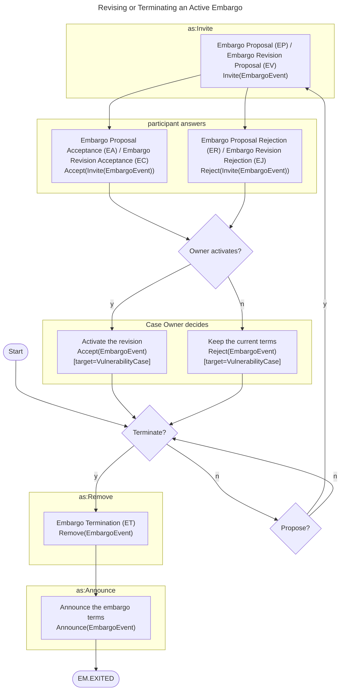

# How to Revise or Terminate an Embargo

Use this guide once a case already has an active embargo.
A revision runs the same propose, accept, or reject cycle that established the embargo.
A termination removes the embargo outright.
You finish with the case at Embargo Management (EM) state `EM.ACTIVE` under new terms, or at `EM.EXITED`.
A participant that no longer wants to be bound by the embargo can also withdraw from it.
A withdrawal does not change the EM state of the case.

---

## Prerequisites



- A case at `EM.ACTIVE`.
  See [How to Establish an Embargo](establish_embargo.md).
- The Case Owner role, for activating a revision or terminating the embargo.
  Any participant can propose a revision.

!!! note "Embargo Management is a model of its own"

    The Vultron protocol gives much detail about [Embargo Management](../../../topics/process_models/em/index.md) and about how the protocol expects participants to interact with embargoes.
    Read that section before designing embargo behavior.

---

## The exchange

The flowchart below extends the establishment flow with the moves available once an embargo is active.
The `Terminate?` branch is where an active embargo ends.
The `Propose?` branch is where an active embargo changes.



---

## Revise the terms

Embargo Revision Proposal (EV) is implemented in ActivityStreams as `Invite(EmbargoEvent)`.
An initial proposal, Embargo Proposal (EP), uses the same activity.

1. Send `Invite(EmbargoEvent)` with the revised `EmbargoEvent`.
   The case moves to `EM.REVISE`.

    

2. Each participant answers with Embargo Revision Acceptance (EC), `Accept(Invite(EmbargoEvent))`, or Embargo Revision Rejection (EJ), `Reject(Invite(EmbargoEvent))`.
   Either answer records only the consent of that participant to the revision.
   This rule also applies to an answer from the Case Owner.
   The active embargo does not change.

    

    

3. When you judge that the revision has carried, send `Accept(EmbargoEvent)` as Case Owner.
   Set the revised `EmbargoEvent` as its `object` and the case as its `target`.
   Then send `Announce(EmbargoEvent)`.
   The revision replaces the active embargo.
   Your own consent to the revision is recorded too.
   If the revision ends no later than the embargo it replaces, every participant that agreed to the old terms is bound by the new ones too.

    

    

A revision uses the same activities as an initial proposal.
The receiver uses the EM state of the case to distinguish a revision from an initial proposal.
A proposal that arrives while the embargo is active is a revision (MSM-02).

To keep the current terms, send `Reject(EmbargoEvent)` with the same `object` and `target` as Case Owner instead.
The case returns to `EM.ACTIVE` under the original terms.
The consent of every participant stays the same.
The embargo does not lapse because a revision failed.



---

## Terminate the embargo

Embargo Termination (ET) is implemented in ActivityStreams as `Remove(EmbargoEvent)`.

Send `Remove(EmbargoEvent)`.
The case moves to `EM.EXITED`, with immediate effect.

Set `content` to the reason that the embargo ends.
Use `EARLY` to end the embargo before its end time.
Use `END_TIME_REACHED` after its end time has passed.
A receiver refuses a `Remove(EmbargoEvent)` that has a different `content` value.
A receiver also refuses an `END_TIME_REACHED` that is sent before the end time.
If you want a human-readable account, put it in `summary`.
The protocol does not read `summary`.

With `EARLY`, you may also use `terminationCause` to say why the embargo ends.
Set its `kind` to one of these:

- `FIX_READY`, with `vendors` listing the actor IDs of the Vendors whose readiness made the quorum, each once.
- `FIX_DEPLOYED`, with no detail.
- `OTHER`, with no detail.
  Give the account in `summary`.

The CASE_MANAGER records the cause as you give it.
If you end the embargo with the `terminate-embargo` trigger, give the cause as `cause` in the request body.
Use the same `kind` and detail.
An `EARLY` request with no `cause` is sent with an `OTHER` cause.
The trigger refuses a `THREAT_SIGNAL` cause, and any cause with `END_TIME_REACHED`.
Do not send `terminationCause` with `END_TIME_REACHED`.
A receiver refuses a `Remove(EmbargoEvent)` with an unknown `kind`, a missing or malformed detail, or a cause on `END_TIME_REACHED`.

Do not use `THREAT_SIGNAL`.
The CASE_MANAGER refuses `THREAT_SIGNAL` on every `Remove(EmbargoEvent)` except its own.
To end the embargo because the vulnerability is public, an exploit is public or attacks are observed, send a case status update setting `P`, `X` or `A` instead.
The CASE_MANAGER then ends the embargo itself, with a `THREAT_SIGNAL` cause naming the signals the case carries.



Only the CASE_MANAGER changes the case's EM state (EP-09-008).
If you are not the CASE_MANAGER, address `Remove(EmbargoEvent)` to the CASE_MANAGER.
If you are the CASE_MANAGER, address `Remove(EmbargoEvent)` to every other participant and never to yourself (EMB-19-001).



The CASE_MANAGER commits the termination to the case ledger and sends the entry to every participant.
Your own copy of the case moves to `EM.EXITED` when the CASE_MANAGER's ledger entry for the termination reaches you.
Your copy does not move when you send.

When the CASE_MANAGER applies a Case Owner's termination that arrives before the end time, it then sends `Announce(EmbargoEvent)` naming the terminated embargo.
It sends this announcement to every other active participant except a Closed Participant, the Case Owner included (EMB-19-001, CM-23-004).
A termination the CASE_MANAGER starts itself sends no `Announce(EmbargoEvent)`.
The CASE_MANAGER also sends no `Announce(EmbargoEvent)` for a Case Owner's termination that arrives after the end time.
In that case, the CASE_MANAGER's own end-time check has already ended the embargo when the `Remove(EmbargoEvent)` arrives.



!!! warning "Termination is not a revision"

    `Remove(EmbargoEvent)` ends the embargo now.
    It does not propose a shorter embargo.
    If you want the embargo to end sooner but still exist, propose a revision with an earlier end time.

An embargo also terminates when the case reaches public awareness.
See [Early Termination](../../../topics/process_models/em/early_termination.md).

### End the embargo at its end time

You do not need to send anything when the end time passes.
The CASE_MANAGER ends the embargo with `END_TIME_REACHED` the next time it handles the case.
To end the embargo on time without that wait, have the CASE_MANAGER call the `terminate-embargo` trigger with `reason` set to `END_TIME_REACHED`.
For example, make the call from a [Sentinel](../../../reference/glossary.md) that watches embargo timers.
If the embargo has already ended, the trigger answers with no activity and commits nothing.

---

## Withdraw from the embargo

A participant bound by the active embargo can stop complying with it at any time (VP-13-017).
Withdrawal is implemented in ActivityStreams as `Leave(EmbargoEvent)`, with the embargo in force as its `object` and the case as its `context` (MSM-07-010).
A withdrawal is not an answer to an Invite.
Thus you do not need an `Invite(EmbargoEvent)` to withdraw.
A Reporter whose consent was recorded when the case was created can withdraw too.

1. Call `withdraw-embargo` with the case's ID.
   The trigger reads the embargo in force from your copy of the case.
2. The trigger sends `Leave(EmbargoEvent)` to the CASE_MANAGER.
   The CASE_MANAGER marks your consent row for the embargo in force `DECLINED`.
   It also marks `DECLINED` every row that you had marked `AGREED` for an open revision.
   The reason is that each open revision replaces the embargo that you left.
   The CASE_MANAGER commits the withdrawal to the case ledger.
   Then it commits each consent row that it declines as a separate entry.
   Your own copy of the case changes when those entries reach you.



The embargo stays in force for every other participant, and the case's EM state does not move.
You are no longer bound by the embargo.
Thus the CASE_MANAGER stops sending you case content until the embargo ends, or until you are invited to it again and agree (CM-10-005).

The trigger refuses the withdrawal in three cases:

- No embargo is in force.
- Your consent row for the embargo in force is not `AGREED`.
  To refuse terms that you never agreed to, reject the Invite instead (see [How to Establish an Embargo](establish_embargo.md#answer-an-embargo-already-in-force)).
- You are the Case Owner.
  A Case Owner ends an embargo by terminating it, as the previous section shows.

!!! warning "A Reject never withdraws"

    `Reject(Invite(EmbargoEvent))` refuses terms.
    It is not a way to leave an embargo that you agreed to.
    A `Reject` of the embargo in force from an `AGREED` row is refused.
    A `reject-embargo` with no `proposal_id` rejects an open revision, and your consent to the embargo in force stays `AGREED` (MSM-07-004).

---

## Verify

| What you sent | What to confirm |
|---|---|
| `Invite(EmbargoEvent)` on an active embargo | The case `em_state` is `REVISE`. |
| `Accept(EmbargoEvent)` with the case as `target`, as Case Owner | The case `em_state` is `ACTIVE` and the active embargo carries the new terms. |
| `Reject(EmbargoEvent)` with the case as `target`, as Case Owner | The case `em_state` is `ACTIVE` and the terms are unchanged. |
| `Reject(Invite(EmbargoEvent))` on a revision | Your consent row for the revision is `DECLINED`. The case `em_state` is still `REVISE`. |
| `Remove(EmbargoEvent)` | Once the CASE_MANAGER's ledger entry arrives, the case `em_state` is `EXITED` and no embargo is active. |
| `Leave(EmbargoEvent)` | Once the CASE_MANAGER's ledger entry arrives, your consent row for the embargo in force is `DECLINED`. The case `em_state` does not change. |

---

## See it end to end

!!! example "Try it: `vultron-demo manage-embargo`"

    

    Or with Docker Compose:

    ```bash
    DEMO=manage-embargo docker compose -f docker/docker-compose.yml run --rm demo
    ```

    The scenario runs an activate-then-terminate path and a reject-then-repropose path.

---

## Further reading

- [Embargo Management (EM) Messages](../../../reference/messages/em.md) — the wire format and a rendered example for each activity above, and the state-context rule that distinguishes a revision from a proposal
- [Embargo Management](../../../topics/process_models/em/index.md) — the state machine these activities drive
- [Participant Embargo Consent](../../../topics/behavior_logic/use-cases/embargo-lifecycle.md#which-messages-move-consent) ([§9 Participant Embargo Consent (PEC) State Machine in the specification](../../../reference/vultron-spec/tracking-models.md#9-participant-embargo-consent-pec-state-machine-n)) — how each participant's own commitment is tracked alongside the case EM state
- [Trigger API Reference](../../../reference/trigger-api.md#embargo-management) — request schema and endpoint details for `propose-embargo-revision`, `terminate-embargo` and `withdraw-embargo`
