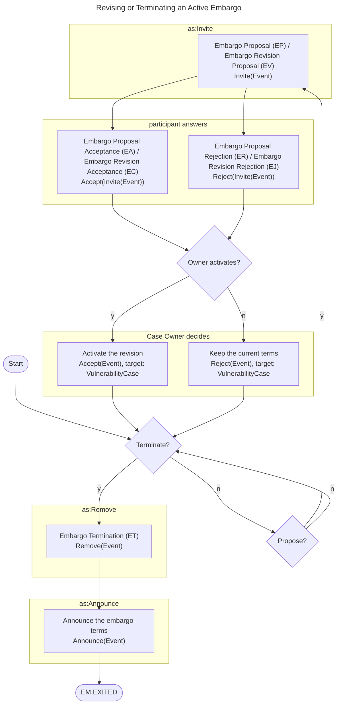

# How to Revise or Terminate an Embargo

Use this guide once a case already has an active embargo.
A revision runs the same propose, accept, or reject cycle that established the embargo; a termination removes it outright.
You finish with the case at Embargo Management (EM) state `EM.ACTIVE` under new terms, or at `EM.EXITED`.
A participant that no longer wants to be bound by the embargo can also withdraw from it, which leaves the case's EM state where it is.

---

## Prerequisites



- A case at `EM.ACTIVE`.
  See [How to Establish an Embargo](establish_embargo.md).
- The Case Owner role, for activating a revision or terminating the embargo.
  Any participant can propose a revision.

!!! note "Embargo Management is a model of its own"

    The Vultron protocol carries considerable detail about [Embargo Management](../../../topics/process_models/em/index.md) and how participants are expected to interact with embargoes.
    Read that section before designing embargo behavior.

---

## The exchange

The flowchart below extends the establishment flow with the moves available once an embargo is active.
The `Terminate?` branch is where an active embargo ends; the `Propose?` branch is where it changes.



---

## Revise the terms

Embargo Revision Proposal (EV) is implemented in ActivityStreams as `Invite(Event)` — the same activity as an initial proposal, Embargo Proposal (EP).

1. Send `Invite(Event)` with the revised `EmbargoEvent`.
   The case moves to `EM.REVISE`.

    

2. Each participant answers with Embargo Revision Acceptance (EC), `Accept(Invite(Event))`, or Embargo Revision Rejection (EJ), `Reject(Invite(Event))`.
   Either answer records only that participant's own consent to the revision, the Case Owner's included; the active embargo is unchanged.

    

    

3. As Case Owner, send `Accept(Event)` with the revised `EmbargoEvent` as its `object` and the case as its `target`, once you judge the revision has carried, then `Announce(Event)`.
   The revision replaces the active embargo and your own consent to it is recorded.
   If the revision ends no later than the embargo it replaces, every participant that agreed to the old terms is bound by the new ones too.

    

    

A revision uses the same activities as an initial proposal.
The receiver tells the two apart from the case's EM state: a proposal that arrives while the embargo is active is a revision (MSM-02).

To keep the current terms, send `Reject(Event)` with the same `object` and `target` as Case Owner instead.
The case returns to `EM.ACTIVE` under the original terms, and no participant's consent changes.
The embargo does not lapse because a revision failed.



---

## Terminate the embargo

Embargo Termination (ET) is implemented in ActivityStreams as `Remove(Event)`.

Send `Remove(Event)`.
The case moves to `EM.EXITED`, with immediate effect.

Set `content` to the reason the embargo ends: `EARLY` to end it before its end time, or `END_TIME_REACHED` once its end time has passed.
A receiver refuses a `Remove(Event)` whose `content` is anything else, and refuses `END_TIME_REACHED` sent before the end time.
Put a human-readable account in `summary` if you want one; the protocol does not read it.

With `EARLY`, you may also say why the embargo ends, in `terminationCause`.
Set its `kind` to one of these:

- `FIX_READY`, with `vendors` listing the actor IDs of the Vendors whose readiness made the quorum, each once.
- `FIX_DEPLOYED`, with no detail.
- `OTHER`, with no detail; give the account in `summary`.

The CASE_MANAGER records the cause as you give it.
If you end the embargo with the `terminate-embargo` trigger, give the cause as `cause` in the request body, with the same `kind` and detail.
An `EARLY` request with no `cause` is sent with an `OTHER` cause.
The trigger refuses a `THREAT_SIGNAL` cause, and any cause with `END_TIME_REACHED`.
Do not send `terminationCause` with `END_TIME_REACHED`.
A receiver refuses a `Remove(Event)` with an unknown `kind`, a missing or malformed detail, or a cause on `END_TIME_REACHED`.

Do not use `THREAT_SIGNAL`: the CASE_MANAGER refuses it on any `Remove(Event)` but its own.
To end the embargo because the vulnerability is public, an exploit is public or attacks are observed, send a case status update setting `P`, `X` or `A` instead.
The CASE_MANAGER then ends the embargo itself, with a `THREAT_SIGNAL` cause naming the signals the case carries.



Only the CASE_MANAGER changes the case's EM state (EP-09-008).
If you are not the CASE_MANAGER, address `Remove(Event)` to the CASE_MANAGER.
If you are the CASE_MANAGER, address `Remove(Event)` to every other participant and never to yourself (EMB-19-001).



The CASE_MANAGER commits the termination to the case ledger and fans the entry out to every participant.
Your own copy of the case moves to `EM.EXITED` when the CASE_MANAGER's ledger entry for the termination reaches you, not when you send.

When the CASE_MANAGER applies a Case Owner's termination that arrives before the end time, it then sends `Announce(Event)` naming the terminated embargo to every other active participant except a Closed Participant, the Case Owner included (EMB-19-001, CM-23-004).
A termination the CASE_MANAGER starts itself sends no `Announce(Event)`.
Neither does a Case Owner's termination that arrives after the end time: the CASE_MANAGER's own end-time check has already ended the embargo when that `Remove(Event)` arrives.



!!! warning "Termination is not a revision"

    `Remove(Event)` ends the embargo now, rather than proposing a shorter one.
    If you want the embargo to end sooner but still exist, propose a revision with an earlier end time.

An embargo also terminates when the case reaches public awareness.
See [Early Termination](../../../topics/process_models/em/early_termination.md).

### End the embargo at its end time

You do not need to send anything when the end time passes.
The CASE_MANAGER ends the embargo with `END_TIME_REACHED` the next time it handles the case.
To end it on time without waiting for that, have the CASE_MANAGER call the `terminate-embargo` trigger with `reason` set to `END_TIME_REACHED`, for example from a [Sentinel](../../../reference/glossary.md) that watches embargo timers.
If the embargo has already ended, the trigger answers with no activity and commits nothing.

---

## Withdraw from the embargo

A participant bound by the active embargo can stop complying with it at any time (VP-13-017).
Withdrawal is implemented in ActivityStreams as `Leave(Event)`, with the embargo in force as its `object` and the case as its `context` (MSM-07-010).
It is not an answer to an Invite, so you need no `Invite(Event)` to withdraw: a Reporter whose consent was recorded when the case was created can withdraw too.

1. Call `withdraw-embargo` with the case's ID.
   The trigger reads the embargo in force from your copy of the case.
2. The trigger sends `Leave(Event)` to the CASE_MANAGER.
   The CASE_MANAGER marks your consent row for the embargo in force `DECLINED`, and also every row you had marked `AGREED` for an open revision, because each open revision replaces the embargo you left.
   It commits the withdrawal to the case ledger, then each consent row it declines as an entry of its own.
   Your own copy of the case changes when those entries reach you.



The embargo stays in force for every other participant, and the case's EM state does not move.
Because you are no longer bound by the embargo, the CASE_MANAGER stops sending you case content until the embargo ends, or until you are invited to it again and agree (CM-10-005).

The trigger refuses the withdrawal in three cases:

- No embargo is in force.
- Your consent row for the embargo in force is not `AGREED`; to refuse terms you never agreed to, reject the Invite instead (see [How to Establish an Embargo](establish_embargo.md#answer-an-embargo-already-in-force)).
- You are the Case Owner, which ends an embargo by terminating it, as in the previous section.

!!! warning "A Reject never withdraws"

    `Reject(Invite(Event))` refuses terms; it is not a way to leave an embargo you agreed to.
    A `Reject` of the embargo in force from an `AGREED` row is refused, and `reject-embargo` with no `proposal_id` rejects an open revision while your consent to the embargo in force stays `AGREED` (MSM-07-004).

---

## Verify

| What you sent | What to confirm |
|---|---|
| `Invite(Event)` on an active embargo | The case `em_state` is `REVISE`. |
| `Accept(Event)` with the case as `target`, as Case Owner | The case `em_state` is `ACTIVE` and the active embargo carries the new terms. |
| `Reject(Event)` with the case as `target`, as Case Owner | The case `em_state` is `ACTIVE` and the terms are unchanged. |
| `Reject(Invite(Event))` on a revision | Your consent row for the revision is `DECLINED`; the case `em_state` is still `REVISE`. |
| `Remove(Event)` | Once the CASE_MANAGER's ledger entry arrives, the case `em_state` is `EXITED` and no embargo is active. |
| `Leave(Event)` | Once the CASE_MANAGER's ledger entry arrives, your consent row for the embargo in force is `DECLINED`; the case `em_state` is unchanged. |

---

## See it end to end

!!! example "Try it: `vultron-demo manage-embargo`"

    

    Or with Docker Compose:

    ```bash
    DEMO=manage-embargo docker compose -f docker/docker-compose.yml run --rm demo
    ```

    The scenario runs an activate-then-terminate path and a reject-then-repropose path.

---

## Further reading

- [Embargo Management (EM) Messages](../../../reference/messages/em.md) — the wire format and a rendered example for each activity above, and the state-context rule that distinguishes a revision from a proposal
- [Embargo Management](../../../topics/process_models/em/index.md) — the state machine these activities drive
- [Participant Embargo Consent](../../../topics/behavior_logic/use-cases/embargo-lifecycle.md#which-messages-move-consent) ([§9 Participant Embargo Consent (PEC) State Machine in the specification](../../../reference/vultron-spec/tracking-models.md#9-participant-embargo-consent-pec-state-machine-n)) — how each participant's own commitment is tracked alongside the case EM state
- [Trigger API Reference](../../../reference/trigger-api.md#embargo-management) — request schema and endpoint details for `propose-embargo-revision`, `terminate-embargo` and `withdraw-embargo`
