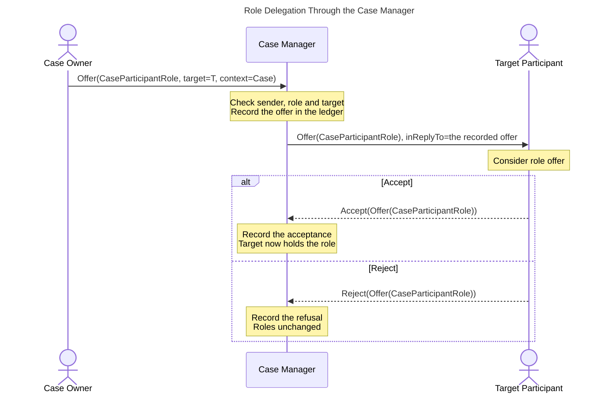

# How to Delegate a Role to Another Participant

Use this guide to offer a [`CVDRole`](../../../topics/case_lifecycle/case_model.md) on a case to another participant.
Delegation is an offer, so the participant offered the role decides whether to take it.
The offer and the answer both travel through the case's [Case Manager](../../../topics/case_lifecycle/case_manager_and_ledger.md), which checks the offer, records it in the case ledger and forwards it.
You finish with the participant holding the role, or with the roster unchanged.

---

## Prerequisites



- An existing case on which you are the Case Owner.
  Only the Case Owner may offer a role, and the Case Manager refuses an offer from anyone else ([CM-33-002](../../../reference/specs/protocol.md#cm-33-002)).
- The target participant's Uniform Resource Identifier (URI).
  The target must already be a participant in the case.
- The specific `CVDRole` you intend to offer.
  You cannot offer `CASE_OWNER` or `CASE_MANAGER`, and you cannot offer a role the target already holds ([CM-33-003](../../../reference/specs/protocol.md#cm-33-003)).
  Ownership moves through an [ownership transfer](../../../topics/case_lifecycle/ownership_transfer.md) instead.

---

## The exchange

The sequence diagram below shows both outcomes.
The Case Owner sends the offer to the Case Manager, never to the target.
The Case Manager records it and forwards it to the target, and the target answers the Case Manager.

---

## Offer the role

1. Send `Offer(CaseParticipantRole)` to the case's Case Manager only, with the Case Manager as the sole `to` recipient ([CM-33-001](../../../reference/specs/protocol.md#cm-33-001)).
2. Carry the role in a `CaseParticipantRole` object, name the target participant in `target`, and name the case in `context`.
   `CaseParticipantRole` is a Vultron vocabulary type.

    

3. Wait for the reply.
   Nothing changes until the target answers.

The Case Manager refuses the offer, records nothing and forwards nothing when any of these is true:

- you are not the Case Owner;
- the offer carries no readable role, or offers `CASE_OWNER` or `CASE_MANAGER`;
- the target is not a participant in the case, or already holds the role.

When it admits the offer, the Case Manager records it in the case ledger and then sends the target its own `Offer(CaseParticipantRole)`.
The forward names the Case Manager as its `actor` and you as its `attributedTo`, and its `inReplyTo` is the id of the offer the Case Manager recorded.
The Case Manager does not give the target the role at this point.

In the reference implementation this is the `offer-case-participant-role` trigger behavior.
The trigger addresses the offer to the case's Case Manager, and fails without sending anything when the case names no Case Manager.
The request must name the role to offer: it has no default.
No `vultron-demo` scenario exercises role delegation yet; drive it through the [Trigger API](../../../reference/trigger-api.md#actor-participation) endpoints listed under Further reading.

!!! warning "Offer a role, not a case"

    A role offer and a case ownership transfer are both offers, and they used to serialize identically.
    Carrying a `CaseParticipantRole` object is what tells a peer which one you mean (ADR-0039), so do not offer the `VulnerabilityCase` when you mean to delegate a role.
    For the transfer, see [Ownership Transfer](../../../topics/case_lifecycle/ownership_transfer.md).

---

## Answer a role offer

Act only on a role offer the Case Manager sent you.
A role offer from any other actor, the Case Owner included, is refused with no answer ([CM-33-004](../../../reference/specs/protocol.md#cm-33-004)).

Reply to the Case Manager only, never to the Case Owner, with the forwarded `Offer` as your `object`.

- If you are taking the role, send `Accept(Offer(CaseParticipantRole))`.

    

- If you are not, send `Reject(Offer(CaseParticipantRole))`.
  The roster is unchanged.

    

You hold the role once the Case Manager records your `Accept` in the case ledger ([CM-02-016](../../../reference/specs/project.md#cm-02-016)).
Consider what the role obliges you to do before accepting.

---

## Verify

| What you sent | What to confirm |
|---|---|
| `Offer(CaseParticipantRole)` | The Case Manager's ledger holds an `offer_case_participant_role` entry, and the target holds the Case Manager's forward. |
| `Accept(Offer(CaseParticipantRole))` | The Case Manager holds your `Accept`. |
| `Reject(Offer(CaseParticipantRole))` | Your roles are unchanged and the Case Manager holds your `Reject`. |

Only the Case Manager writes to the case ledger.
Your answer adds no entry to your own copy of the ledger; the Case Manager records it and sends the entry to every participant.

---

## Further reading

- [Case Management Messages](../../../reference/messages/case_management.md) — the wire format, pattern, and factory for each activity above
- [Activity Vocabulary Design](../../../topics/activity_vocabulary_design.md) — why a new object type was minted here rather than a new verb
- [ADR-0039 — Resolve Wire Ambiguity Between OFFER\_CASE\_MANAGER\_ROLE and OFFER\_CASE\_OWNERSHIP\_TRANSFER via Dedicated Object Type](../../../adr/0039-offer-case-participant-role-wire-type.md)
- [Trigger API Reference](../../../reference/trigger-api.md#actor-participation) — request schema and endpoint details for `offer-case-participant-role`, `offer-case-ownership-transfer`, `accept-actor-recommendation`, `accept-case-ownership-transfer`, `reject-case-ownership-transfer`, and `withdraw-case-ownership-transfer`
