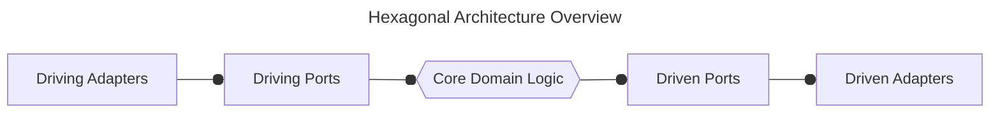
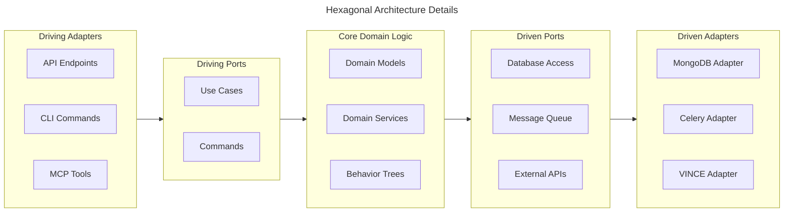

# Hexagonal Architecture

Our reference implementation of the Vultron Protocol is structured according to the principles of a port and adapter architecture, also known as hexagonal architecture.
This design allows us to separate the core domain logic from the infrastructure and external interfaces, making the system more modular, testable, and adaptable to different use cases and environments.

In this architecture:

- The **Driving Adapters** implement the driving ports using specific
  technologies (e.g., FastAPI endpoints, CLI commands, etc.) and translate  
  external inputs into calls to the core domain logic.
- The **Driving Ports** define the interfaces through which external actors
  (e.g., finders, vendors, coordinators) can interact with the core domain logic. These are the entry points for commands and queries that drive the system's behavior.
- The **Core Domain Logic** contains the business rules, policies, and behavior trees that govern how the system operates. It is completely agnostic to how it is accessed or what technologies are used to implement the interfaces.
- The **Driven Ports** define the interfaces through which the core domain
  logic can interact with external systems (e.g., databases, message queues,
  external APIs). These are the exit points for the core to perform actions  
  that have side effects or require external resources.
- The **Driven Adapters** implement the driven ports using specific technologies
  (e.g., MongoDB for database access, Celery for task queues, etc.)
  and
  translate calls from the core domain logic into interactions with external
  systems.

## Use cases and behavior trees

Inside the core, every request takes the same path.

| Layer | Where it lives | What it does |
|---|---|---|
| Driving adapter | `vultron/adapters/driving/` | Accepts an inbox POST or a trigger request and hands it to core. |
| Dispatcher | `vultron/core/dispatcher.py`, `vultron/core/trigger_dispatcher.py` | Looks up the use case for the message semantics or the trigger verb. |
| Use case | `vultron/core/use_cases/` | Sets up the blackboard, runs one behavior tree, and turns the outcome into a result. |
| Behavior tree | `vultron/core/behaviors/` | Checks preconditions, decides what to do, changes state, and emits activities. |
| Domain model | `vultron/core/models/`, `vultron/core/states/` | Holds the case state and validates it. |

A use case stands for one actor goal, such as validating a report or inviting a participant.
It is thin glue: it builds the tree, runs it through `BTBridge.execute_with_setup()`, reads the result, and returns.
It does not write to the DataLayer itself; every write happens in a tree node (CLP-10-020).

The decisions that follow from the goal belong in the tree.
Is the case open, is the sender entitled to ask, is this a duplicate, who must be told: each of these is a node.
Keeping them in the tree means the tree shows the whole process, and analysis tools can read it without reading the code (BT-06-001).
