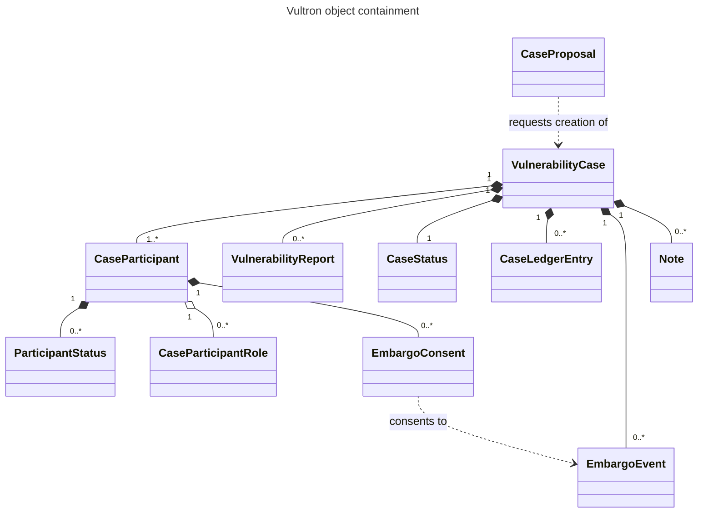

## 4. Messages [N]

!!! question "What happened to the formal message type shorthand?"
    The formal message set, with its two-letter shorthands such as `RS`, `EP` and `CV`, was a design model of the protocol's messages.
    This version realizes that model as occasions, each conveyed by one wire activity.
    Formal types that share one wire activity merged, and context tells them apart: the receiver's embargo state separates `EV`, `EJ` and `EC` from `EP`, `ER` and `EA`, and a field value separates `CV`, `CF` and `CD`, and `CP`, `CX` and `CA`.
    The formal set remains the vocabulary of the transition tables of [§6 Report Management (RM) State Machine](tracking-models.md#6-report-management-rm-state-machine-n) through [§9 Participant Embargo Consent (PEC) State Machine](tracking-models.md#9-participant-embargo-consent-pec-state-machine-n) ([ADR-0083](../../adr/0083-formal-message-set-and-as2-vocabulary-are-different-shapes.md)).

This section defines what a participant sends in each situation of a case, and what a message it receives means.
Its unit is the [occasion](../glossary.md#messaging-and-protocol): a situation in a case that a sender conveys with a particular [Wire Activity](../glossary.md#messaging-and-protocol).
A normative statement about a message is a statement about an occasion.
A protocol shorthand, such as `RS` or `EP`, is a cross-reference tag that names the formal message an occasion realizes.

Wire activities are written in the notation of [Wire Activity Notation](annex-c-notation.md#wire-activity-notation), `Verb(Object)[field=Value]`, using the `type` values a sender puts on the wire.
[§5 Encoding and Transport](layers.md#5-encoding-and-transport-n) specifies how each one is encoded and delivered.

### 4.1 Rules Under Any Coordination Model

These rules hold for every message, however the case is coordinated.

**Every message reports something that already happened.**
A message does not instruct its recipient to make a transition.
It tells the recipient that the sender has made one, or that the sender has observed something ([§3.1 Coordination Model](introduction.md#31-coordination-model)).
A proposal, such as an embargo invitation, asks for a decision, and its answer reports the decision once it is made.

**A message that arrives before its case is held, not applied.**
A message from the CASE_MANAGER may reach a participant before the bootstrap message that establishes the case and its trust ([§10.3 Case Bootstrap and the Trust Root](interactions.md#103-case-bootstrap-and-the-trust-root)).
Such a message MUST NOT update the participant's case state before that bootstrap message has been validated ([CBT-03-002](../specs/protocol.md#cbt-03-002)).
The participant SHOULD hold it only for a short, bounded interval ([CBT-03-001](../specs/protocol.md#cbt-03-001)).
When the interval expires, the participant MUST drop the message, and the CASE_MANAGER sends it again after the bootstrap ([CBT-03-003](../specs/protocol.md#cbt-03-003)).
Applying it early would create case state from a message whose context was never established.

Messages are addressed according to the routing rules of [§10 Case Coordination](interactions.md#10-case-coordination-n).

### 4.2 Knowledge Model and Actor Isolation

Each participant knows only what it has been told.
This subsection states what follows from that, including why a recipient must be able to obtain every object a message names ([§5.2 Serialization](layers.md#52-serialization)).

**What a participant knows versus what is true.**
A participant's replica reflects the messages it has received.
Two participants in the same case may hold different views at the same moment, because a message is in transit or because a participant has not yet reported a change.
The protocol does not require every participant to agree at every instant.
It requires that each converge on the case's canonical state as ledger entries reach it.

**No participant reads another's state.**
An implementation MUST NOT read or write another actor's state directly.
Everything it knows about another participant MUST be derived from a message that participant sent, or from the canonical ledger.
This is what makes a participant's knowledge independent of any other participant being reachable.

**A recipient can obtain what a message names.**
A participant MUST NOT assume a recipient holds an object it was never sent ([AKM-02-001](../specs/protocol.md#akm-02-001)).
An object the recipient cannot be expected to hold is carried inline, or by a reference the recipient can dereference ([AKM-02-002](../specs/protocol.md#akm-02-002)).
Either form satisfies the protocol.

!!! info "See also"
    - [Actor Knowledge Model](../../topics/actor-knowledge-model.md)
    - [ADR-0012: Per-Actor Data Layer Isolation](../../adr/0012-per-actor-datalayer-isolation.md)

### 4.3 Object Types

An activity's meaning depends on what it acts on, so the object types matter as much as the verbs.
Vultron extends the ActivityStreams 2.0 (AS2) vocabulary with the object types a vulnerability case needs, and they are not a flat set.
A case contains participants, reports, status records, embargoes and an ordered ledger, as the diagram below shows.
That containment is the model the rest of this specification assumes.

| Object | What it is |
|---|---|
| `VulnerabilityCase` | The case itself: the container for everything below |
| `VulnerabilityCaseStub` | A minimal description of a case, carrying enough for an invited actor to decide whether to join and no vulnerability detail |
| `VulnerabilityReport` | A report of the vulnerability, such as the one that started the case |
| `CaseParticipant` | An actor's membership in a case, carrying the roles it holds and the state it owns |
| `CaseParticipantRole` | A role offered to an actor in the context of a case. It is a distinct type so that offering a role is structurally different from offering ownership of the case |
| `EmbargoEvent` | An embargo's terms: its start and end times. It is a Vultron extension of the AS2 `Event` type, which is why embargo messages are invitations to an event rather than an embargo-specific verb |
| `EmbargoConsent` | One participant's consent to one embargo, held on that participant's record ([§9 Participant Embargo Consent (PEC) State Machine](tracking-models.md#9-participant-embargo-consent-pec-state-machine-n)) |
| `CaseLedgerEntry` | One entry in the canonical case ledger ([§2.3 Protocol Objects and Messages](introduction.md#23-protocol-objects-and-messages)) |
| `CaseProposal` | A request that some actor create and manage a case. The requesting actor does not intend to manage the case itself, and the actor that accepts becomes the case's creator |
| `CaseStatus` / `ParticipantStatus` | Status records: a `ParticipantStatus` is one participant's claim, and a `CaseStatus` is the case's canonical status, which only the CASE_MANAGER writes ([§10.5 Claims and Canonical Status](interactions.md#105-claims-and-canonical-status)) |
| `ProcessingFault` | A receiver's report that it could not process a message ([§4.11 Faults and Acknowledgments](layers.md#411-faults-and-acknowledgments)) |
| `Note` | The AS2 `Note` type, used unchanged for narrative posted to the case |

**An embargo is sent as `type: EmbargoEvent`.**
A sender MUST give an embargo the `type` value `EmbargoEvent`, never the plain AS2 `Event` it extends ([Wire Activity Notation](annex-c-notation.md#wire-activity-notation)).
A receiver that expects an embargo does not treat a plain `Event` as one.

### 4.4 Message Tables

Each message subsection below includes its group of the occasion table, generated from the reference implementation's registry of wire activities ([Message Types](../messages/index.md)).
Each row is one occasion, and its columns say:

| Column | Says |
|---|---|
| When… | The sender's situation |
| Send | The wire activity that conveys it |
| Send to | The addressee: the case manager, a participant, or, before a case exists, an actor outside any case |
| Sent by | The standing a receiver requires of the sender |
| Distinguished by | What tells this occasion apart from another occasion that shares its wire activity and addressee |
| Details | The occasion's section in the message reference, named by its protocol shorthand where it has one |

"The case manager" in a table is the participant that holds the CASE_MANAGER role for the case, whichever actor that is ([§10 Case Coordination](interactions.md#10-case-coordination-n)).
A row whose "Sent by" reads "internal to the case manager" is an act the CASE_MANAGER performs on its own case.
No receiver handles such an activity, though the CASE_MANAGER may commit it to the case ledger.

### 4.5 Report Management Messages

These messages concern one participant's handling of a report.
Each reports a change to the **sender's** report management state ([§6 Report Management (RM) State Machine](tracking-models.md#6-report-management-rm-state-machine-n)).



Only Report Submission (`RS`) drives a state change in its **receiver**: receiving a report moves the receiver to Received.
The other messages tell the receiver something about the sender and leave the receiver's own state alone.
A participant that joined the case by invitation never saw the report offer, so it reports Report Valid (`RV`), Report Invalid (`RI`) or Report Closed (`RC`) by answering the full-case `Invite` ([§4.7 Case and Participant Messages](layers.md#47-case-and-participant-messages)).

!!! note "`RK` acknowledges the submission, not the reading"
    Report Acknowledgment (`RK`) reports that the submission arrived.
    It does not report that the recipient has read the report, assessed it, or agreed to work on it: those are `RV`, `RI`, Report/Case Accepted (`RA`) and Report/Case Deferred (`RD`).

    The protocol defines no message meaning "I have read the report".
    An implementation MUST NOT infer from `RK` that the recipient has examined the content, and MUST NOT treat `RK` as a substitute for a report management state message.

### 4.6 Case Proposal Messages

A report receiver that does not intend to manage a case itself asks a Case Actor Service to open one.
This exchange happens before the case exists, so its messages go to an actor outside any case.



### 4.7 Case and Participant Messages

These messages create a case and manage who is in it.
Most have no protocol shorthand, because they concern the case as an object rather than any state machine's state.
The exception is the answer to the full-case `Invite`, which realizes `RV`, `RI` or `RC`, as described below.
How a participant joins, changes role and leaves is specified at [§12 Participant Lifecycle Within a Case](interactions.md#12-participant-lifecycle-within-a-case-n).



**The two ways an actor joins a case are different messages.**
Conflating them loses a round trip in which the Case Owner decides:

- `Invite(Actor)[target=VulnerabilityCaseStub]` is the CASE_MANAGER inviting an actor to join on the Case Owner's behalf.
  It is answered with `Accept` or `Reject`.
- `Offer(Actor)[target=VulnerabilityCase]` is a participant *recommending* an actor ([§4.10 General Messages](layers.md#410-general-messages)).
  The Case Owner decides on it, and its approval may cause an `Invite` to be sent.
  An implementation MUST NOT treat it as an invitation to the recommended actor.

Both paths end in an `Accept` of the stub `Invite` ([§12.2 Invitation and Acceptance](interactions.md#122-invitation-and-acceptance-n)).
That `Accept` joins the case; it is not `RV`.
The joined participant judges the case by answering the full-case `Invite`, `Invite(Actor)[target=VulnerabilityCase]`, and that answer is `RV`, `RI` or `RC` ([VAM-04-011](../specs/protocol.md#vam-04-011), [CM-11-020](../specs/protocol.md#cm-11-020)).

### 4.8 Embargo Management Messages

These messages negotiate the case's embargo ([§7 Embargo Management (EM) State Machine](tracking-models.md#7-embargo-management-em-state-machine-n)).
A participant proposes or answers terms by writing to the CASE_MANAGER, which asks each other participant about a proposal, and the Case Owner decides whether a proposal takes effect.



!!! warning "A revision proposal and an initial proposal are the same activity"
    Embargo Revision Proposal (`EV`), Embargo Revision Rejection (`EJ`) and Embargo Revision Acceptance (`EC`) share their wire activities with Embargo Proposal (`EP`), Embargo Proposal Rejection (`ER`) and Embargo Proposal Acceptance (`EA`).
    The activity does not encode the difference.

    An implementation MUST determine which it has received from its own embargo state, as the "Distinguished by" column states.
    If the case embargo is Active or Revise, an arriving proposal is a revision.
    If it is None or Proposed, the same message is an initial proposal.

    The outcome of a rejection differs between the two: rejecting an initial proposal leaves the case with no embargo, while rejecting a revision leaves the agreed terms in force ([§7.2 Transitions and Guards](tracking-models.md#72-transitions-and-guards)).
    An implementation that treats the activity as self-describing will mishandle every revision.
    Because a mishandled revision rejection returns the case to None, it silently drops embargoes that every participant still believes are in force.

**Choosing between `EV` and `ET`.**
Embargo Termination (`ET`) takes effect immediately.
A sender that wants the embargo to end at some future point SHOULD send `EV` proposing that end date rather than `ET`.

**Tacit acceptance of a default embargo.**
Submitting a report without proposing terms accepts the receiver's default embargo policy ([§7.2 Transitions and Guards](tracking-models.md#72-transitions-and-guards)).
Where the receiver has published no default, the same section specifies a short protocol default, so an embargo-eligible case never begins without an embargo.

### 4.9 Case State Messages

These messages report facts about the vulnerability ([§8 Case State (CS) Dimensions](tracking-models.md#8-case-state-cs-dimensions-n)).
A participant reports them as a claim in a `ParticipantStatus`, and the CASE_MANAGER records the facts it adopts about the world in a `CaseStatus`.



!!! warning "Several case state occasions share one activity"
    Every claim a participant makes, whichever fact it reports, is `Add(ParticipantStatus)[target=CaseParticipant]`.
    Every fact the CASE_MANAGER records about the world is `Add(CaseStatus)[target=VulnerabilityCase]`.
    The fact travels in the status record's fields, as the "Distinguished by" column states, so an implementation that dispatches on the activity alone cannot tell Fix Readiness (`CF`) from Attacks Observed (`CA`).

    The two activities differ by the sender's authority, not by the fact.
    A participant MUST NOT send `Add(CaseStatus)` ([§10.5 Claims and Canonical Status](interactions.md#105-claims-and-canonical-status)).

The Vendor aware, Fix ready, fix Deployed (VFD) occasions report the sender's own progress, so receiving one updates the receiver's model of the sender rather than the receiver's own state ([§8.4 Receiving CS Messages: Own State vs. Model of Others](tracking-models.md#84-receiving-cs-messages-own-state-vs-model-of-others)).
The Public aware, eXploit public, Attacks observed (PXA) occasions in a `ParticipantStatus` report a claim about the world.
That claim becomes canonical case state only if the CASE_MANAGER adopts it ([§11.3 Status Adoption: The Two-Seam Model](interactions.md#113-status-adoption-the-two-seam-model)).

### 4.10 General Messages

These messages carry narrative and actor suggestions.
Together they realize the formal General Inquiry (`GI`), which spans two exchanges ([MSM-04-001](../specs/project.md#msm-04-001), [MSM-04-002](../specs/project.md#msm-04-002)):

- the note lifecycle, `Add(Note)[target=VulnerabilityCase]` and `Remove(Note)[target=VulnerabilityCase]`;
- the actor-suggestion exchange, in which a participant suggests an actor, the CASE_MANAGER presents the suggestion to the Case Owner, and the CASE_MANAGER tells the recommender the Case Owner's decision.



A received `Create(Note)` is not a protocol message, and its receiver does not change the case because of it ([VAM-01-011](../specs/protocol.md#vam-01-011)).
General Acknowledgment (`GK`) and General Error (`GE`) have no wire activity of their own; the mechanisms of [§4.11 Faults and Acknowledgments](layers.md#411-faults-and-acknowledgments) serve their purposes ([MSM-04-003](../specs/project.md#msm-04-003)).

### 4.11 Faults and Acknowledgments

The formal message set defines an acknowledgment and an error message for each of its four groups: `RK`, `EK`, `CK` and `GK`, and `RE`, `EE`, `CE` and `GE`.
Their status here is **not uniform**, and an implementation MUST NOT assume symmetry across the groups.

Of the eight, only `RK` has a wire activity, `Read(Offer(VulnerabilityReport))` ([§4.5 Report Management Messages](layers.md#45-report-management-messages)).
The other seven have none.
An implementation MUST NOT expect to receive any of the seven, and MUST NOT wait on one.

The absences have two different reasons.

**`EK`, `CK` and `GK` are redundant.**
Changes to a case are replicated through the case ledger, and a participant shows that it received them by holding an unbroken hash chain ([§4.12 Ledger Replication Messages](layers.md#412-ledger-replication-messages)).
A per-message acknowledgment would restate what the chain already shows.
`RK` survives because report submission happens before the case exists, so there is no ledger to carry it.

**`RE`, `EE`, `CE` and `GE` are deliberately unmodeled, not merely unimplemented.**
The protocol does not type an error message by the state machine that produced it, because that grouping tells a receiver nothing it can act on.
Knowing *which* machine was confused does not indicate what to do about it.
Errors are grouped by **failure mode** instead, which is actionable ([MSM-05-001](../specs/protocol.md#msm-05-001)):

| Failure mode | When it applies | Wire activity | What the sender can do |
|---|---|---|---|
| Not understood | The message could not be parsed, or its meaning is unrecognized | `Create(ProcessingFault)` | Re-send, or send a simpler equivalent |
| Understood but declined | The message was well-formed and meaningful, but the receiver will not act on it given the case's state | `Reject` of the message being declined | Reconsider; the state, not the message, is the obstacle |
| Needs explanation | The condition cannot be expressed as a structured message and requires prose | `Add(Note)[target=VulnerabilityCase]` | Read the explanation; there is no automatic recovery |



An actor that cannot process an inbound activity from an authenticated sender notifies that sender with `Create(ProcessingFault)` ([ASK-07-001](../specs/protocol.md#ask-07-001)).
It sends no fault to a sender that is not authenticated ([ASK-07-002](../specs/protocol.md#ask-07-002)).

!!! warning "`Reject` does not mean error"
    An implementation MUST NOT infer error semantics from the `Reject` verb alone ([MSM-05-003](../specs/protocol.md#msm-05-003)).
    `Reject` also carries legitimate protocol answers, including closing a report and declining an embargo invitation, a case invitation, a case proposal or a case ownership transfer.



### 4.12 Ledger Replication Messages

These messages keep every participant's replica of the case ledger in step with the CASE_MANAGER's ([§10.4 Ledger Replication and Case Delivery](interactions.md#104-ledger-replication-and-case-delivery)).



Acknowledgment of the ledger is cumulative and implicit ([MSM-05-002](../specs/protocol.md#msm-05-002)).
A participant whose local tail matches a received entry's previous-entry hash sends nothing, because the match is the acknowledgment.
On a mismatch it sends `Reject(CaseLedgerEntry)`, and the CASE_MANAGER replays every entry after the last one the participant accepted.

### 4.13 Formal Message Set

The table below lists all 28 messages of the formal message set, each with the wire activities whose occasions carry it.
It is generated from the same registry as the occasion tables above.
A shorthand with no wire activity links to the section of the message reference that says why ([§4.11 Faults and Acknowledgments](layers.md#411-faults-and-acknowledgments)).



---
