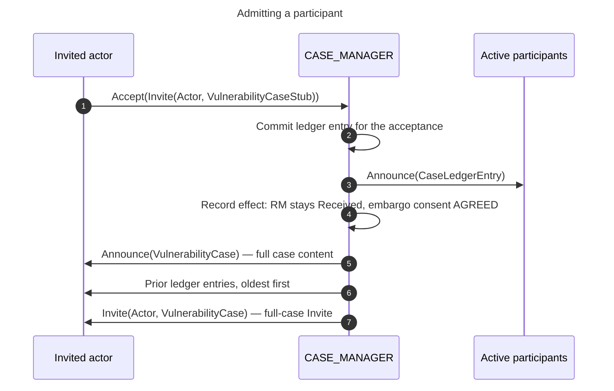

## 10. Model Interactions and Cascade Rules [N]

The five state machines are not independent. A transition in one produces
obligations in others, and this section specifies those couplings.

Each coupling is a **cascade**: a state change raises a domain event, and the
CASE_MANAGER handles that event by applying further changes. Every cascade step
is authorized separately, and where the order of steps matters this section says
so. The cascades below are the complete set that this specification requires.

!!! note "Recall: which machine owns which state"
    

### 10.1 Admitting a Participant

When an actor accepts the stub Invite, the CASE_MANAGER admits it to the case and
delivers the case content. The CASE_MANAGER created the actor's inert participant
record, at RM state `Received`, when it sent the stub Invite
([§11.2 Invitation and Acceptance](interactions.md#112-invitation-and-acceptance-n)).
The steps are ordered because each one supplies a precondition for the next.

On receiving `Accept(Invite)`, the CASE_MANAGER MUST perform these four steps in
this order (CM-17-004):

1. Commit a ledger entry recording the acceptance, and send that entry to every active participant.
2. Record the acceptance's effect on the participant: its RM state stays `Received`, and its consent row for the active embargo, if any, becomes `AGREED`, unless the participant had declined that embargo.
3. When the participant is now active, send `Announce(VulnerabilityCase)` carrying the full case snapshot, then replay the ledger entries committed before this participant joined, oldest first.
4. Send the full-case Invite, which asks the participant to judge the case.

!!! note "Recall: report management states"
    

    Full definitions are in [§6.1 States](tracking-models.md#61-states).

Step 3 delivers the content that step 2 authorizes: the embargo consent recorded
in step 2 is what the delivery gate tests
([§9.7 Gating Full Case Delivery](tracking-models.md#97-gating-full-case-delivery)).
Step 4 follows the replay, so the participant judges a case it already holds.

### 10.2 Embargo Revision and Termination Cascades

A change to the embargo in force propagates to participants' consent, because consent is given to specific terms.
A change that is only proposed does not.
Each cascade below starts from a step on the case's embargo register ([§7.1.1 The Embargo Register](tracking-models.md#711-the-embargo-register)), and the EM state follows from the register.

!!! note "Recall: embargo management states"
    

    Full definitions are in [§7.1 States](tracking-models.md#71-states).

- **A revision is proposed** (EM enters, or stays at, `Revised`).
  The register gains a `PROPOSED` entry for the revision, and every other participant gets an `UNINVITED` row for it (CM-18-001).
  No consent to the embargo in force changes: the prior embargo is still in force and every signatory to it remains one (EP-05-002).
  The CASE_MANAGER records the proposer's row for the revision as `AGREED`, because proposing terms is consenting to them.
- **The case owner activates the revision.**
  The register activates the revision's entry and supersedes the entry in force, in one step; EM returns to `Active`, or stays at `Revised` while another revision is open (EMB-18-005).
  The owner's row for the revision becomes `AGREED` unless it already is.
  If the revision ends no later than the embargo it replaces, the CASE_MANAGER applies `CARRY_OVER` to the revision's row of every participant whose row for the replaced embargo is `AGREED`, a `DECLINED` row for the revision included (EP-05-001, MSM-07-005).
  If it ends later, no row is written: a signatory to the replaced terms whose row for the revision is not `AGREED` has lapsed, which is read from its rows and the register ([§9.3 Signatory and Lapsed](tracking-models.md#93-signatory-and-lapsed)).
  A participant that has already agreed to the revision is its signatory by lookup.
- **The case owner rejects the revision.**
  The register rejects the revision's entry; EM returns to `Active` once no other revision is open.
  No consent row changes, the owner's included, and the prior terms stand (MSM-07-009).
- **The embargo is terminated** (EM enters `Exited`).
  The register terminates the entry in force and cancels every open proposal in the same step (EP-08-004).
  No consent row is written (CM-18-016, MSM-07-006).
  With no `ACTIVE` entry, no participant is a signatory and none has lapsed, and every row for the terminated and canceled entries is frozen as it stood, so an accept that arrives afterwards records nothing (EMB-17-004).
- **After a teardown.**
  The termination's own ledger entry, fanned out as `Announce(CaseLedgerEntry)`, records the end (EP-09-009).
  The CASE_MANAGER then sends `Announce(EmbargoEvent)` to every other active participant (EMB-19-001), and a direct `Remove(EmbargoEvent)` notice to each signatory the ledger fan-out does not reach (CM-31-009).
  No message is sent for consent, because none is written (MSM-07-006).

!!! note "Recall: participant embargo consent states"
    

    Full definitions are in [§9.1 States](tracking-models.md#91-states).

Every one of these changes reaches the case ledger, and every replica applies it by copying (CM-23-016).
The act's own activity carries its whole register step: a termination's entry also cancels every open proposal, and an activation's entry also supersedes the embargo it replaces (CLP-07-013).
Where the act's activity states a row itself, as the owner's `Accept` states the owner's agreement, the act's entry carries that row (CLP-07-013).
Each other consent row the CASE_MANAGER writes as a consequence of the act, such as an `UNINVITED` row, the proposer's `AGREED` row or a `CARRY_OVER`, is its own CASE_MANAGER entry after the act's entry, a `Create(EmbargoConsent)` for a new row or an `Update(EmbargoConsent)` for a changed one, carrying the row in full (EP-09-007).
A replica copies those rows and never decides a carry-over, an expiry or a lapse itself.

### 10.3 Status Adoption: The Two-Seam Model

A participant's report does not become canonical case state on arrival. It
passes two authorization points, which this specification calls **seams**. A
seam is a place where the CASE_MANAGER makes an authorization decision that can
be re-policied without affecting the other.

Two seams exist because "record what a participant claimed" and "act on that
claim as truth" are separate decisions with separate authority.

#### Seam 1 — Adoption

A participant reports an observation by sending `Add(ParticipantStatus)` to the
CASE_MANAGER. A participant does not send `Add(CaseStatus)`: writing canonical
case status is reserved to the CASE_MANAGER
([§5.4.1 Single-Writer Authority](layers.md#541-single-writer-authority)).

The CASE_MANAGER records the claim in the case ledger first, and then decides
whether to adopt it as canonical:

- The CASE_MANAGER MUST adopt a Case Owner's report without seeking approval.
  Asking the Case Owner to approve its own report would be circular
  ([§12.4.4 Case Owner Authority](conformance.md#1244-case-owner-authority)).
- For every other sender, the CASE_MANAGER MUST obtain Case Owner authorization
  before adopting the report as canonical case state. This is the default
  posture, and it is deliberate: without it, any admitted participant could
  force a change to canonical case state.
- An implementation MAY configure a permissive policy instead, where all
  admitted participants are trusted and the cost of Case Owner approval is
  unacceptable. Such a configuration MUST be explicit and documented. An
  implementation MUST NOT relax the default in order to unblock a path that the
  gate is correctly blocking.
- The CASE_MANAGER adjudicates each state-machine dimension of a reported
  status separately. A valid `vfd` update proceeds even when the `rm` value in
  the same report is refused.
- On adoption, the CASE_MANAGER commits the adopted status as its own
  `Add(CaseStatus)` case ledger entry, carrying the reported public state
  where it moves the case's forward. It writes the entry directly, never by
  sending an `Add(CaseStatus)` to itself, and a receiver refuses an
  `Add(CaseStatus)` from any other sender.
- The component that records the claim MUST NOT execute side-effects.

!!! warning "The default is Case Owner authorization, not automatic adoption"
    A permissive default would mean that any admitted participant — including a
    hostile or malfunctioning one admitted as an external monitor — could force
    a canonical PXA change and, through it, an embargo teardown, with no Case
    Owner confirmation. A conservative default makes that a protocol guarantee
    rather than a deployment posture.

#### Seam 2 — Side-effects

After the canonical write, the CASE_MANAGER evaluates what the new canonical
state requires:

- The CASE_MANAGER MUST check whether the adopted status set Public Aware,
  Exploit Public, or Attacks Observed
  ([§8.2 PXA — Public Aware, Exploit Public, Attacks Observed](tracking-models.md#82-pxa-public-aware-exploit-public-attacks-observed)).
- If any of those is now set, the CASE_MANAGER MUST evaluate embargo teardown.
- **This check MUST run after the canonical write, never before.** What is
  written is the `CaseStatus` record holding the case's shared EM and PXA
  values; the check reads that written record, so that the side-effect always
  follows from canonical state rather than from an unadopted claim.
- Executing the teardown MUST also require Case Owner authorization by default,
  on the same terms as adoption above.

The two seams are independent. Seam 1 does not examine embargo teardown, and
seam 2 cannot tell whether the canonical write came from an inbound message or
from the CASE_MANAGER's own emission. Either seam can therefore change policy
without a change to the other.

!!! note "When teardown is required but not authorized"
    Evaluating teardown is mandatory; executing it is authorized. If the
    authorization is withheld, the case is left in a state where public
    awareness coexists with an active embargo. That combination is a
    contradiction, and the CASE_MANAGER records it as a diagnostic note on the
    case rather than resolving it silently.

!!! note "Where the gate model applies"
    Seam 1 governs any reported status. Its authorization question matters most
    for the participant-agnostic PXA values, which any participant may report
    ([§12.4.2 Participant-Agnostic CS Transitions (PXA)](conformance.md#1242-participant-agnostic-cs-transitions-pxa)) —
    including reports about other participants.

!!! info "See also"
    - [ADR-0046: Received Status Authorization](../../adr/0046-received-status-authorization.md)
    - [ADR-0076: Security-Significant Gates Default to Require Case Owner Approval](../../adr/0076-security-significant-gates-default-require-case-owner-approval.md)
    - [ADR-0080: Protocol Asks, Not Suspended Behaviors](../../adr/0080-protocol-asks-not-suspended-behaviors.md)

---
