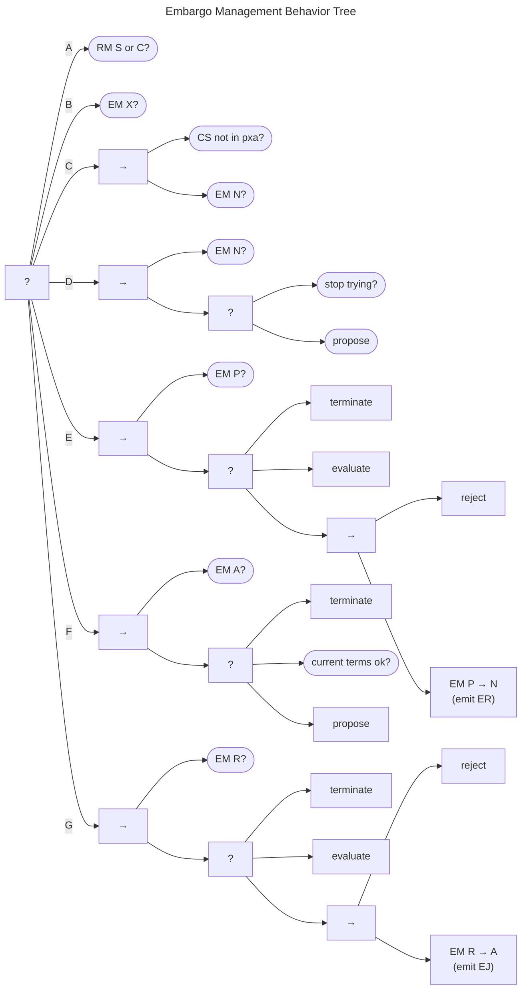

# Embargo Management Behavior Tree

## Requirements

The [Requirements Catalog](../../reference/vultron-spec/requirements/index.md) and [Architecture Specifications](../../reference/specs/architecture.md) specify the behavioral requirements for this tree:

- [EMB-10](../../reference/vultron-spec/requirements/state-behavior.md#protocol-emb-10) — Enter EM Proposed
- [EMB-11](../../reference/vultron-spec/requirements/state-behavior.md#protocol-emb-11) — Enter EM Active
- [EMB-12](../../reference/vultron-spec/requirements/state-behavior.md#protocol-emb-12) — Enter EM Revise
- [EMB-13](../../reference/vultron-spec/requirements/state-behavior.md#protocol-emb-13) — Enter EM Exited
- [EMB-16](../../reference/vultron-spec/requirements/state-behavior.md#protocol-emb-16) — CS Public/Exploit/Attacks Detected While EM Proposed
- [EMB-18](../../reference/specs/architecture.md#emb-18) — EM Write-Boundary Consolidation





The figure below shows the Embargo Management Behavior Tree.
It follows the state transition function in the [Embargo Management Process Model](../process_models/em/index.md#em-state-transitions).
Remember that the EM process starts in the $q^{em} \in N$ state and ends in one of two states:

- in the *eXited* ($q^{em} \in X$) state, after the Participants establish an *Active* embargo
- in the *None* ($q^{em} \in N$) state, after all attempts to reach an agreement fail

(A) The tree first checks whether no report has arrived or the report is already *Closed* ($q^{rm} \in \{S{,}C\}$).
If either condition is true, no more effort is necessary, and the tree succeeds.

(B) Next, the tree checks whether the embargo is already *eXited* ($q^{em} \in X$).
If it is, the tree succeeds.

(C) If that check fails, the tree checks whether the case is outside the embargo "habitable zone".
The ${q^{cs}\not\in\cdot\cdot\cdot pxa}$ condition is true in three situations: someone has observed attacks, an exploit is public, or information about the vulnerability is public.
If one of these conditions is true and the embargo state is *None* ($q^{em} \in N$), the check returns *Success*.
The tree then stops, as [Negotiating Embargoes](../process_models/em/negotiating.md) describes.

!!! tip inline end "See also"

    - [Negotiating Embargoes](../process_models/em/negotiating.md)
    - [Propose Embargo Behavior](em_propose_bt.md)
    - [Terminate Embargo Behavior](em_terminate_bt.md)
    - [Evaluate Embargo Behavior](em_eval_bt.md)

Otherwise, the tree goes through each of the remaining EM states.

(D) When there is no embargo and no open proposal ($q^{em} \in N$), the tree has only two options.
It can stop trying, or it can [propose](em_propose_bt.md) a new embargo.
Each Participant decides when to stop trying to get an embargo.
[Negotiating Embargoes](../process_models/em/negotiating.md) gives some guidance about this decision.

(E) When there is an open embargo proposal ($q^{em} \in P$), the tree first tries the [terminate](em_terminate_bt.md) task.
This task returns *Success* if there is a reason for ${q^{em} \in P \xrightarrow{r} N}$.

If there is no reason to [terminate](em_terminate_bt.md), the tree goes to the [evaluate](em_eval_bt.md) task, which is described below.
The evaluate task returns *Success* if the Participant accepts the proposal or makes a counterproposal.

If neither of these succeeds, the tree rejects the proposal.
It returns to $q^{em} \in N$ and emits a related $ER$ message.

(F) The process in the *Active* ($q^{em} \in A$) state is also simple.
If there is a reason to [terminate](em_terminate_bt.md) the embargo, the tree terminates it.
Otherwise, the tree checks whether the current embargo terms are acceptable.
If they are not, the tree proposes a new embargo.

(G) Last, the tree handles the *Revise* EM state ($q^{em} \in R$).
This branch has the same structure as the *Proposed* branch above.
Again, the tree checks whether there is a reason to [terminate](em_terminate_bt.md), and terminates if necessary.

If termination is not necessary, the tree goes to [evaluate the proposed revision](em_eval_bt.md).
The Participant then accepts the proposal or makes a counterproposal.
If neither of these succeeds, the tree rejects the revision.
The EM state then returns to $q^{em} \in A$, and the original embargo terms do not change.
An $EJ$ message gives this information to the other Participants.
