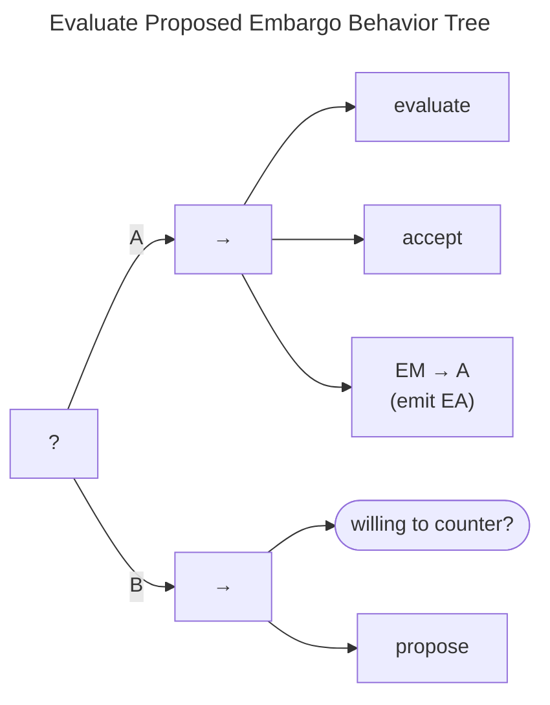

# Evaluate Proposed Embargo Behavior

## Requirements



- [EMB-11](../../reference/vultron-spec/requirements/state-behavior.md#protocol-emb-11) — Enter EM Active
- [EMB-15](../../reference/vultron-spec/requirements/state-behavior.md#protocol-emb-15) — Inbound Embargo-Response Decision (Received Side)
- [EMB-17](../../reference/vultron-spec/requirements/state-behavior.md#protocol-emb-17) — Late Accept of an Expired Embargo Invitation





The Evaluate Proposed Embargo Behavior Tree in the figure below handles the acceptance of an embargo or a counterproposal to it.

(A) As noted [above](em_bt.md), the same process applies to the *Proposed* and *Revise* EM states ($q^{em} \in \{P,R\}$).
An evaluation task comes first, and then an accept task.
These tasks are placeholders for the actual decision process.
Each Participant decides how to do this process.
In both states, acceptance causes an EM state transition to $q^{em} \in A$, and the tree emits an $EA$ message.

!!! tip inline end "See also"

    - [Propose Embargo Behavior](em_propose_bt.md)

(B) But the proposed terms can be unacceptable.
In that case, the Participant might be willing to make a counterproposal.
The [propose](em_propose_bt.md) behavior covers the counterproposal.
