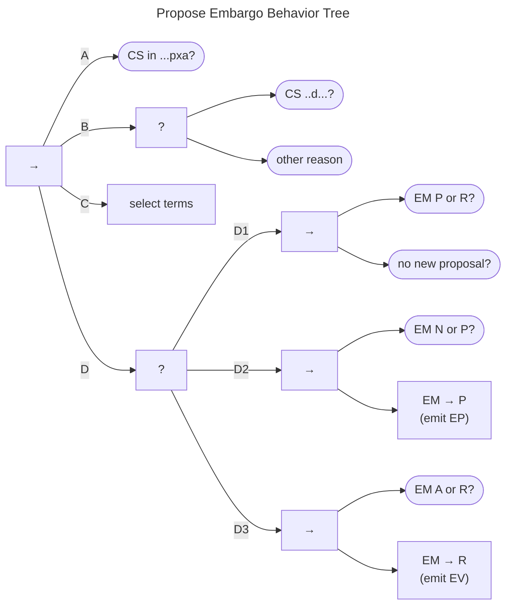

# Propose Embargo Behavior

## Requirements



- [EMB-10](../../reference/specs/protocol.md#emb-10) — Enter EM Proposed
- [EMB-12](../../reference/specs/protocol.md#emb-12) — Enter EM Revise





The figure below shows the Propose Embargo Behavior Tree.

!!! tip inline end "See also"

    - [Negotiate Embargoes](../process_models/em/negotiating.md)
    - [Default Embargoes](../process_models/em/defaults.md)

The tree is a sequence.
It starts with (A,B) a check for embargo viability, as [Negotiating Embargoes](../process_models/em/negotiating.md) describes.

When the checks succeed, the tree goes to (C), which selects the embargo terms to propose.
An implementation of this task can use a default policy, as in [Default Embargoes](../process_models/em/defaults.md).
Or a Participant can make a decision that is specific to the case.

(D) A Participant can propose embargo terms from any state that is not *eXited* ($q^{em} \in \{N,P,A,R\}$).

(D1) If someone has already proposed a new or revised embargo ($q^{em} \in \{P,R\}$), the tree checks whether the Participant wants to make a counterproposal.
If the Participant does not, the tree makes no proposal, and the behavior succeeds.

Otherwise, (D2) a proposal from state $q^{em} \in N$ emits $EP$ and causes the transition $q^{em} \xrightarrow{p} P$.
(D3) Otherwise, a proposal from $q^{em} \in A$ emits $EV$ and moves to $q^{em} \xrightarrow{p} R$.

A proposal from state $q^{em} \in P$ (D2) or $q^{em} \in R$ (D3) is a counterproposal.
Thus, it does not change the EM state.
But it does emit an $EP$ or $EV$ message, as applicable.
