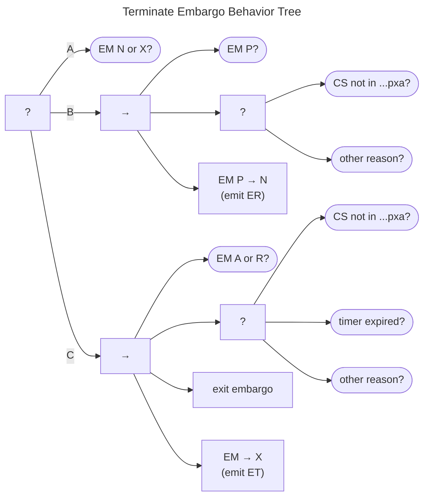

# Terminate Embargo Behavior

## Requirements



- [EMB-13](../../reference/specs/protocol.md#emb-13) — Enter EM Exited
- [EMB-14](../../reference/specs/protocol.md#emb-14) — Actor-Voluntary Embargo Termination (Trigger Side)
- [EMB-19](../../reference/specs/protocol.md#emb-19) — Embargo Teardown Announcement





The diagram below shows the Terminate Embargo Behavior Tree.
It has two major behaviors.
Which behavior applies depends on whether an embargo is established.

(A) If the EM state is *None* or *eXited* ($q^{em} \in \{N{,}X\}$), the tree succeeds immediately.

(B) The next node handles the situation where no embargo is established.
The behavior goes into a sequence that checks whether the EM state is $Proposed$ ($q^{em} \in P$).
If it is, the sequence checks whether there is a reason to exit the embargo negotiation process.

One such reason is that the case state is outside the embargo "habitable zone".
Other reasons can exist, but we do not specify them.
If the sequence finds a reason, the tree rejects the proposal, the state returns to *None*, and the tree sends an $ER$ message.

(C) If that branch fails, the tree must still handle the situation where an embargo is already established.
First, the tree confirms that the EM state is *Active* or *Revise*.
Then it looks for reasons to exit again.
This time, the explicit conditions also include timer expiration.

To terminate an existing embargo, the Participant can have other teardown procedures to complete.
The *exit embargo* task represents these procedures.
Last, the tree changes the EM state to *eXited* and emits an $ET$ message.

!!! tip inline end "See also"

    - [Early Termination](../process_models/em/early_termination.md)
    - [Threat Monitoring Behavior](monitor_threats_bt.md)
    - [Message Handling Behavior](msg_intro_bt.md)

The Terminate Embargo Behavior Tree occurs in multiple locations in the larger tree.
It is a possible response to evidence that [threat monitoring](monitor_threats_bt.md) collects.
It is also a response to some [CS or EM messages](msg_intro_bt.md) in states where an embargo is no longer viable.
