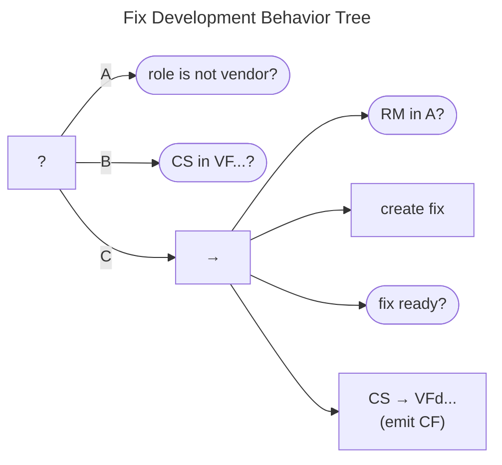

# Fix Development Behavior

## Requirements



- [CSB-09](../../reference/vultron-spec/requirements/state-behavior.md#protocol-csb-09) — Enter CS V (Vendor Aware)
- [CSB-10](../../reference/vultron-spec/requirements/state-behavior.md#protocol-csb-10) — Enter CS F (Fix Ready)
- [CSB-15](../../reference/vultron-spec/requirements/state-behavior.md#protocol-csb-15) — Trigger-Side VFD Role Preconditions







The Fix Development Behavior Tree is shown below.

(A) Fix development is relegated to the Vendor role, so Non-Vendors return *Success* since they have nothing further to do.

(B) For Vendors, if a fix is ready (i.e., the case is in $q^{cs} \in VF\cdot\cdot\cdot\cdot$), the tree returns *Success*.

(C) Otherwise, engaged Vendors ($q^{rm} \in A$) can

- create fixes
- set $q^{cs} \in Vfd\cdot\cdot\cdot \xrightarrow{\mathbf{F}} VFd\cdot\cdot\cdot$
- emit $CF$ upon completion
