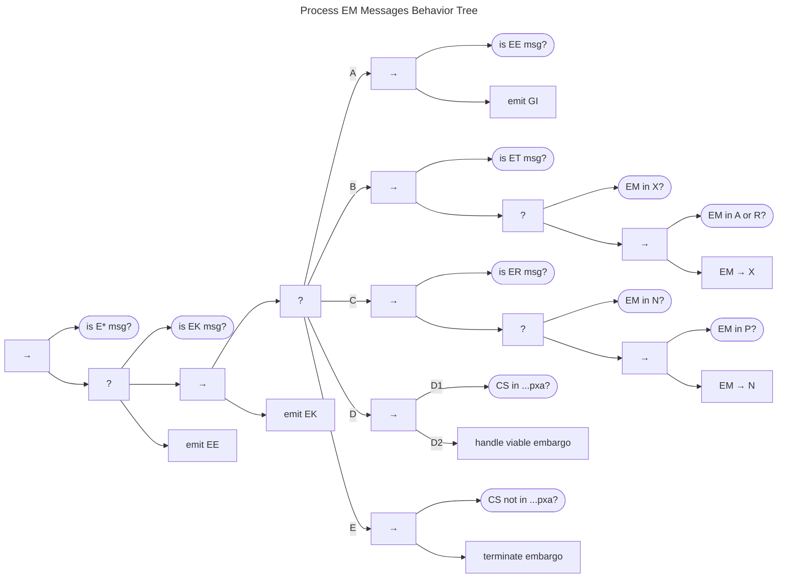
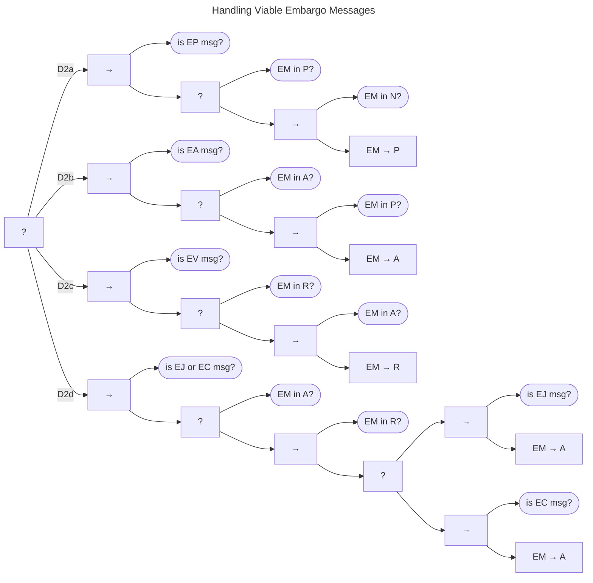

# Process EM Messages Behavior

## Requirements









The figure below shows the Process EM Messages Behavior Tree.

This tree is a child of the fallback node that starts in [Receiving Messages Behavior](msg_intro_bt.md).
The tree starts with a precondition check for EM message types and then goes to a fallback node.
EM acknowledgment messages (*EK*) get no more processing and return *Success*.

## Messages That Lead to a Simple Acknowledgment

Next comes a branch that handles all the messages that get a simple acknowledgment (*EK*).

(A) The first case is embargo error messages (*EE*).
An *EE* message also triggers a general inquiry (*GI*) message, to try to solve the problem.

(B) The second case is embargo termination messages (*ET*).
If the Participant is already in the EM *eXited* state (*X*), the tree does nothing more (other than the *EK*).
Otherwise, if the Participant is in the *Active* or *Revise* EM state, the *ET* message triggers a state transition $q^{em} \xrightarrow{t} X$.

(C) The third case is embargo rejections.
A simple sequence handles them and returns the state from *Proposed* to *None*.

### Handling Viable Embargo Messages

(D) The last part of the simple acknowledgment branch handles EM messages that arrive when the case state lets an embargo be viable ($q^{cs} \in \cdot\cdot\cdot pxa$).
The tree can do different actions in this case state, as the next diagram shows.

(D2a) An embargo proposal (*EP*) moves the state from *None* to *Proposed*.
If the state is already *Proposed*, it stays in *Proposed*.

(D2b) An embargo acceptance (*EA*) moves the state from *Proposed* to *Active*.

(D2c) An embargo revision proposal (*EV*) works like the *EP* behavior.
It moves the state from *Active* to *Revise*, or the state stays in *Revise*, as applicable.

(D2d) Last, the tree handles a revision rejection (*EJ*) or acceptance (*EC*) in the *Revise* state.

Back up the tree, *Success* in any of the branches in this paragraph or the previous paragraph causes an acknowledgment message *EK*.

## Messages That Require More than a Simple Acknowledgment

(E) Now go back to the tree at the top of the page.
The next branch handles EM messages when an embargo is no longer viable.
That is, attacks are occurring, or the exploit or the vulnerability is public ($q^{cs} \not \in \cdot\cdot\cdot pxa$).
This branch goes to the [Terminate Embargo tree](em_terminate_bt.md), which can emit other messages.

Last, go back to the end of the tree at the top of the page.
If no other branch succeeds, the tree emits an embargo error (*EE*) message to report the failure.
