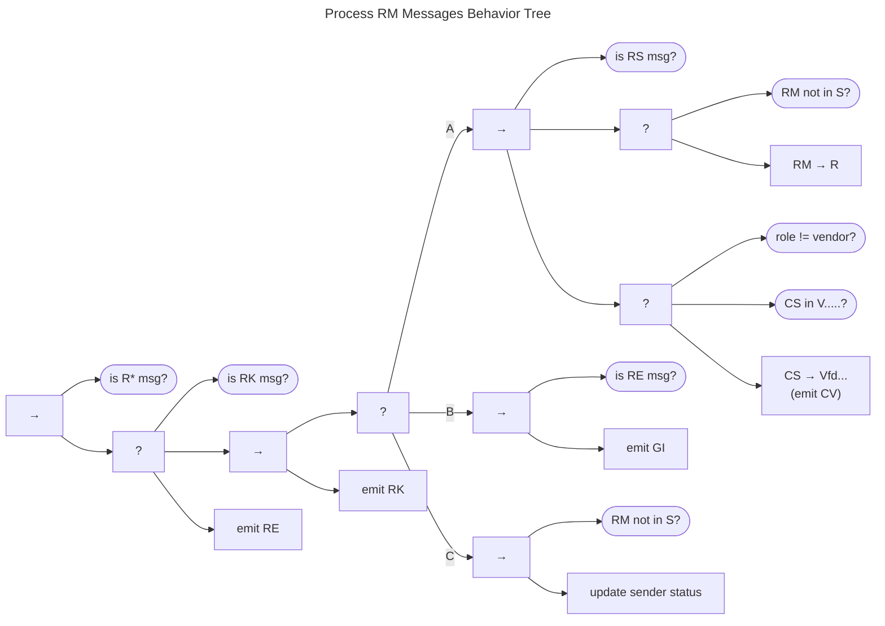

# Process RM Messages Behavior

## Requirements









The figure below shows the Process RM Messages Behavior Tree.

This tree is a child of the fallback node that starts in [Receiving Messages Behavior](msg_intro_bt.md).
The tree starts with a precondition check for any RM message type and then goes to a fallback node.
RM acknowledgment messages (*RK*) get no more processing and return *Success*.

Next comes the main RM message processing sequence.
A fallback node covers three major cases:

- (A) The first case is a sequence that handles new reports (*RS* when $q^{rm} \in S$).
    This branch changes the RM state of the recipient, whatever the role of the Participant is.
    The Participant can be a Vendor that did not know about the vulnerability in the report before.
    In that case, the Vendor also records the CS transition $q^{cs} \in vfd \xrightarrow{\mathbf{V}} Vfd$ and emits a related *CV* message.

- (B) The second case is an RM Error (*RE*).
    The recipient emits a general inquiry (*GI*), so that the Participants can find the cause of the problem.
    The recipient also emits an *RK* to acknowledge receipt of the error.

- (C) The third case covers most of the remaining RM messages.
    Each CVD Participant has its own RM process.
    Thus, most of these messages give information about the status of other Participants and do not directly change the status of the receiver.
    If a case already exists ($q^{rm} \not\in S$), the recipient can update its record of the sender state.
    No other action is necessary.

For all three cases, an *RK* message acknowledges receipt of the message.
The tree replies with an *RE* message to any message that it does not handle, to show an error.
