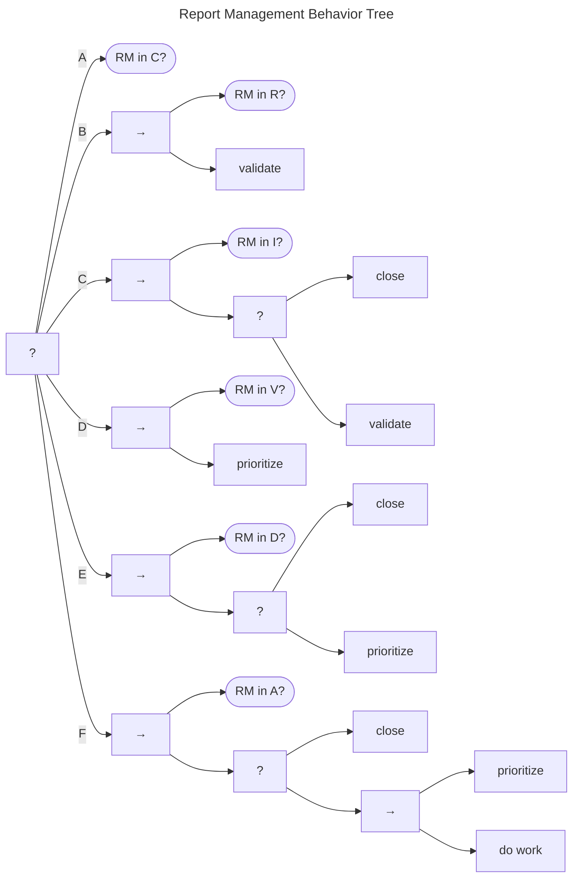

# Report Management Behavior Tree

## Requirements

The [Protocol Specifications](../../reference/specs/protocol.md) give the behavioral requirements for this tree:

- [RMB-09](../../reference/specs/protocol.md#rmb-09) — Enter RM Received
- [RMB-10](../../reference/specs/protocol.md#rmb-10) — Enter RM Valid
- [RMB-11](../../reference/specs/protocol.md#rmb-11) — Enter RM Invalid
- [RMB-12](../../reference/specs/protocol.md#rmb-12) — Enter RM Deferred
- [RMB-13](../../reference/specs/protocol.md#rmb-13) — Enter RM Accepted
- [RMB-14](../../reference/specs/protocol.md#rmb-14) — Enter RM Closed
- [RMB-15](../../reference/specs/project.md#rmb-15) — RM Write-Boundary Transition Validation

!!! note "Implementation approach"

    The behavior tree diagram below shows one conformant implementation of these requirements.
    Implementations do not have to use behavior trees.
    Any approach that satisfies the requirements above is conformant.

!!! note "Legacy design diagram"

    The diagram on this page shows the simulator-era design from `vultron/bt/`.
    It may not match the current implementation in `vultron/core/behaviors/`.
    See the [Behaviors Reference](../../reference/behaviors/index.md) for documentation that a tool generates automatically from the current implementation.

The figure below shows a Behavior Tree for the Report Management model.
A Fallback node represents the Report Management process.
We assume that the process needs multiple *ticks* of the Behavior Tree to complete.
The reason is that each tick can complete one branch at most.

(A) The first check examines whether the case is already $Closed$ ($q^{rm} \in C$).
If that check succeeds, the branch returns *Success*, and the process is complete.
If the check fails, the tree goes to the next branch (B), which handles reports in the *Received* state ($q^{rm} \in R$).

!!! tip inline end "See also"

    - [Report Validation Behavior](rm_validation_bt.md)
    - [Report Prioritization Behavior](rm_prioritization_bt.md)
    - [Report Closure Behavior](rm_closure_bt.md)
    - [Do Work Behavior](do_work_bt.md)

From $q^{rm} \in R$, the only action is to validate the report.
We discuss [report validation](rm_validation_bt.md) later.
For now, the validate report behavior returns *Success* after it moves the report to *Valid* ($q^{rm} \xrightarrow{v} V$) or *Invalid* ($q^{rm} \xrightarrow{i} I$).

The next branch (C) covers reports in the *Invalid* state ($q^{rm} \in I$).
This branch has two options.
It can close the report ($q^{rm} \xrightarrow{c} C$, as described in [report closure](rm_closure_bt.md)), or it can try the validation again.

(D) For reports in the *Valid* state ($q^{rm} \in V$), the only action is to prioritize the report.
Another page describes [report prioritization](rm_prioritization_bt.md) in detail.
That behavior returns *Success* after it moves the report to *Accepted* ($q^{rm} \xrightarrow{a} A$) or *Deferred* ($q^{rm} \xrightarrow{d} D$).

(E) Next come the behaviors for reports that are both validated and prioritized.
A *Deferred* report ($q^{rm} \in D$) can go to *Closed* or get a new priority evaluation.
Otherwise, we do not expect a *Deferred* report to get more work.

(F) An *Accepted* report ($q^{rm} \in A$) can also go to *Closed* or get a new priority evaluation.
However, we also expect an *Accepted* report to get more effort: the *do work* task node.
We discuss this node in [Do Work Behaviors](do_work_bt.md).

The composability of Behavior Trees makes the presentation simpler.
A behavior that occurs in multiple places can be its own tree.
The next few subsections examine the most relevant of these subtrees.
