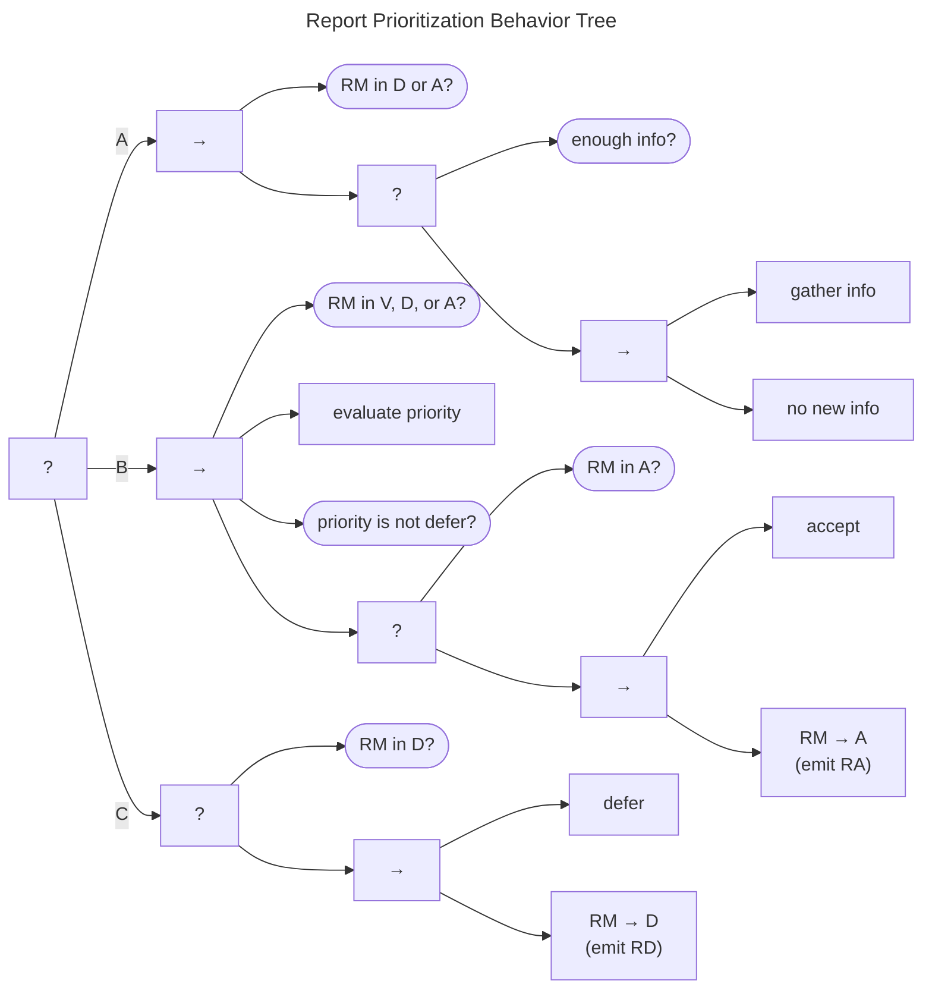

# Report Prioritization Behavior

## Requirements

The [Protocol Specifications](../../reference/specs/protocol.md) give the behavioral requirements for this tree:

- [RMB-12](../../reference/specs/protocol.md#rmb-12) — Enter RM Deferred
- [RMB-13](../../reference/specs/protocol.md#rmb-13) — Enter RM Accepted

!!! note "Implementation approach"

    The behavior tree diagram below shows one conformant implementation of these requirements.
    Implementations do not have to use behavior trees.
    Any approach that satisfies the requirements above is conformant.

!!! note "Legacy design diagram"

    The diagram on this page shows the simulator-era design from `vultron/bt/`.
    It may not match the current implementation in `vultron/core/behaviors/`.
    See the [Behaviors Reference](../../reference/behaviors/index.md) for documentation generated from the current implementation.

The figure below shows the Report Prioritization Behavior Tree.
Its structure is similar to the Report Validation Behavior Tree.
An initial postcondition check (A) falls back to the main process (B), which leads toward $accept$.
The main process in turn falls back to the deferral process (C).

In more detail, (A) the behavior ends if the report is already in the *Accepted* or *Deferred* state and no new information prompts a change.

If check (A) fails, we enter the main prioritization sequence (B).
This sequence has two alternative preconditions.
Either the report has not yet left the *Valid* state through prioritization ($q^{rm} \in V$).
Or new information is available for a report in $q^{rm} \in \{ D, A \}$, and this information triggers a new evaluation.

If the preconditions are met, the Participant evaluates the report priority.
For example, a Participant that uses [SSVC](https://github.com/CERTCC/SSVC){:target="_blank"} could put that process here.
The evaluation task always sets the report priority.
The next check returns *Failure* on a defer priority or *Success* on any other priority.

On *Success*, the tree runs an *accept* task.
This task is a placeholder for any intake process that a Participant has for *Accepted* reports.
If the task succeeds, the tree moves the report to the *Accepted* state ($q^{rm} \xrightarrow{a} A$) and emits an $RA$ message.

(C) If any item in the main sequence fails, the tree defers the case.
It sets the state with $q^{rm} \xrightarrow{d} D$ and emits an $RD$ message.
A *defer* task is also present as a callback placeholder.
