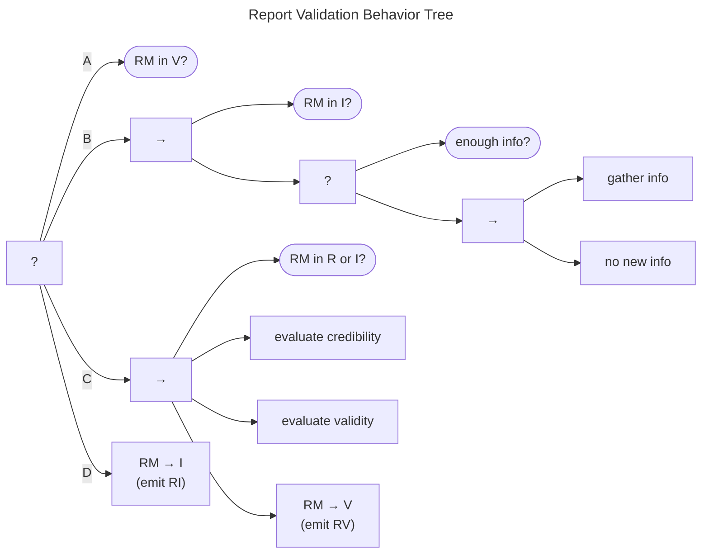

# Report Validation Behavior

## Requirements



- [RMB-10](../../reference/vultron-spec/requirements/state-behavior.md#protocol-rmb-10) — Enter RM Valid
- [RMB-11](../../reference/vultron-spec/requirements/state-behavior.md#protocol-rmb-11) — Enter RM Invalid





The next figure shows a Report Validation Behavior Tree.
To begin with (A), if the report is already *Valid*, this behavior does nothing more.

(B) The report can already have the *Invalid* designation.
In that case, the necessary actions depend on whether the behavior needs more information.
If the information in the report is sufficient, no more action is necessary, and the entire behavior returns *Success*.

However, a previous validation pass can leave an indicator that more information is necessary.
In that case, execution goes to the sequence that runs the *gather info* task.
If the task finds nothing new, the entire branch returns *Success*, and the report stays *Invalid*.
If the task *does* find new information, the branch fails, and execution goes to the main validation sequence.

(C) The main validation sequence runs when none of the conditions above are true.
Two conditions trigger the validation sequence.
In the first, the report is in *Received* and no one has evaluated its validity.
In the second, an earlier evaluation found the report *Invalid*, and new information is now available that calls for a new evaluation.

The validation process shown here has two main steps: a credibility check and then a validity check.
Our introduction of the [Received (R) state](../process_models/rm/index.md#the-received-r-state) describes these steps.

As a reminder, a report can be in one of three categories:

- (a) neither credible nor valid
- (b) credible but invalid
- (c) both credible and valid

If the report passes both the credibility check and the validity check, the report is *Valid*.
The tree then moves the report with $q^{rm} \xrightarrow{v} V$ and emits an $RV$ message.

(D) If either check fails, the validation sequence fails.
The report is then *Invalid* and moves to (or stays in) $q^{rm} \in I$.
In that case, the Participant sends an $RI$ message when applicable, to tell other Participants about the related state change.
