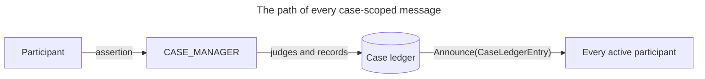
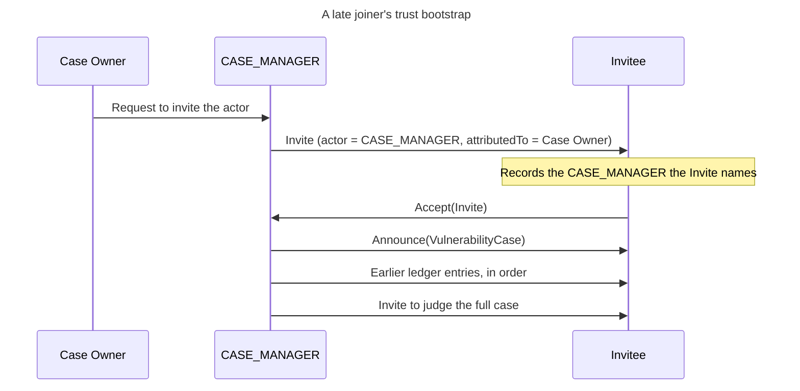

# Case Authority, Trust, and Routing

This page explains the authority model of a Vultron case: who may change what, and why every case message goes through one actor.
It also explains how a node decides which actor to trust for a case it has not seen before.
It is for you if you build a node that takes part in cases, in any language.
That node can be a tracker, a vendor's coordination system, or a service that holds the case history.
It assumes you know how the case history is kept ([The CASE_MANAGER and the Case Ledger](case_manager_and_ledger.md)) and what a case is made of ([The Case Model](case_model.md)).

---

## Authority is a role

Every case has exactly one actor that holds the `CASE_MANAGER` role ([CM-02-001](../../reference/specs/protocol.md#cm-02-001)).
That actor, the [CASE_MANAGER](case_manager_and_ledger.md), is the single writer of the case history.
It is the only node whose record of the case is authoritative ([CM-02-002](../../reference/specs/protocol.md#cm-02-002)).

An actor is the authority for a case if and only if it holds the `CASE_MANAGER` role in that case's participant list ([CM-02-011](../../reference/specs/architecture.md#cm-02-011)).
Authority does not come from where an actor is hosted, from its name, or from the shape of its URL.
The reference implementation runs a dedicated service actor, the **Case Actor**, to hold the role.
That name, and a URL that ends in `actors/case-actor`, are provisioning conveniences with no protocol meaning ([CM-02-013](../../reference/specs/architecture.md#cm-02-013), [ADR-0088](../../adr/0088-consolidate-case-authority-determination.md)).
Your node must not treat either as evidence of authority ([ARCH-24-004](../../reference/specs/architecture.md#arch-24-004)).
Read the role.

A case never lacks a CASE_MANAGER.
The role is assigned when the case is created, and a delegation hands it on without a gap ([CM-24-006](../../reference/specs/protocol.md#cm-24-006)).
So a node that finds no CASE_MANAGER for a case has found a corrupt participant list, not a case that runs without one.
It stops and reports the fault.
It does not fall back to sending a message directly.

The `CASE_MANAGER` role is not the `CASE_OWNER` role.
The **Case Owner** is the participant whose disclosure decision the case exists to serve: the report receiver whose proposal caused the case to exist ([CBT-01-003](../../reference/specs/protocol.md#cbt-01-003)).
The CASE_MANAGER writes the history.
The Case Owner decides.
The Case Owner role is never delegated to the CASE_MANAGER, though it can move to another participant by [ownership transfer](ownership_transfer.md).

---

## Who may assert what

A message from a participant to the CASE_MANAGER is an **assertion**: a claim that something happened on the sender's side.
The CASE_MANAGER does not perform the asserted action again.
It judges the assertion and, if it accepts it, records it in the ledger.
What it accepts depends on who sent the assertion and what the assertion is about.

### Participant status is self-declared

Each participant reports its own Report Management (RM) state and its own Vendor fix path (VFD) state.
No other participant approves the report ([PRM-06-001](../../reference/specs/protocol.md#prm-06-001), [ADR-0121](../../adr/0121-joined-participant-judges-the-case-by-full-case-invite.md)).
That is why these are *participant* status items: they are what the participant says about itself.

There is one write about a participant that the participant does not make: its creation.
When the CASE_MANAGER invites an actor, it creates that actor's participant record at RM `RECEIVED` ([CM-11-006](../../reference/specs/protocol.md#cm-11-006)).
The record is inert until the invitee accepts.

### Two narrow on-behalf exceptions

Some state changes are evidenced by events outside the participant.
For two of them, the CASE_MANAGER or the Case Owner may assert the change on the participant's behalf.

| Change | Who may assert it on another's behalf | When |
|---|---|---|
| `v → V`, the Vendor is aware | The CASE_MANAGER or the Case Owner | The notification is evidenced: any acknowledgment from the Vendor, even a read receipt of its invitation ([PRM-06-003](../../reference/specs/protocol.md#prm-06-003)). The write does not change the Vendor's RM state |
| `d → D`, the fix is deployed | The CASE_MANAGER or the Case Owner | The same evidenced pattern, and rarely — for example, a Deployer that joined and has since gone quiet ([PRM-06-004](../../reference/specs/protocol.md#prm-06-004)). The write succeeds only when the Deployer's RM state is consistent with deployment |
| `f → F`, the fix is ready | Nobody | Fix readiness is not knowable from outside the Vendor, so only the Vendor asserts it ([PRM-06-005](../../reference/specs/protocol.md#prm-06-005)) |

An on-behalf assertion targets an existing participant only.
One whose target is not a participant in the case is refused before any write, and it never creates a participant ([PRM-06-006](../../reference/specs/protocol.md#prm-06-006)).
A status update is not a way into a case.
An actor joins a case only through the invitation flow.

A Vendor that takes part in a case is, by definition, aware of it.
So a Vendor never reports itself as unaware: its valid fix-path reports are `Vf` and `VF` ([PRM-06-002](../../reference/specs/protocol.md#prm-06-002)).
The only `v` a Vendor participant carries is the one the CASE_MANAGER writes when the invitation creates its record.
Any reply to that invitation sets `V`.
The on-behalf `v → V` assertion exists for the case in between: an invited Vendor that has acknowledged the invitation but not yet answered it.

### Decisions about the case need the Case Owner

Changes to who is in the case, what roles they hold, and whether the case continues are not self-declared.
They are the Case Owner's decisions, carried out by the CASE_MANAGER ([CM-02-005](../../reference/specs/protocol.md#cm-02-005)).

| Decision | Who decides |
|---|---|
| Admitting an actor to the case | The Case Owner approves or rejects each invitation. Another participant may only recommend an actor ([CM-16-019](../../reference/specs/protocol.md#cm-16-019)) |
| Granting a role | The Case Owner, through a role offer the receiving actor accepts ([§11.1 Role Assignment](../../reference/vultron-spec/interactions.md#111-role-assignment-n)) |
| Removing or reinstating a participant | The Case Owner only ([CM-31-004](../../reference/specs/protocol.md#cm-31-004)) |
| Transferring ownership | Only the Case Owner may offer ([CM-21-019](../../reference/specs/protocol.md#cm-21-019)). Only the named transferee may accept ([CM-21-011](../../reference/specs/protocol.md#cm-21-011)) |
| Activating or ending an embargo | The Case Owner ([CM-02-005](../../reference/specs/protocol.md#cm-02-005)) |
| Closing the case | The Case Owner, by leaving it (see [Closing a case](#closing-a-case-is-a-hard-write-boundary)) |

What a participant may do is the union of what each of its roles permits ([CM-26-001](../../reference/specs/protocol.md#cm-26-001)).
A participant that holds both a Vendor role and the Case Owner role may do everything either role allows.

---

## Why every message goes through the CASE_MANAGER

Once a case exists, a participant addresses every case-scoped message to the CASE_MANAGER and to nobody else ([PCR-08-001](../../reference/specs/protocol.md#pcr-08-001)).
That covers notes, status updates, embargo proposals, and every other message about the case.
The CASE_MANAGER judges it, records the outcome in the ledger, and sends the new ledger entry to every active participant.
That fan-out is the only way a participant learns of an admitted change ([PCR-08-003](../../reference/specs/protocol.md#pcr-08-003), [§5.4.2 Routing Topology](../../reference/vultron-spec/layers.md#542-routing-topology)).

The diagram shows the one path: a participant sends to the CASE_MANAGER, the CASE_MANAGER records, and the ledger entry goes out to every active participant.

The rule follows from having one writer.
If participants sent case messages to each other, the content would arrive outside the ledger.
Then no node could rebuild a replica from the ledger alone, and the hash chain would not cover every change.
The CASE_MANAGER could not refuse a malformed assertion or put changes in one order.
Two participants could each hold a fact the other never saw.

This is a rule about Vultron protocol messages, not about people.
Participants still talk to each other by mail, by phone, or in a shared channel, and the protocol does not try to stop them.
Suppose one participant sends a case-scoped Vultron activity directly to another.
That activity is not part of the protocol, and the receiver has no obligation to apply it.

### Two exceptions, both before the case exists

The rule has two exceptions, and both happen before there is a CASE_MANAGER to route through ([§4.5 Trust and Bootstrap Semantics](../../reference/vultron-spec/layers.md#45-trust-and-bootstrap-semantics)).

1. The reporter sends its report directly to the actor it chose to tell, because no case exists yet.
2. The case-creation message, `Create(VulnerabilityCase)`, which the report receiver sends the reporter, introduces the CASE_MANAGER to the reporter.

Everything after those two messages goes through the CASE_MANAGER.

### Messages sent on someone's behalf

One participant asks for some messages, but the CASE_MANAGER sends them.
For these messages, the protocol requires the CASE_MANAGER to be the recognized sender.
An invitation to join the case is the main example ([PCR-08-007](../../reference/specs/protocol.md#pcr-08-007)).
The Case Owner asks, and the CASE_MANAGER sends.

A message sent this way names the CASE_MANAGER as its `actor` and the participant who asked as its `attributedTo` ([CM-24-001](../../reference/specs/protocol.md#cm-24-001), [CM-24-002](../../reference/specs/protocol.md#cm-24-002)).
A receiver then knows both who sent the message and who wanted it sent.

A node sends only as the actors it hosts ([ADR-0109](../../adr/0109-a-container-emits-only-as-actors-it-hosts.md)).
A Case Owner whose node does not host the CASE_MANAGER does not build the invitation itself.
It sends its own request to the CASE_MANAGER, and the CASE_MANAGER sends the invitation and records it ([CM-24-004](../../reference/specs/architecture.md#cm-24-004)).

### Who receives a broadcast

Being on the participant list does not entitle a participant to the case content.
The CASE_MANAGER sends case content only to **active participants** ([CM-10-004](../../reference/specs/protocol.md#cm-10-004), [ADR-0114](../../adr/0114-joining-a-case-stub-invite-inert-participant.md)).
An active participant was seated when the case was created or accepted its invitation, and has not been removed.
While an embargo is active, it has also agreed to that embargo.
Every other participant is inert.
It still receives the invitations that ask it to join or to consent, but no ledger entries, case snapshots, or status broadcasts.

### Two different checks on every inbound message

A CASE_MANAGER makes two checks before it acts on a message, and they answer different questions.

Every node first asks whether the message was addressed to it at all.
A message is addressed to a node that sent it, that its `to` names, or that is an active participant of a case participants collection its `to` names ([HP-01-012](../../reference/specs/architecture.md#hp-01-012)).
Any other node holds a misaddressed copy, so it refuses the copy and answers nothing ([HP-01-005](../../reference/specs/project.md#hp-01-005)).

The first check is about the receiver: *am I the CASE_MANAGER of this case?*
A node that receives a message meant for the CASE_MANAGER, but does not hold the role, refuses it and says which role it lacks ([HP-01-005](../../reference/specs/project.md#hp-01-005)).
It does not treat the message as a harmless duplicate.

The second check is about the sender: *may this sender make this assertion?*
The first check tells nothing about the second ([HP-01-006](../../reference/specs/protocol.md#hp-01-006), [ADR-0115](../../adr/0115-received-handlers-check-sender-entitlement.md)).
Each kind of message has its own sender rule.
The CASE_MANAGER admits a reply to an invitation only from the actor that the invitation named ([CM-11-017](../../reference/specs/protocol.md#cm-11-017)).
It accepts a reply to an ownership offer only from the named transferee.
It accepts a request to remove a participant only from the Case Owner.

The request that the CASE_MANAGER recorded authorizes a reply.
The copy of that request that the sender puts in its reply never does.
Otherwise a sender could write itself into a request that the CASE_MANAGER never sent.

A participant's replica applies the matching rule from the other side.
It accepts a change to the case only when the CASE_MANAGER for that case sent it ([PCR-03-001](../../reference/specs/protocol.md#pcr-03-001)).
The Case Owner's own node follows the same rule.
It does not write its own changes into its replica.
It sends them to the CASE_MANAGER and waits for the ledger entry ([PCR-03-002](../../reference/specs/protocol.md#pcr-03-002), [PCR-03-006](../../reference/specs/protocol.md#pcr-03-006)).

---

## Trust bootstrap: how a participant learns whom to trust

A replica accepts changes only from the CASE_MANAGER.
That raises a question every new participant must answer once per case: *which actor is the CASE_MANAGER?*
The participant cannot learn the answer from the case snapshot alone, because whoever sent the snapshot wrote it.

The **trust bootstrap** is how a participant answers the question for the first time.
The answer must come from a relationship the participant already has, before the case arrives.
We call the local record of that relationship a **trust anchor**.
A participant accepts the CASE_MANAGER for a case only when a trust anchor it wrote itself names that actor.

Transport security does not replace the bootstrap.
An authenticated or encrypted message proves who sent it, but not that the sender holds authority for this case ([CBT-02-002](../../reference/specs/protocol.md#cbt-02-002)).

There are two bootstrap paths, one for each way a participant can come to a case.

### The participants a case starts with

A case starts with three participants: the reporter, the report receiver who becomes the Case Owner, and the CASE_MANAGER.
The report receiver proposes the case to a CASE_MANAGER, which creates it ([Case Initialization](case_initialization.md)).

Each of the first two has its own trust anchor.

| Participant | What it already knows | What it checks |
|---|---|---|
| Report receiver (Case Owner) | The actor it sent its case proposal to | It acts on the reply to the proposal, and on the bootstrap, only when that actor sent it ([CP-06-005](../../reference/specs/protocol.md#cp-06-005)) |
| Reporter | The report it submitted, and the actor it submitted it to | The bootstrap must reference that report and come from that actor ([CBT-01-005](../../reference/specs/protocol.md#cbt-01-005)) |

The bootstrap is a one-time `Create(VulnerabilityCase)` message ([CBT-01-001](../../reference/specs/protocol.md#cbt-01-001)).
It carries the whole case and every participant record, inline or by reference ([CBT-01-002](../../reference/specs/protocol.md#cbt-01-002), [CBT-01-007](../../reference/specs/protocol.md#cbt-01-007)).
The reference implementation embeds them in full rather than as bare links, because it cannot yet fetch an object by reference ([CBT-01-012](../../reference/specs/project.md#cbt-01-012)).
It names the Case Owner and the CASE_MANAGER as distinct participants ([CBT-01-003](../../reference/specs/protocol.md#cbt-01-003)).
It includes the reporter at RM `ACCEPTED`, set directly ([CBT-01-008](../../reference/specs/protocol.md#cbt-01-008)).
A receiver that finds a required participant missing rejects the whole bootstrap.
It does not fill the gap from what it thinks the participant should be ([CBT-05-008](../../reference/specs/protocol.md#cbt-05-008)).
The reference implementation also counts a participant present only as a bare link as missing, because it cannot fetch it ([CBT-05-009](../../reference/specs/project.md#cbt-05-009)).

The report receiver, not the CASE_MANAGER, sends the reporter's bootstrap ([ADR-0132](../../adr/0132-the-report-receiver-introduces-the-case-manager-to-the-reporter.md)).
The CASE_MANAGER sends its own `Create(VulnerabilityCase)` to the Case Owner only ([CBT-01-010](../../reference/specs/protocol.md#cbt-01-010)).
The report receiver then sends the reporter a `Create(VulnerabilityCase)` as itself, and that message names the CASE_MANAGER the receiver delegated to.
The reporter never addressed the CASE_MANAGER, so it trusts the introduction because it came from the actor the reporter chose.
A case snapshot that names its own sender as CASE_MANAGER is never an anchor.
A participant refuses a bootstrap from an actor that no record it wrote names, and stores nothing from it ([CBT-01-011](../../reference/specs/protocol.md#cbt-01-011)).
When the Case Owner also holds the `CASE_MANAGER` role, the reporter gets only the receiver's message.

After it accepts the bootstrap, a participant stores three things together.
They are the case that its report became, the actor that created the case, and the actor that is the CASE_MANAGER ([CBT-01-006](../../reference/specs/protocol.md#cbt-01-006)).
Those records are its trust anchor for the case from then on.
Later full-case updates arrive as `Announce(VulnerabilityCase)` from that CASE_MANAGER, not as further `Create` messages ([CBT-02-001](../../reference/specs/protocol.md#cbt-02-001)).

Ordinary case traffic cannot replace the trusted CASE_MANAGER.
A different actor becomes the CASE_MANAGER only through an explicit delegation the case records ([CBT-02-003](../../reference/specs/protocol.md#cbt-02-003)).

A reporter may offer one report to several recipients, for example when the first one does not answer.
Each recipient that creates a case sends its own bootstrap.
The reporter checks each one against the recipient that sent it, and accepting one does not affect whether it accepts another ([CBT-06-002](../../reference/specs/protocol.md#cbt-06-002)).

### A participant that joins later

An actor invited after the case is under way has no report relationship with anyone in it.
Its trust anchor is the invitation.

The sequence shows the invitation creating the trust anchor before any case content reaches the invitee.

The Case Owner asks the CASE_MANAGER to invite the actor.
The CASE_MANAGER sends the invitation, which identifies both the case and the CASE_MANAGER ([CBT-04-001](../../reference/specs/protocol.md#cbt-04-001), [CBT-04-002](../../reference/specs/protocol.md#cbt-04-002)).
The invitee records the CASE_MANAGER that the invitation names and replies to it, not to the Case Owner ([PCR-08-008](../../reference/specs/protocol.md#pcr-08-008)).
When it accepts, the CASE_MANAGER sends the case snapshot and the earlier ledger entries without waiting for anything else ([CM-11-008](../../reference/specs/protocol.md#cm-11-008)).
No separate `Create` bootstrap is needed, because the invitation already did that job ([CBT-04-003](../../reference/specs/protocol.md#cbt-04-003)).

Until the invitee accepts, a later invitation for the same case that names a different CASE_MANAGER replaces the recorded one.
After the invitee accepts, the invitee refuses such an invitation and keeps the CASE_MANAGER it accepted ([PCR-03-004](../../reference/specs/protocol.md#pcr-03-004)).
So a forged invitation cannot stop the invitee from joining when the real invitation follows.
The invitee cannot yet tell a forged invitation from a real one, so if it accepts a forged invitation first, the forger stays recorded.

The hash chain then lets the joiner check that it received an unbroken history.
That is a check against tampering and gaps, not a second source of trust.

### When the bootstrap arrives late

Messages can arrive in any order.
A message from a CASE_MANAGER can reach a participant before the bootstrap that would make it trusted.

The participant holds such a message for a short time and does not apply it ([CBT-03-001](../../reference/specs/protocol.md#cbt-03-001), [CBT-03-002](../../reference/specs/protocol.md#cbt-03-002)).
Holding a message does not make its sender trusted: only an invitation or the bootstrap creates a trust anchor ([PCR-03-004](../../reference/specs/protocol.md#pcr-03-004)).
If the bootstrap arrives in time, normal checks resume.
If it does not, the participant drops the held message and logs a warning.
The sender must send that message again after the bootstrap ([CBT-03-003](../../reference/specs/protocol.md#cbt-03-003)).
The participant should also ask the case creator, with a `Question`, to send the bootstrap again ([CBT-03-004](../../reference/specs/project.md#cbt-03-004)).
The reference implementation holds a message for 300 seconds by default.

We chose a bounded hold over an outright refusal on purpose.
Refusing every early message would make delivery order part of protocol correctness, and the transport promises no order.

---

## Case replica seeding: no replica without prior trust

**Case replica seeding** is the step where a participant creates its local copy of a case for the first time.
A missing trust check at this step does the most harm.
The seeded copy is the replica that the participant checks all later changes against.

A participant must not create a replica from an `Announce(VulnerabilityCase)` unless it already has a trust anchor for that case ([PCR-03-004](../../reference/specs/protocol.md#pcr-03-004)).
One of two things must already be true:

1. It accepted a bootstrap `Create(VulnerabilityCase)` that introduced the CASE_MANAGER, as described above.
2. It completed an invitation exchange for that case, which recorded the CASE_MANAGER it expects.

When neither is true, the participant refuses the announcement, logs a warning, and stores no case.
No legitimate sequence of messages delivers a first-contact case announcement without one of those two messages first.
So refusing loses nothing a correct sender would send.

### The announced participant list is not a trust anchor

It is tempting to check the announcement against itself: accept it if its participant list names the sender as CASE_MANAGER.
That check proves nothing.
The sender wrote the list.
A fabricated case that names its sender as CASE_MANAGER passes, and nothing available at first contact can show it is false.
That is why every trust anchor is written locally, by the participant, from a message it had reason to expect.

### Rules for the invitation anchor

The invitation path has three rules, because an invitation is itself a message from an actor the invitee does not yet trust ([PCR-03-004](../../reference/specs/protocol.md#pcr-03-004)).

| Rule | What it prevents |
|---|---|
| The participant records an anchor only when the invitation's `object` is the participant itself | A misaddressed invitation planting an anchor for a different actor |
| The anchor names the invitation's `actor`, not whichever server delivered the message | A relay or forwarder becoming the trusted CASE_MANAGER |
| A second invitation to the same case that names a different CASE_MANAGER is refused, and the first anchor stays | A later message silently replacing the authority |

These rules are structural.
Whether the named CASE_MANAGER is genuine cannot be proved until actors sign their messages, which is future work ([§14.1 Trust Model](../../reference/vultron-spec/considerations.md#141-trust-model)).

### Messages for a case the participant does not hold

A message about a case the participant has no replica for is not discarded ([PCR-06-001](../../reference/specs/protocol.md#pcr-06-001)).
The participant holds it briefly and asks the CASE_MANAGER for the case snapshot ([PCR-06-002](../../reference/specs/protocol.md#pcr-06-002)).
It applies nothing from the message until a trusted replica exists ([PCR-06-003](../../reference/specs/protocol.md#pcr-06-003)).
A node that hosts several actors holds these messages separately for each actor ([PCR-06-004](../../reference/specs/project.md#pcr-06-004)).
Then a case seeded for one actor never receives messages held for another.

---

## Linking a submitted report to its case

A reporter submits a report before any case exists.
Later, case traffic arrives that refers to a case, not to the report.
The reporter needs to know that the two belong together.

So every actor keeps a record, for each report it submitted, of the case that report became ([PCR-05-001](../../reference/specs/protocol.md#pcr-05-001)).
The record starts empty when the report is submitted.
The bootstrap fills it, together with the trust anchors described above ([CBT-01-006](../../reference/specs/protocol.md#cbt-01-006)).
An `Announce(VulnerabilityCase)` also fills it: when the announced case lists a report the actor submitted, the actor links its replica to that report ([PCR-05-002](../../reference/specs/protocol.md#pcr-05-002)).

The link is made only after the message has passed the sender check.
A case from an untrusted sender is refused before any link is written, so an untrusted actor cannot claim someone else's report.

The link does three jobs.
It lets a reporter see what became of each report it sent.
It lets the reporter recognize later traffic about the case as the consequence of its own submission.
It holds the identity of the CASE_MANAGER that later announcements must come from.
When one report went to several recipients, each recipient's case is linked separately ([CBT-06-002](../../reference/specs/protocol.md#cbt-06-002)).

---

## Closing a case is a hard write boundary

A case closes when the Case Owner leaves it.
Other participants leave too, but only the Case Owner's departure closes the case.

### What happens when the Case Owner leaves

The CASE_MANAGER runs one fixed sequence when it receives the Case Owner's `Leave(VulnerabilityCase)` ([CM-23-002](../../reference/specs/protocol.md#cm-23-002)).

1. It records the departure in the ledger.
2. It expires every embargo invitation still waiting for an answer ([CM-23-014](../../reference/specs/protocol.md#cm-23-014)).
3. It moves the Case Owner to RM `CLOSED`, recording each step.
4. It moves its own participant record to RM `CLOSED`, recording each step.
   Its own status entry that reaches RM `CLOSED` is the last entry of the close, and it marks the boundary.

It sends each of these entries to every active participant that has not already left.
No separate entry marks the closure, because every node that holds the case and its ledger can already see it ([ADR-0152](../../adr/0152-a-case-managers-act-shares-the-participants-semantic-type-and-an-observation-is-not-ledgered.md)).

The CASE_MANAGER declines the close with a `Reject` while an embargo is still active ([CM-23-011](../../reference/specs/protocol.md#cm-23-011)).
It records nothing for the declined close.
The Case Owner must end the embargo first and then leave again.

Closing the case does not close every participant.
Only the Case Owner and the CASE_MANAGER move to RM `CLOSED`.
Every other participant keeps the RM state it last reported ([CM-23-012](../../reference/specs/protocol.md#cm-23-012)).
A participant's RM state is its own report about itself, and closing the case around it does not change that report.

### After the boundary, nothing is recorded

Once its own RM `CLOSED` status entry is in the ledger, the CASE_MANAGER treats the case as if its process had exited ([CM-23-013](../../reference/specs/protocol.md#cm-23-013), [ADR-0085](../../adr/0085-case-lifecycle-boundaries.md)).
For any inbound message about the case, it records no ledger entry and changes no state.
That applies to every kind of message: notes, status updates, embargo messages, and departures alike.
It is a kill switch, not a filter.

The boundary has to be absolute to be useful.
Suppose some kinds of message were still accepted after close.
Then every implementation would draw the line in a different place, and the history of a closed case would keep growing.

The CASE_MANAGER may reply to a late message with `Reject`, or send nothing.
A participant must not rely on getting a reply ([CM-23-013](../../reference/specs/protocol.md#cm-23-013)).
The reference implementation sends nothing by default ([ADR-0131](../../adr/0131-post-close-traffic-is-dropped-and-only-a-late-leave-may-be-answered.md)).
A setting lets it answer a late `Leave(VulnerabilityCase)` with `Reject(Leave(VulnerabilityCase))`, and every other late message is still dropped without a reply.

A general `Reject` reply is not safe, because many `Reject` messages already mean a decision.
`Reject(Invite)` is a declined invitation.
A sender that received one after close would read it as an answer to its request, not as "the case is closed".
`Reject(Leave)` already means "close declined", so it cannot be misread.

A new case proposal is not a late message about the case, because it names a report, not a case.
When a proposal resolves to a closed case, the CASE_MANAGER answers it with `Reject(CaseProposal)` under either setting, and records nothing for the case ([CP-05-006](../../reference/specs/protocol.md#cp-05-006), [CP-05-008](../../reference/specs/protocol.md#cp-05-008)).
That reply is a decision on the proposal, so it cannot be misread either.

The boundary stops new writes, not reads.
The CASE_MANAGER may still answer a participant's request for missing ledger entries, because sending entries the ledger already holds adds nothing to it ([CM-23-013](../../reference/specs/protocol.md#cm-23-013)).
A replica that missed entries before the close can still catch up.
How that catch-up works is the subject of [Case Ledger Synchronization](case_ledger_sync.md).

The CASE_MANAGER's own RM `CLOSED` status entry marks the write boundary, not the end of the ledger.
A node must not treat it as proof that it holds the complete history ([CM-23-002](../../reference/specs/protocol.md#cm-23-002)).

### The Case Owner leaves last

A participant's departure after the close is a write, and the CASE_MANAGER no longer records writes.
So a participant that wants its own departure recorded must leave before the Case Owner does.
For that reason the Case Owner should leave last, after the other participants have left ([CM-23-015](../../reference/specs/protocol.md#cm-23-015)).

---

## Closed is terminal, so defer instead

RM `CLOSED` has no way out.
Once a participant reaches it, no further RM change is possible for that participant in that case ([RMB-14-006](../../reference/specs/protocol.md#rmb-14-006)).
There is no rejoin: making `CLOSED` reversible would need a second lifecycle for one participant record, and the protocol does not define one ([ADR-0085](../../adr/0085-case-lifecycle-boundaries.md)).

A participant whose closure is recorded also has no further say in the case.
The CASE_MANAGER refuses every later activity from it, with two exceptions ([CM-23-018](../../reference/specs/protocol.md#cm-23-018)).
Its request for missing ledger entries is still answered, but only with the entries that record its own closure.
A repeat of an act that closed it, such as a second `Leave(VulnerabilityCase)`, changes nothing, so the CASE_MANAGER reports it as skipped.
The Case Owner's second `Leave` is the exception while the case is not fully closed: its `Leave` also closes the case, so a repeat completes a closure that a failed first delivery left unfinished.
A `Close(Report)` closes no one once a case holds the report: the CASE_MANAGER refuses it from every sender, and the Case Owner closes the case with `Leave(VulnerabilityCase)` ([CM-23-019](../../reference/specs/protocol.md#cm-23-019)).

A participant that expects to come back should move to RM `DEFERRED` instead ([RMB-14-007](../../reference/specs/protocol.md#rmb-14-007)).
`DEFERRED` can resume to `ACCEPTED` or go on to `CLOSED` later.
`CLOSED` can do neither.
Deferring is a pause, and closing is an exit.

Whether a node creates a case as soon as a report arrives is an implementation choice, not a protocol rule ([CM-15-006](../../reference/specs/project.md#cm-15-006)).
The reference implementation does so by default.
A node that does not creates the case in a separate, later step.
When that case is to be closed, it closes through the same close path as any other case.

---

## Summary

| Principle | Statement |
|---|---|
| Authority is a role | The actor that holds `CASE_MANAGER` is the case's single writer. Names, URLs and hosting carry no authority |
| One route | After the bootstrap, every case message goes to the CASE_MANAGER and reaches others only as a ledger entry |
| Self-declared status | Each participant reports its own RM and fix-path state. The only on-behalf exceptions are `v → V` and `d → D`, for existing participants only |
| Owner decisions | Admission, roles, removal, ownership, embargo activation and closure are the Case Owner's |
| Two checks | The receiver must hold the role, and the sender must be entitled to the assertion. Neither check implies the other |
| Trust from a prior relationship | A participant trusts a CASE_MANAGER only when a trust anchor it wrote itself names that actor |
| No replica without trust | A case announcement seeds a replica only after a bootstrap or an invitation exchange |
| Hard close | After its own RM `CLOSED` status entry, the CASE_MANAGER records nothing. Replay of existing entries still works |
| Closed is final | RM `CLOSED` is terminal. A participant that may return defers instead |

---

## Further reading

- [The CASE_MANAGER and the Case Ledger](case_manager_and_ledger.md) — the single writer, the ledger, and fan-out
- [Case Initialization](case_initialization.md) — why the CASE_MANAGER, not the report receiver, creates the case
- [Ownership Transfer](ownership_transfer.md) — how the `CASE_OWNER` role moves to another participant
- [Case Ledger Synchronization](case_ledger_sync.md) — how a replica orders entries and catches up on missed ones
- [The Case Model](case_model.md) — the objects a case is made of and the roles participants hold
- [§4.5 Trust and Bootstrap Semantics](../../reference/vultron-spec/layers.md#45-trust-and-bootstrap-semantics) — the normative statement of the trust root
- [§5.4.2 Routing Topology](../../reference/vultron-spec/layers.md#542-routing-topology) — the normative routing rule and its two exceptions
- [Protocol specifications](../../reference/specs/protocol.md) — the requirements behind this page, including CBT, PCR, PRM, and CM-23
