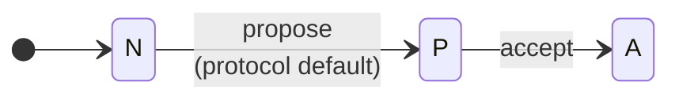
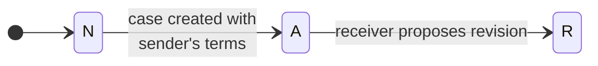
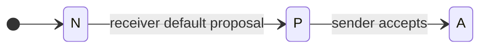
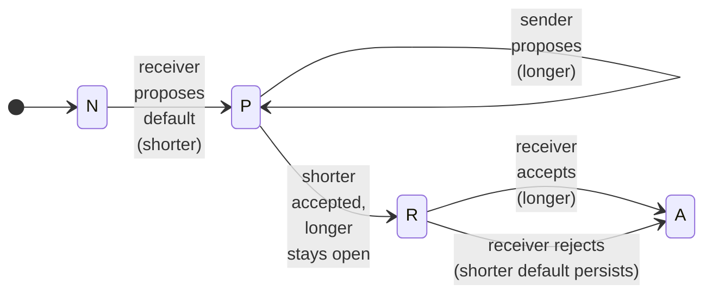
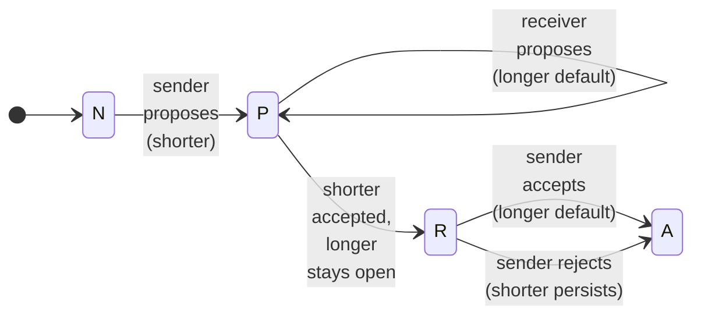

# Default Embargoes



Embargo negotiation can repeat without end.
One side proposes, the other side rejects, and the case stays with no embargo at all.
Defaults exist to stop this result.
Defaults make sure that *some* embargo is in force from the moment a case exists.
The parties are then free to negotiate a better embargo.

## Declaring Defaults

Any CVD Participant, Reporters included, can publish a default embargo period in their vulnerability disclosure policy.
The protocol encourages report recipients, usually Vendors and Coordinators, to publish one.

!!! note ""

    Participants MAY include a default embargo period as part of a published Vulnerability Disclosure Policy.

!!! note ""

    Report Recipients SHOULD post a default embargo period as part of their Vulnerability Disclosure Policy to set expectations with potential Reporters.

## Embargoes Are Active at Case Creation

The scenarios below describe embargo agreement as an exchange between two parties.
In the most common situation, however, no exchange is visible at all.
A case is created, and it *already* has an active embargo.
This section explains why.

Embargo Management (EM) begins when the case is created.
There is no embargo phase before a case exists ([ADR-0096: A Protocol Default Embargo Replaces the Pre-Case Phase](../../../adr/0096-protocol-default-embargo.md)).
A Reporter who wants particular terms attaches a proposed embargo to the report they submit.
Those terms, and the Recipient's published default, are weighed together when the Recipient creates the case.

When a Report Recipient has published a default embargo period (see [Declaring Defaults](#declaring-defaults)), that default acts as a **standing proposal**.
A Reporter who submits a report without proposing different terms has **tacitly accepted** the standing proposal, by not objecting.
So by the time the case is created, both parties have already stated their positions.
The Recipient did so by publishing the policy, and the Reporter did so by not contradicting it.

Because the agreement is already in place, nothing remains to negotiate.
The embargo is *Active* from the moment the case is created.

!!! note ""

    When a case is created and a published default embargo applies with no contrary proposal, the embargo SHALL begin in the *Active* state.

The same is true when *nobody* has published anything.
In that situation, a short [protocol default](#no-defaults-no-proposals-the-protocol-default) applies instead.
So an embargo-eligible case always begins with an *Active* embargo, whatever the parties have or have not declared.
The EM process exists to avoid one outcome: a case with no embargo because of mutual silence.

### Why *Active* and Not *Proposed*?

The *Proposed* state represents an embargo that a party has offered but the parties have not yet agreed.
It is an open question that waits for a decision.
On the default path there is no open question.
The published default supplies the *propose* action and the Reporter's silence supplies the *accept* action.
The protocol applies the two actions together when the case is created, so the case never stays in *Proposed*, and nobody ever sees it there.

If a newly created case stayed in *Proposed*, it would wrongly show a settled agreement as an unresolved one.
It would also imply that some party still owes a response.
For this reason, a protocol trace of the happy path shows an *Active* embargo with no preceding *propose* or *accept* message between the parties.
The absence of that exchange is intentional and correct.
It is not a skipped step.

### The Case Owner Is a Signatory from the Start

The party who creates the case is its Case Owner.
The Case Owner creates the active embargo, so it would be incoherent to treat the Case Owner as not yet bound by that embargo.
[Participant Embargo Consent (PEC)](../../behavior_logic/use-cases/embargo-lifecycle.md#which-messages-move-consent) tracks the agreement of each Participant to the embargo, separately from the embargo state of the case.
PEC keeps one consent row per Participant for each embargo.
The row of the Case Owner for the default embargo is seeded `AGREED`.
The row of a Reporter whose submission accepted the terms is also seeded `AGREED`.
Neither party receives an invitation.
Each of these parties is therefore a signatory.
Signatory is not a state of its own, but a read of the row of that party for the embargo in force.
[Embargo Lifecycle](../../behavior_logic/use-cases/embargo-lifecycle.md) explains how the two scopes fit together.
[§9.2 Transitions and Guards in the Vultron Protocol Specification](../../../reference/vultron-spec/tracking-models.md#92-transitions-and-guards) specifies consent without an invitation.

### When a Counter-Proposal Is Present

The default path applies only when the Reporter proposes nothing to the contrary.
If the Reporter proposes different terms, the case follows the negotiated path instead.
See [Sender Proposes an Embargo Longer than the Receiver Default](#sender-proposes-an-embargo-longer-than-the-receiver-default) and [Sender Proposes an Embargo Shorter than the Receiver Default](#sender-proposes-an-embargo-shorter-than-the-receiver-default) below.
Even then, the shorter proposal is taken as accepted and the longer one as a proposed revision.
The case therefore still gets an embargo in force at once, and does not stall in negotiation.

### A Default Embargo Ends Like Any Other

A default embargo is an ordinary embargo once it is in force.
When its end time passes, the Case Manager ends it with the reason `END_TIME_REACHED` the next time it handles the case (EMB-13-003).
In the same step, the Case Manager cancels any revision that is still open (EMB-13-003).
The termination writes no Participant's consent.
With no embargo in force, nobody is bound by an embargo.
The consent rows of each Participant stay as they were.
[When the End Time Passes](early_termination.md#when-the-end-time-passes) describes the termination.
[Recording Why an Embargo Ended](early_termination.md#recording-why-an-embargo-ended) describes the reason it records.

## Using Defaults

The scenarios below show how published defaults interact with proposed terms.
They go from the simplest scenario to the most complex.
Each scenario describes two parties: a Sender who submits a report, and a Receiver who creates the case from that report.
[Adding Participants to an Embargoed Case](working_with_others.md) covers bringing further parties into an existing embargo.

Each scenario starts when the Receiver creates the case.
At that point, the positions of both parties are already known.
These positions are the published default of the Receiver, if any, and any terms that the Sender attached to the report.
The diagrams show the EM path up to the first *Active* state and any revision that follows it.
Where a default applies, the steps up to *Active* happen together when the case is created.

Each scenario also gives the path in the EM shorthand that the [EM formal model](formal_model.md#em-states) defines.
In this shorthand, N, P, A and R stand for *None*, *Proposed*, *Active* and *Revise*.
A subscript on a transition names the Participant whose proposal the transition acts on.
It does not name the Participant who acts.
For example, $a_{sender}$ is acceptance of the Sender's proposal, even when the Receiver is the one who accepts.

### No Defaults, No Proposals — the Protocol Default

The simplest case is one in which neither party has a default and nobody proposes an embargo.
Even in this case, an embargo is established.
Its short duration comes from the protocol itself.



As on the other default paths, the protocol applies the two transitions together at case creation.
*Proposed* is never observable (see [Why *Active* and Not *Proposed*?](#why-active-and-not-proposed) above).
The only difference is where the duration comes from: the protocol, rather than either party.

The protocol default lasts between 72 hours and 5 days.
Each deployment configures the exact value.
[§7.2 Transitions and Guards in the Vultron Protocol Specification](../../../reference/vultron-spec/tracking-models.md#72-transitions-and-guards) states these rules normatively.

The protocol default is deliberately short.
Its purpose is not to provide a comfortable embargo.
Its purpose is to reward publishing a default embargo period.
A Participant who publishes nothing gets a few days.
A Participant who publishes a considered period gets the period they asked for.
A generous fallback would remove the reason to publish at all.

!!! warning "The Protocol Default Is Not a Proposal"

    The protocol default does **not** take part in the *shortest proposal wins* comparison described below.
    It is the value applied when there are no candidates, never a candidate itself.

    This distinction is load-bearing.
    Suppose that a 3-day protocol default competed under shortest-wins.
    It would win against every longer proposal and cap every embargo in the system at 3 days.
    No longer embargo could ever be agreed.

    Two different things are called a *default*, and they behave differently:

    | Term | What it is | Competes under shortest-wins? |
    |---|---|---|
    | **Actor default** | A duration from the `EmbargoPolicy` on the Case Owner's actor profile — a *standing proposal* | **Yes** |
    | **Protocol default** | The fallback when no proposal and no actor default applies | **No** |

    The actor default belongs to the Case Owner, which is the Receiver that received the report, and to no one else.
    A policy that the Case Manager or any other actor published is never a candidate.
    The policy is a field of the Case Owner's profile.
    The Case Owner sends that profile inline as the `actor` of the case proposal.
    The Case Manager therefore reads the default from that profile alone and keeps it for no other case (CP-01-010).

Nor is the protocol default a *minimum*.
A Participant who proposes terms shorter than the protocol default gets the terms they proposed.
The range above limits the value of the fallback, not what the parties may agree.

One exception applies.
An embargo on a vulnerability that is already public protects nothing, so no protocol default embargo is created for a case that is no longer embargo-eligible.
Where the vulnerability is already public, exploit code is public, or attacks have been observed, the case stays at *None*.

### Sender Proposes When Receiver Has No Default Embargo

Here the Sender attaches proposed terms to the report, and the Receiver has published no default embargo.
The Sender's terms are the only terms proposed, so these terms become the *Active* embargo when the case is created.
As on the default path, the protocol applies the *propose* and *accept* steps together.
The case never stays in *Proposed* ([EP-04-002](#why-active-and-not-proposed)).
A Receiver that wants different terms proposes a revision.
It does not leave the case without an embargo.



!!! note ""

    ???+ note inline end "Formalism"

        $$q^{em} \in N \xrightarrow{p_{sender}} P \xrightarrow{a_{receiver}} A$$

    If the Sender proposes an embargo and the Receiver has no default embargo specified by policy, the Sender's proposed terms SHALL become the *Active* embargo at case creation.

!!! note ""

    ???+ note inline end "Formalism"

        $$q^{em} \in A \xrightarrow{p_{receiver}} R$$

    The Receiver MAY then propose a revision.

### Receiver Has Default Embargo, Sender Implies Acceptance

Here the Receiver has published a default embargo and the Sender proposes nothing.



!!! note ""

    ???+ note inline end "Formalism"

        $$q^{em} \in N \xrightarrow{p_{receiver}} P$$

    A Receiver's default embargo specified in its vulnerability disclosure policy SHALL be treated as an initial embargo proposal.

!!! note ""

    ???+ note inline end "Formalism"

        $$q^{em} \in N \xrightarrow{p_{receiver}} P \xrightarrow{a_{receiver}} A$$

    If the Receiver has declared a default embargo in its vulnerability disclosure policy and the Sender proposes nothing to the contrary, the Receiver's default embargo SHALL be considered as an accepted proposal.

### Sender Proposes an Embargo Longer than the Receiver Default

Here the Sender proposes an embargo longer than the Receiver's default.



!!! note ""

    If the Sender proposes an embargo *longer* than the Receiver's default embargo, the Receiver's default SHALL be taken as accepted and the Sender's proposal taken as a proposed revision.
    The longer proposal stays open when the shorter one is accepted.
    The longer proposal therefore becomes the revision, and the case moves directly to *Revise*.

    ???+ note "Formalism"

        $$q^{em} \in N \xrightarrow{p_{receiver}} P \xrightarrow{p_{sender}} P \xrightarrow{a_{receiver}} R$$

!!! note ""

    ???+ note inline end "Formalism"

        $$q^{em} \in \begin{cases}
            R \xrightarrow{a_{sender}} A \\
            R \xrightarrow{r_{sender}} A
            \end{cases}$$

    The Receiver MAY then *accept* or *reject* the proposed extension.

### Sender Proposes an Embargo Shorter than the Receiver Default

A common scenario is one in which the Sender proposes an embargo shorter than the Receiver's default.



!!! note ""

    If the Sender proposes an embargo *shorter* than the Receiver's default embargo, the Sender's proposal SHALL be taken as accepted and the Receiver's default taken as a proposed revision.
    As in the longer case, the default stays open when the shorter proposal is accepted, so the case moves directly to *Revise*.

    ???+ note "Formalism"

        $$q^{em} \in N \xrightarrow{p_{sender}} P \xrightarrow{p_{receiver}} P \xrightarrow{a_{receiver}} R$$

!!! note ""

    ???+ note inline end "Formalism"

        $$q^{em} \in \begin{cases}
            R \xrightarrow{a_{receiver}} A \\
            R \xrightarrow{r_{receiver}} A
            \end{cases}$$

    The Sender MAY then *accept* or *reject* the proposed extension.

## Rationale for Accepting the Shortest Proposed Embargo

A Participant has two reasons to accept the shorter of two proposed embargoes, and then to propose a revision that makes it longer.

**Refusing a short embargo usually means getting none.**
A Reporter does not have to give the report to the Receiver at all.
The Reporter holds the information until they do.
[Negotiating Embargoes](negotiating.md) describes this asymmetry.
If the Receiver rejects a proposal as too short, the Reporter may leave the negotiation and publish when they choose.
[Negotiating Embargoes](negotiating.md) recommends that Reporters not do that, but a Receiver cannot depend on it.
When no fix is available, *any* embargo is better than *no* embargo, so the Receiver does better if it accepts the short embargo and works to extend it.

**The shorter embargo is exactly what both parties already agree on.**
Think of an embargo as a series of one-day agreements.
Two parties who want 30 and 90 days both agree to keep days 1 through 30 quiet, and disagree only about days 31 through 90.
The longest embargo both will accept is therefore the shorter of the two.
The [EM formal model](formal_model.md#why-the-shortest-proposal-wins) states this argument formally.

!!! example "The Shortest Proposed Embargo Wins"

    If a Reporter proposes a 90-day embargo but the Vendor prefers 30 days, both parties agree to the first 30 days and disagree beyond that.
    By accepting the shorter 30-day embargo, the Reporter now has 30 days to continue negotiating an extension with the Vendor.
    Even if those negotiations fail, both parties get at least the 30 days they agreed on in the first place.
    That result is better for both parties than no embargo at all.
    A rejection of the shorter proposal would risk that outcome.

    ```mermaid
    ---
    title: Embargo Agreement in a Nutshell
    ---
    stateDiagram-v2
        direction LR
        dots: ...
        state Agreement {
            direction LR
            [*] --> 1
            1 --> 2
            2 --> dots
            dots --> 30
            negotiate: negotiate extension
            [*] --> negotiate
            negotiate --> 30
        }
        30 --> 31
        state Disagreement {
            dots2: ...
            31 --> dots2
            dots2 --> 90
        }
    ```

    Typically it is the Reporter who wants a shorter embargo than the Vendor.
    The example reverses the roles.
    It shows that the reasoning holds for either party that wants the shorter embargo.

## Resolving Proposals and Revisions

The same reasoning extends to several proposals at once.

!!! note ""

    When two or more embargo proposals are open (that is, none have yet been accepted) and $q^{em} \in P$, Participants SHOULD accept the shortest one and propose the remainder as revisions.

!!! note ""

    When two or more embargo revisions are open (that is, an embargo is active yet none of the proposals have been decided) and $q^{em} \in R$, Participants SHOULD *accept* or *reject* them individually, in earliest to latest expiration order.

Working through several open revisions in order looks like this:

1. Sort the proposals from earliest to latest end date.
2. Take the earliest as the current candidate.
3. Evaluate each later proposal in turn against the current candidate.
4. If a proposal is accepted, it becomes the current candidate.
   Evaluate the next proposal.
5. Stop at the first proposal that is rejected.
6. The current candidate, the latest accepted proposal, becomes the new *Active* embargo.
7. If even the earliest revision is rejected, the later ones would be rejected too.
   The existing *Active* embargo stays as it is.

Shortest-wins is a recommendation, not a requirement.
An implementation may instead leave the choice to the Case Owner or apply its own organizational policy.
See [§7.2 Transitions and Guards in the Vultron Protocol Specification](../../../reference/vultron-spec/tracking-models.md#72-transitions-and-guards).

## Doing It on the Wire

- [How to Establish an Embargo](../../../howto/activitypub/activities/establish_embargo.md) shows how an embargo is proposed, accepted and activated, including activating settled terms at once when a published policy already applies.
- [How to Revise or Terminate an Embargo](../../../howto/activitypub/activities/manage_embargo.md) shows how the longer proposal is offered as a revision and accepted or rejected.
