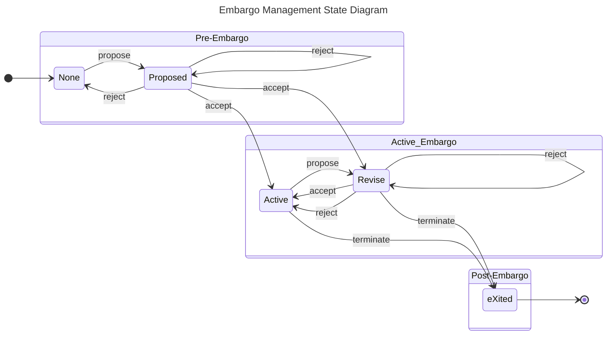

<!-- em-state-machine-start -->

<!-- em-state-machine-end -->

The diagram shows every move of the EM transition table.
A self-loop on reject or accept is the move made while another proposal is still open, and accept from Proposed reaches Revise when the other open proposals become revisions of the embargo now in force.
