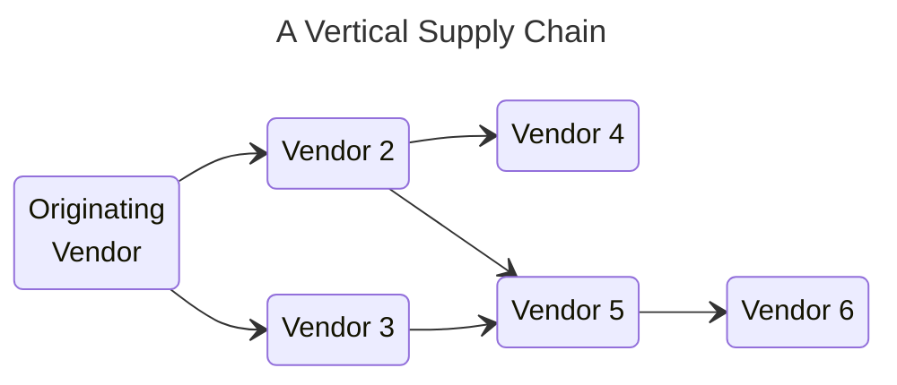

# Embargo Management Process Model



This section describes the Embargo Management (EM) process for Coordinated Vulnerability Disclosure (CVD).
<!-- start_excerpt -->
For our purposes, an embargo is an *informal* agreement among peer CVD case Participants.
The Participants agree not to publish information about a vulnerability until some future point in time relative to the report at hand.
After an embargo expires, no restriction on publishing information about the vulnerability remains.
<!-- end_excerpt -->

!!! tip inline end "Reminder"

    Exploits are information about vulnerabilities too.

CVD case Participants must be able to propose, accept, and reject embargo timing proposals according to their individual needs.
Participants may also want to agree that specific details about a vulnerability can be shared with other Participants or made public.
Such content considerations are outside the scope of this documentation.
We focus on the *when* of an embargo, not the *what*.



In the [Report Management (RM)](../rm/index.md) model, each Participant has their own RM state.
EM state is different: it is a property of the CVD case as a whole.

!!! note ""
    A CVD case SHALL NOT have more than one active embargo at a time.

Some multi-party CVD (MPCVD) cases have a [vertical supply chain](https://certcc.github.io/CERT-Guide-to-CVD/howto/coordination/mpcvd/){:target="_blank"}, as in the figure below.
In a vertical supply chain, Vendors must wait for their upstream suppliers to produce fixes before they can act.
Even then, the intent is that the embargo ends once as many Vendors as possible have had an adequate opportunity to produce a fix.



## EM states

An embargo moves through five states.
The state belongs to the case as a whole, not to any one Participant.

| State | What it means |
|---|---|
| *None* | No embargo is in force, and none has ever been agreed for this case. |
| *Proposed* | At least one embargo has been proposed and not yet accepted or rejected, and none is in force. |
| *Active* | An embargo is in force, and no change to it is open. |
| *Revise* | An embargo is in force, and at least one change to it has been proposed but not yet accepted or rejected. |
| *eXited* | The embargo has ended. |

The [EM formal model](formal_model.md#em-states) introduces the underlined-capital shorthand for these states (N, P, A, R, X).



### The embargo register

The EM state is not stored on its own.
A case keeps an **embargo register**, with one entry for every embargo ever proposed on it.
Each entry has a status: `PROPOSED`, `ACTIVE`, `REJECTED`, `SUPERSEDED`, `CANCELLED` or `TERMINATED`.
The EM state is computed from the register.

The case is *Proposed* while proposals are open and no embargo is in force.
The case is *Active* while one embargo is in force and no proposal is open.
The case is *Revise* while one embargo is in force and at least one proposal is open.
The case is *eXited* once the embargo in force is terminated.
[§7.1.1 The Embargo Register in the Vultron Protocol Specification](../../../reference/vultron-spec/tracking-models.md#711-the-embargo-register) gives the statuses, the rules every change to the register keeps, and the full derivation.

The register's statuses and the EM states share words, but not meanings.
Register status `ACTIVE` means that one embargo is in force.
EM *Active* means that the whole case has an embargo in force and no change to it is open.

!!! warning "Check which model a state name belongs to"

    An embargo can be *Active* while a report is [*Accepted*](../rm/index.md#the-accepted-a-state).
    The EM and RM states are independent.

## EM state transitions

Four actions move a case between EM states: *propose*, *accept*, *reject* and *terminate*.
Each action changes the register.
The change must move the EM state along one of the transitions drawn below.
A change that would not move the EM state this way is refused.



- Proposing an embargo when none exists moves the case to *Proposed*.
  A further proposal while one is outstanding is added beside it.
  Both proposals stay open.
- Accepting a proposal makes the embargo *Active*.
  Any other open proposals stay open as changes to it, so the case moves to *Revise* instead.
  Rejecting a proposal returns the case to *None* once no other proposal is open.
- Proposing a change to an active embargo moves the case to *Revise*.
  The existing embargo stays in force until a revision is accepted.
  Rejecting the revision returns the case to *Active*, with the old terms standing, not to *None*.
  The case stays at *Revise* while another revision is open.
- An active embargo MUST eventually *terminate*, whether or not a revision is open.
  Termination moves the case to *eXited* and closes every open revision.

The normative transitions table is [§7.2 Transitions and Guards in the Vultron Protocol Specification](../../../reference/vultron-spec/tracking-models.md#72-transitions-and-guards).

!!! note "EM begins when the case is created"

    There is no EM phase before a case exists.
    A Reporter proposes terms by attaching them to the report they submit.
    Those terms are evaluated once the case is created.
    If nobody proposes anything, an embargo-eligible case still starts under a short protocol-default embargo.
    See [Default Embargoes](defaults.md) and [ADR-0096: A Protocol Default Embargo Replaces the Pre-Case Phase](../../../adr/0096-protocol-default-embargo.md).

## The case embargo and each Participant's consent

The EM state says whether the *case* has an embargo.
Whether each *Participant* has agreed to its current terms is a separate question.
[Participant Embargo Consent (PEC)](../../behavior_logic/use-cases/embargo-lifecycle.md#which-messages-move-consent) tracks that question, with one consent row per Participant for each embargo in the register.

A Participant is bound when its row for the embargo in force says it agreed.
A case can be *Active* while some Participants are not bound.
A Participant who has been invited but not yet joined is not bound, and neither is a Participant who declined.

The two are linked at two points.
When the case owner activates revised terms that end later than the ones in force, every Participant who had agreed to the old terms and not to the new ones has lapsed.
Those Participants must agree again.

A revision that is only proposed changes nobody's consent.
An activated revision that ends no later than the terms in force carries every Participant who agreed to the old terms over to the new ones.

When the case enters *eXited*, no embargo is in force, so nobody is bound.
The termination writes no consent, and each Participant's rows stay as they were.

[Embargo Lifecycle](../../behavior_logic/use-cases/embargo-lifecycle.md) explains how the case and Participant scopes interact.
The normative PEC states and transitions are [§9 Participant Embargo Consent (PEC) State Machine in the Vultron Protocol Specification](../../../reference/vultron-spec/tracking-models.md#9-participant-embargo-consent-pec-state-machine-n).

## In this section

<!-- BEGIN GENERATED SECTION CONTENTS — do not edit; change the mkdocs.yml nav or a listed page's description: frontmatter, then run `uv run docs-site --write` -->

- [Embargo Principles](principles.md) — What an embargo is for, and the norms Participants follow while one is in force.
- [Default Embargoes](defaults.md) — How published defaults and the protocol default start an embargo without a negotiation.
- [Negotiating Embargoes](negotiating.md) — When an embargo can be proposed, accepted or rejected, and how long it can reasonably last.
- [Adding Participants](working_with_others.md) — Adding Participants to a case under embargo.
- [Early Termination](early_termination.md) — The events that end an embargo before its agreed time, how a termination records why it ended, and what happens when the end time passes.
- [Case Splits and Merges](split_merge.md) — What happens to embargoes when cases are split or merged.
- [EM Formal Model](formal_model.md) — The EM process as a formal state machine, with its grammar and every possible history.

<!-- END GENERATED SECTION CONTENTS -->

## Doing it on the wire

- [How to Establish an Embargo](../../../howto/activitypub/activities/establish_embargo.md) — propose, accept, reject and activate an embargo.
- [How to Revise or Terminate an Embargo](../../../howto/activitypub/activities/manage_embargo.md) — change the terms of an active embargo or end it.
