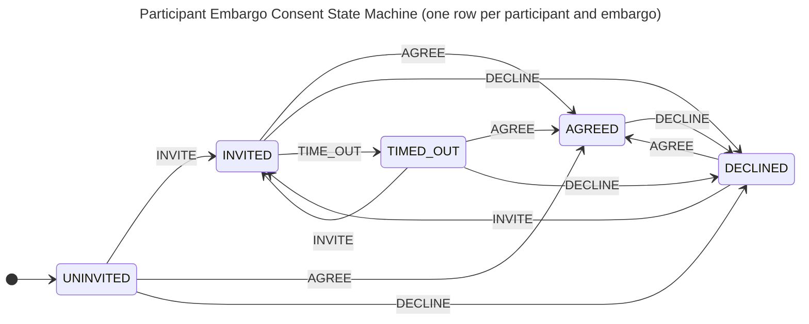

The diagram shows the five states of one consent row and the triggers `INVITE`, `AGREE`, `DECLINE` and `TIME_OUT` that move it.
`CARRY_OVER` also moves every state except `AGREED` to `AGREED`, when the case owner activates a revision that ends no later than the embargo it replaces; those edges are omitted for legibility.
No state is terminal: a row stops accepting triggers when its embargo's register entry reaches a final status.
