# Report Management Process Model



This page describes a high-level workflow for the Coordinated Vulnerability Disclosure (CVD) Report Management (RM) process.
<!-- start_excerpt -->
The RM process is similar to [IT Service Management](https://en.wikipedia.org/wiki/IT_service_management){:target="_blank"} (ITSM) workflows such as problem, change, incident or service request management.
In these workflows, an organization receives work items, validates them, prioritizes them, and then completes the work.
Incident reports, problem tickets and change requests are examples of such work items.
Any workflow of this type maps onto the RM process on this page.
<!-- end_excerpt -->

!!! tip "Vultron Does Not Dictate Internal Processes"

    Organizations have different internal processes.
    To keep interoperability among them possible, our protocol does not specify the subprocesses inside each state.
    [Do Work Behavior](../../behavior_logic/do_work_bt.md) gives examples of such subprocesses.

    [ISO/IEC 30111:2019(E)](https://www.iso.org/standard/69725.html) gives recommendations for the *internal* processes of Vendors.
    These recommendations can be mapped into the RM process.
    Our [Standards Crosswalks](../../../reference/iso_crosswalks/index.md) give such a mapping.

## RM State Machine

The RM process is a state machine with seven states and twelve transitions between them.
This page covers the states first and then the transitions.
Each Participant in a case has its own RM state, which only that Participant changes.

Three other pages cover the rest of the RM model:

- [RM Interactions Between CVD Participants](rm_interactions.md) shows how the RM actions of one Participant move the RM state of another Participant, with common coordination scenarios.
- [RM Formal Model](formal_model.md) defines the RM process as a [deterministic finite automaton (DFA)](../../../reference/formal_protocol/index.md).
  A DFA is a state machine with a fixed set of states and exactly one next state for each state and action.
  The page also gives the grammar, the shortest possible histories, and the named state subsets that other pages use.
- The [Vultron Protocol Specification §6 Report Management (RM) State Machine](../../../reference/vultron-spec/tracking-models.md#6-report-management-rm-state-machine-n), is the normative source for the [RM states](../../../reference/vultron-spec/tracking-models.md#61-states) and [transitions](../../../reference/vultron-spec/tracking-models.md#62-transitions-and-guards).

### RM States

The RM model describes a report lifecycle of seven states: *Start*, *Received*, *Invalid*, *Valid*, *Accepted*, *Deferred*, and *Closed*.
The diagram below shows all seven states and the transitions between them.
The table with it gives each state's shorthand, the capital letter in its name, which this and other pages use.



| Shorthand | State |
|---|---|
| *S* | *Start* |
| *R* | *Received* |
| *I* | *Invalid* |
| *V* | *Valid* |
| *A* | *Accepted* |
| *D* | *Deferred* |
| *C* | *Closed* |

!!! info "RM States vs. CVD Case States"

    RM states are not the same as CVD case states.
    Case states follow the Householder-Spring model summarized in [Case State Model](../cs/index.md).
    [Model Interactions](../model_interactions/index.md) discusses how the RM and Case State (CS) models interact.

#### The *Start* (*S*) State

The *Start* state is a placeholder for reports that a Participant has not yet received.
It is a null state, and a CVD Participant does not show it in their report tracking system.
The model includes it because it helps to model coordination among many Participants in the [formal protocol](../../../reference/formal_protocol/index.md).
The rest of this page mostly ignores it.

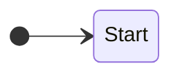

#### The *Received* (*R*) State

Reports first arrive in the *Received* state.

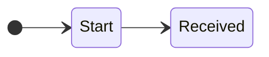

A Vendor that cannot receive reports cannot take part in the CVD process.
Therefore,

!!! note ""

    Vendors SHOULD have a clearly defined and publicly available mechanism for receiving reports.

A Coordinator also needs a capability to receive reports.
Without it, the Coordinator cannot coordinate vulnerability disclosures.
Hence,

!!! note ""

    Coordinators MUST have a clearly defined and publicly available mechanism for receiving reports.

A report moves from *Received* to *Valid* or *Invalid* only after a Participant assesses its validity.
A Participant can instead close the report from *Received* without assessing it (see below).
Validation is different from prioritization, as the description of the [*Valid*](#the-valid-v-state) state shows.
The *Received* state corresponds to the [Validation phase](https://certcc.github.io/CERT-Guide-to-CVD/topics/phases/validation){:target="_blank"} of the [*CERT Guide to Coordinated Vulnerability Disclosure*](https://certcc.github.io/CERT-Guide-to-CVD){:target="_blank"}.

!!! note ""

    Participants SHOULD subject each _Received_ report to some sort of validation process, resulting in the report being designated as _valid_ or _invalid_ based on the Participant's particular criteria.

Validity criteria are not limited to technical analysis.
For example, a Coordinator might accept only reports in its scope of concern.
That Coordinator can mark a report outside its scope as *Invalid*, even if the report correctly describes a real vulnerability.
As another example, a Vendor might have a policy that marks a report as *Invalid* by default if the report has no working proof-of-concept exploit.

A Participant can also close a report directly from *Received*, without validating it first.
This is how a Participant declines a report, or an invitation to a case.
A `Reject` sent from *Received* is the *close* transition.

!!! note ""

    Participants SHOULD have a clearly defined process for validating reports in the _Received_ state.

!!! note ""

    Participants SHOULD have a clearly defined process for transitioning reports from the _Received_ state to the _Valid_ or _Invalid_ states.

!!! note ""

    Participants MAY perform a more technical report validation process before exiting the _Received_ state.

!!! note ""

    Regardless of the technical rigor applied in the validation process, Participants SHOULD proceed only after validating the reports they receive.

!!! note ""

    Participants SHOULD transition all valid reports to the _Valid_ state and all invalid reports to the _Invalid_ state.

!!! note ""

    Regardless of the content or quality of the initial report, once a Vendor confirms that a reported vulnerability affects one or more of their product(s) or service(s), the Vendor SHOULD designate the report as _Valid_.

!!! info "The case exists from the *Received* state"

    Reaching *Received* is when a case begins.
    The receiver stores the report and proposes a case to the [CASE_MANAGER](../../case_lifecycle/case_manager_and_ledger.md).
    The CASE_MANAGER creates the case and its participant records, with the receiver as case owner in RM *Received* ([ADR-0041: CASE_MANAGER-Authoritative Case Initialization](../../../adr/0041-caseactor-authoritative-case-initialization.md)).
    Validation happens later and never creates a case.
    The [Validate Report use case](../../behavior_logic/use-cases/validate-report.md) explains the split.

#### The *Invalid* (*I*) State

The recipient has examined reports in the *Invalid* state and found them lacking.
This state gives the Reporter time to provide more information.
It also gives the receiver time to do the validation again before it moves the report to *Closed*.

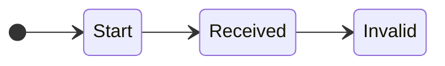

The reasons to put a report in this state are different for each recipient.
They depend on the validation criteria, the technical capability and the available resources of the recipient.
The *Invalid* state is a temporary holding place.
While a report is in it, the recipient can look for more evidence that shows the conclusion is wrong.

!!! note ""

    Participants SHOULD temporarily hold reports that they cannot validate pending additional information.

!!! note ""

    Participants SHOULD provide Reporters an opportunity to update their report with additional information in support of its validity before closing the report entirely.

!!! note ""

    Participants MAY set a timer to move reports from _Invalid_ to _Closed_ after a set period of inactivity.

#### The *Valid* (*V*) State

Reports in the *Valid* state are ready for prioritization for possible future work.
Prioritization either accepts the report for follow-up or defers more effort.
The *Valid* state is equivalent to the [Prioritization (Triage)](https://certcc.github.io/CERT-Guide-to-CVD/topics/phases/prioritization){:target="_blank"} phase of the [*CERT Guide to Coordinated Vulnerability Disclosure*](https://certcc.github.io/CERT-Guide-to-CVD){:target="_blank"}.
For example, a Vendor might later *defer* more response on a *Valid* report because of other priorities.

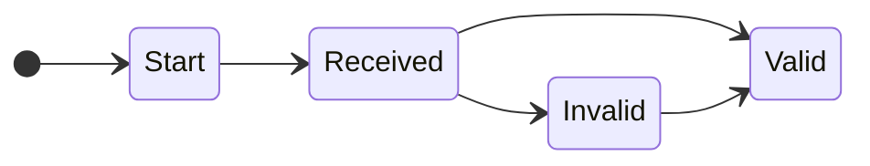

!!! note ""

    For _Valid_ reports, the Participant SHOULD perform a prioritization evaluation to decide whether to _accept_ or _defer_ the report for further work.

!!! note ""

    Participants MAY choose to perform a shallow technical analysis on _Valid_ reports to prioritize any further effort relative to other work.

!!! note ""

    Participants SHOULD have a bias toward accepting rather than deferring _Valid_ cases up to their work capacity limits.

Thus, prioritization is necessary only when the workload of active valid reports is more than the organization can process.

Participants often use prioritization schemes, such as [SSVC](https://github.com/CERTCC/SSVC){:target="_blank"} or the [CVSS](https://first.org/cvss){:target="_blank"}, to prioritize work in the CVD process.
The specific details are left to each Participant implementation.
This page uses the SSVC model as an example.
Any other prioritization scheme can replace it, if its result maps onto the meaning of "continue work" or "defer further action".
[SSVC Crosswalk](../../../reference/ssvc_crosswalk.md) shows in more detail how SSVC fits into the protocol.

#### The *Accepted* (*A*) State

Most of the work of a CVD Participant occurs in the *Accepted* state.
A report reaches this state for a Participant only when the Participant decides that the report is valid and has sufficient priority for more action.
The *Accepted* state has a different meaning for each Participant.

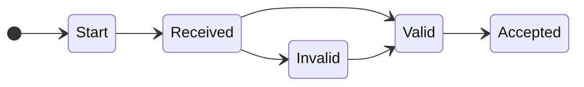

- Finders and Reporters enter the *Accepted* state only for reports that they intend to put through the CVD process.
    If they do not intend to do CVD, they do not need this protocol to track their actions.
    See [the secret lives of finders](rm_interactions.md#the-secret-lives-of-finders) for more.

- Vendors usually do root cause analysis, understand the problem, and produce a fix or mitigation.

- Coordinators typically identify potentially affected Vendors, notify them, and possibly negotiate embargoes.

[Do Work Behavior](../../behavior_logic/do_work_bt.md) gives more examples of the activities that can occur in the *Accepted* state.

!!! note ""

    A report MAY enter and exit the _Accepted_ state a number of times in its lifespan as a Participant resumes or pauses work (i.e., transitions to/from the _Deferred_ state).

#### The *Deferred* (*D*) State

The *Deferred* state is for valid reports that are not closed and that no one actively works on.
Reports that someone actively works on are in *Accepted*.
The *Deferred* state is similar to the *Invalid* state, which holds reports that fail the validation criteria.
In both states, a report waits for closure until the Participant decides that no more action is necessary.

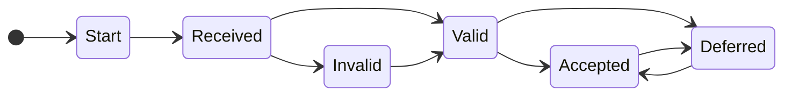

For example, a Participant can use the *Deferred* state when a valid report fails to meet their [prioritization criteria](#prioritize-report).
A Participant can also use it when a task with a higher priority takes precedence over an active case.

!!! note ""

    A report MAY enter and exit the _Deferred_ state a number of times in its lifespan as a Participant pauses or resumes work (i.e., transitions from/to the _Accepted_ state).

!!! note ""

    Reports SHOULD exit the _Deferred_ state when work is resumed (to _Accepted_), or when the Participant has determined that no further action will be taken (to _Closed_).

!!! note ""

    CVD Participants MAY set a policy timer on reports in the _Deferred_ state to ensure they are moved to _Closed_ after a set period of inactivity.

#### The *Closed* (*C*) State

The *Closed* state means that no more work remains.
Therefore, a Participant does any review before closure, such as a quality assurance review, while the report is still in *Received*, *Invalid*, *Deferred*, or *Accepted*.

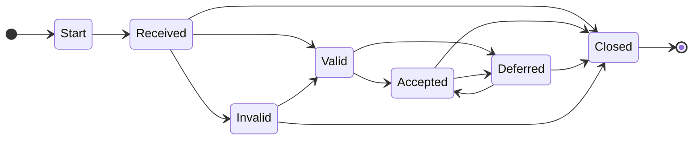

!!! note ""

    Reports SHOULD be moved to the _Closed_ state once a Participant has completed all outstanding work tasks and is fairly sure that they will not be pursuing any further action on it.
    For example

    - reports or cases that have been in _Invalid_ or _Deferred_ for some length of time,
    - cases in _Accepted_ where all necessary tasks are complete.

The RM process starts in *Start* and ends in *Closed*.

### RM State Transitions

The RM process of a Participant begins when the Participant receives a report.
Six actions move a report between states: *receive*, *validate*, *invalidate*, *accept*, *defer*, and *close*.

#### RM Transitions Defined

This section defines the allowed transitions between states in the RM process model.
The following diagram shows the RM process with its states and transitions.
Each state transition is an opportunity to tell the other Participants about the case's status.
That is what turns the RM model into a technical protocol: every state transition implies a different message type.



!!! note ""

    CVD Participants SHOULD announce their RM state transitions to the other Participants in a case.

##### Receive Report

First, a Participant must receive a report.
The *Start* state is a placeholder.
Thus, this action puts the receiving Participant into the *Received* state at the start of their involvement in the case.

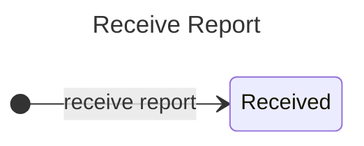

##### Validate Report

To move a report from *Received* to *Valid* or *Invalid*, the Participant must validate it.
The only other exit from *Received* is *close*.

The validation result puts the report in either the *Valid* or the *Invalid* state.
*Invalid* reports often wait for more information from the reporter.
Other *Invalid* reports are not in the scope of the Participant.
Some Participants close *Invalid* reports immediately.
Others validate them again from time to time to see if they are now *Valid*.

Validation does not create a case, because the case already exists from the moment the Participant [received](#the-received-r-state) the report.

!!! note ""

    Participants MAY periodically revalidate _Invalid_ reports to determine if they have become _Valid_.

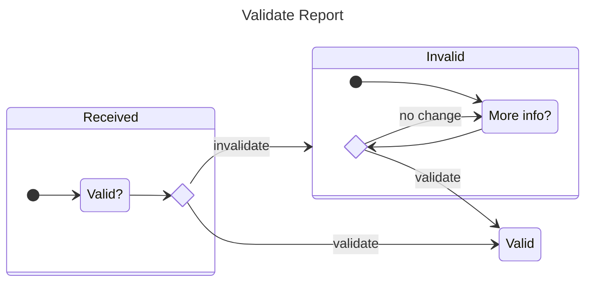

##### Prioritize Report

When a report is valid (in the RM *Valid* state), the Participant must prioritize it.
Prioritization decides what more effort, if any, is necessary.

!!! note ""

    Participants MUST prioritize _Valid_ cases.

Our [SSVC Crosswalk](../../../reference/ssvc_crosswalk.md) shows an example of how to apply the SSVC model here.
Any other prioritization scheme can replace SSVC.
Prioritization ends with the report in either the *Accepted* or *Deferred* state.

A Participant can examine their prioritization decision again and pause work on an *Accepted* report.
In that case, the Participant moves the report to the *Deferred* state.
Similarly, a Participant can resume work on a *Deferred* report and move it to the *Accepted* state.

!!! note ""

    Participants MAY re-prioritize _Accepted_ or _Deferred_ cases.

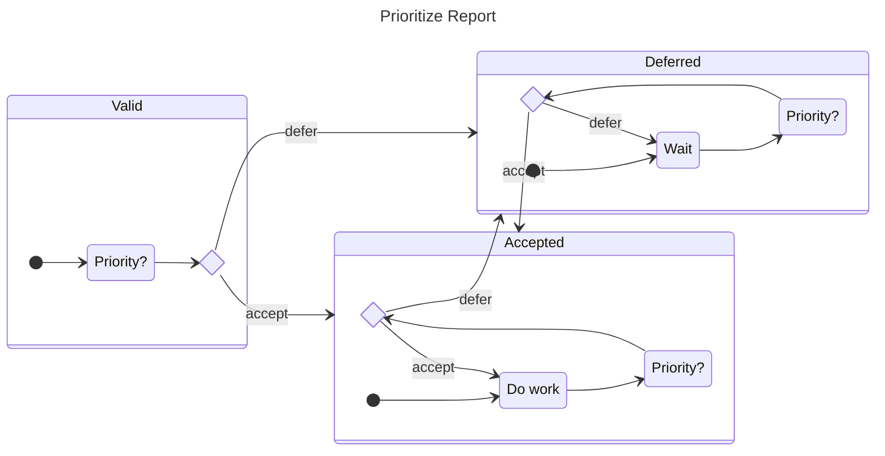

##### Participants Interact from the Accepted State

Some Participants, such as Finders and Coordinators, engage another Participant, such as a Vendor, to resolve a case.
To do this, the *sender* Participants must also be in the *Accepted* state.
A Participant that is not in *Accepted* has no reason to work on the case.

The following diagram shows the interaction between two instances of the RM model.
The left side is the *sender* and the right side is the *recipient*.
The state of the *sender* does not change, but the state of the *recipient* moves from *Start* to *Received*.

!!! note ""

    Participants initiating CVD with others MUST do so from the _Accepted_ state.

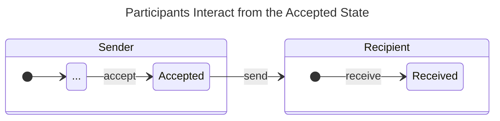

##### Case Closure

Finally, a Participant can close a report in three ways.
It can complete work on an *Accepted* report.
It can stop work on an *Invalid* or *Deferred* report.
It can also decline a *Received* report without validating it.

!!! note ""

    Participants MAY close _Accepted_ or _Deferred_ cases or _Invalid_ reports.

!!! note ""

    Participants MAY close a report from the _Received_ state; a `Reject` sent from _Received_ is that closure.

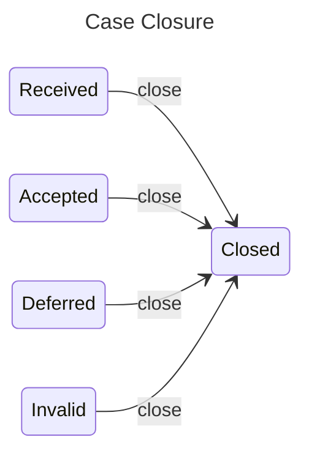

Our model does not let a Participant close a *Valid* report directly.
The report must first go through either *Accepted* or *Deferred*.
Why is *close* not a valid transition from the *Valid* state?
We want prioritization and closure to be different activities, because deferral is reversible and closure is not.

A Participant often *defers* a case first and then resumes work later, when more information arrives.
But a Participant can still have a process that goes from *Valid* to *Deferred* to *Closed* very quickly, or immediately.
A Participant at *Valid* that leaves a case does exactly that.
The protocol records its departure as *Valid* to *Deferred*, then *Deferred* to *Closed*.

!!! note ""

    Participants MUST NOT close cases or reports from the _Valid_ state.

## In this section

<!-- BEGIN GENERATED SECTION CONTENTS — do not edit; change the mkdocs.yml nav or a listed page's description: frontmatter, then run `uv run docs-site --write` -->

- [RM Participant Interactions](rm_interactions.md) — The RM model applied to common coordination scenarios, from a single Reporter and Vendor to multi-party cases.
- [RM Formal Model](formal_model.md) — The formal definition of the RM model, including the state subsets used on the Model Interactions pages.

<!-- END GENERATED SECTION CONTENTS -->

The [Embargo Management Process Model](../em/index.md) describes the process that runs alongside RM when a case is under embargo.
