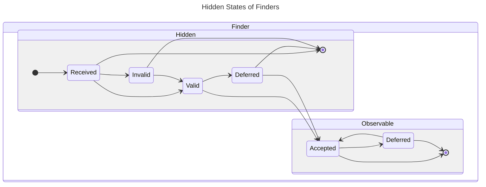
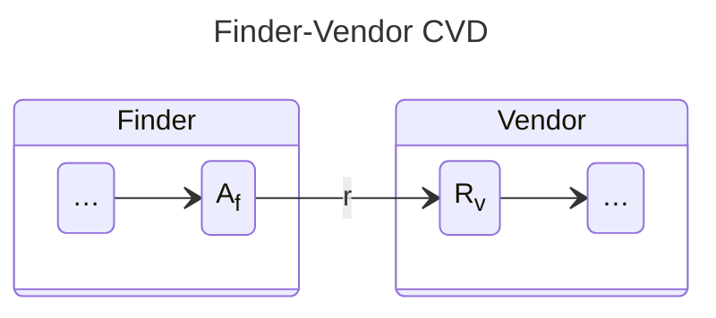
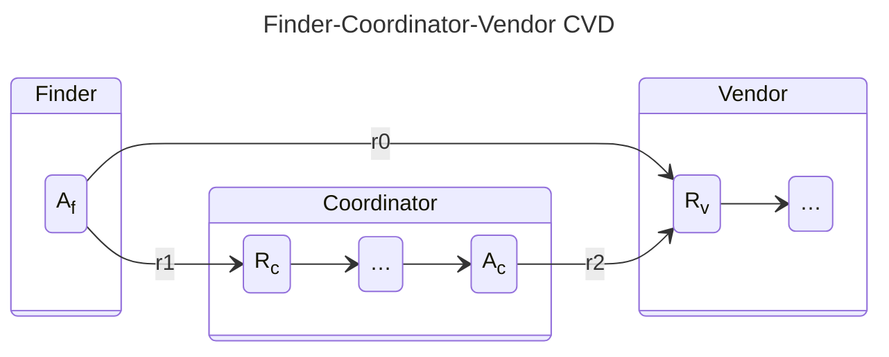
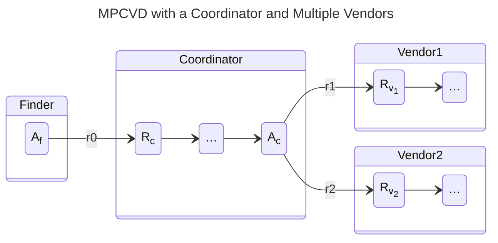
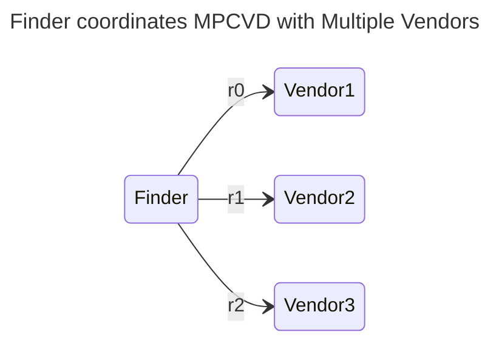
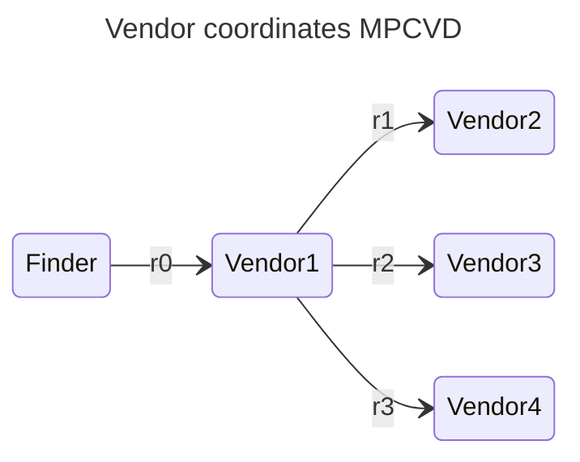
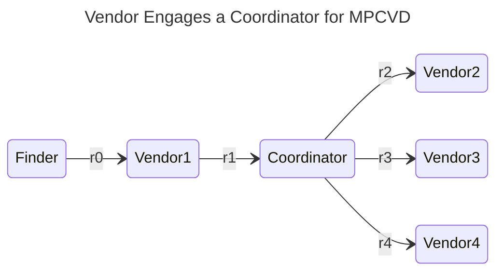
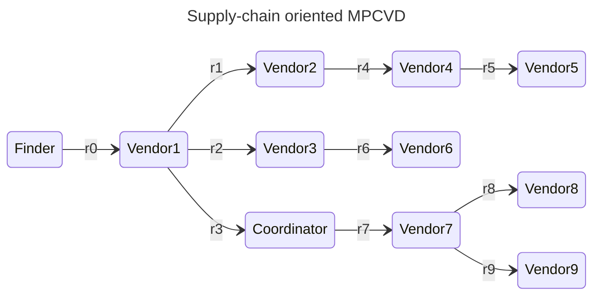

# Report Management Interactions Between CVD Participants

Each Participant in a Coordinated Vulnerability Disclosure (CVD) case has their own instance of the [Report Management (RM) state model](index.md).
Participants can change their local state independently of the state of other Participants.
An event in a CVD case can cause a state transition in one Participant and no transition in another.
For example, [participants interact from the accepted state](index.md#participants-interact-from-the-accepted-state) shows that the *sender* does the action, but the state of the *recipient* changes.
The table below lists role-based actions.

| Finder/Reporter  |      Vendor      |   Coordinator    | Action                                  |                                         RM Transition                                          |
|:----------------:|:----------------:|:----------------:|-----------------------------------------|:----------------------------------------------------------------------------------------------:|
| :material-check: |                  |                  | Discover Vulnerability (hidden)         |                           [Receive Report](index.md#receive-report)                            |
| :material-check: |                  |                  | Analyze Discovery (hidden)              |                          [Validate Report](index.md#validate-report)                           |
| :material-check: |                  |                  | Decide whether to initiate CVD (hidden) |                        [Prioritize Report](index.md#prioritize-report)                         |
| :material-check: | :material-check: | :material-check: | Notify Vendor                           | [Participants Interact from Accepted](index.md#participants-interact-from-the-accepted-state) |
| :material-check: | :material-check: | :material-check: | Notify Coordinator                      | [Participants Interact from Accepted](index.md#participants-interact-from-the-accepted-state) |
|                  | :material-check: | :material-check: | Receive Report                          |                           [Receive Report](index.md#receive-report)                            |
|                  | :material-check: | :material-check: | Validate Report                         |                          [Validate Report](index.md#validate-report)                           |
| :material-check: | :material-check: | :material-check: | Prioritize Report                       |                        [Prioritize Report](index.md#prioritize-report)                         |
| :material-check: | :material-check: | :material-check: | Pause Work                              |                        [Prioritize Report](index.md#prioritize-report)                         |
| :material-check: | :material-check: | :material-check: | Resume Work                             |                        [Prioritize Report](index.md#prioritize-report)                         |
| :material-check: | :material-check: | :material-check: | Close Report                            |                             [Case Closure](index.md#case-closure)                             |

A few examples of this model applied to common CVD and multi-party CVD case scenarios follow.

## The Secret Lives of Finders

The *Received*, *Valid*, and *Invalid* states of the Finder help in modeling and simulation, but they are less useful as part of a CVD protocol.
Other Participants can know about the vulnerability only after the Finder validates the report and decides that the report is worth the effort to coordinate its disclosure.
Without these two steps, CVD cannot happen at all.
Thus, CVD starts only *after* the Finder has reached the *Accepted* state for the vulnerability being reported.
That is also the point at which a *Finder* becomes a *Reporter*.

The model keeps these states for completeness.
The [starting states](../../../reference/formal_protocol/states.md#starting-states) of the formal protocol use this fact.
They assume that a Finder/Reporter enters a case already in *Accepted*.

The diagram below separates the hidden states of the Finder from the states that other Participants can observe.

## Finder-Vendor CVD

The diagram below shows a simple Finder-Vendor CVD scenario.
As explained [above](#the-secret-lives-of-finders), other Participants cannot see most states of the Finder until the Finder reaches the *Accepted* ($A_f$) state.
The *receive* action $A_f \xrightarrow{r} R_v$ connects the two Participants, and it is an instance of [participants interacting from the accepted state](index.md#participants-interact-from-the-accepted-state).
Each Participant then continues through their own copy of the [RM state machine](index.md#rm-states), shown here as "…".

## Finder-Coordinator-Vendor CVD

The next diagram shows a slightly more complex scenario.
In it, a Finder fails to engage a Vendor and then engages a Coordinator.
This scenario is very common in the experience of the CERT Coordination Center (CERT/CC).
That is no surprise, because as a Coordinator the CERT/CC does not take part in cases like the previous example.
This scenario has three notification actions, and each one is an instance of [participants interacting from the accepted state](index.md#participants-interact-from-the-accepted-state):

- First, $A_f \xrightarrow{r_0} R_v$ represents the Finder's initial attempt to reach the Vendor.
- Next, $A_f \xrightarrow{r_1} R_c$ is the Finder's subsequent attempt to engage with the Coordinator.
- Finally, the Coordinator contacts the Vendor in $A_c \xrightarrow{r_2} R_v$.

The diagram shows only the states each notification connects.

## MPCVD with a Coordinator and Multiple Vendors

The diagram below shows a small Multi-Party Coordinated Vulnerability Disclosure (MPCVD) scenario.
As in the other examples, each notification is an instance of [participants interacting from the accepted state](index.md#participants-interact-from-the-accepted-state).
Unlike the previous example, this scenario starts when the Finder contacts a Coordinator.
One possible reason is that the Finder knows that coordination of many Vendors is more complex.

- First, $A_f \xrightarrow{r_0} R_c$ represents the Finder's initial report to the Coordinator.
- Next, $A_c \xrightarrow{r_1} R_{v_1}$ shows the Coordinator contacting the first Vendor.
- Finally, the Coordinator contacts a second Vendor in $A_c \xrightarrow{r_2} R_{v_2}$.

The diagram shows only the states each notification connects.

## A Menagerie of MPCVD Scenarios

Other configurations of MPCVD RM interactions are possible, and the figures below show some of them.
In these figures, each node is the full RM model of one Participant.
Each edge is a notification from the *Accepted* state of one Participant to the *Received* state of another.
The CERT/CC has observed all of the following interactions.
The RM model is designed to be composable enough to include all such permutations.

### Finder coordinates MPCVD with Multiple Vendors

A Finder notifies multiple Vendors without engaging a Coordinator.

### Vendor coordinates MPCVD

A Finder notifies a Vendor, who, in turn, notifies other Vendors.

### Vendor Engages a Coordinator for MPCVD

A Finder notifies a Vendor, who, in turn, engages a Coordinator to reach other Vendors.

### Supply-chain oriented MPCVD

Supply-chain oriented MPCVD often has two or more tiers of Vendors.
The upstream Vendors notify the Vendors that use their components.
One or more Coordinators can also take part.

## Where to go next

Once a case exists, the RM process runs alongside the [Embargo Management (EM) process](../em/index.md).
[Interactions Between the RM and EM Models](../model_interactions/rm_em.md) describes the constraints each places on the other.
