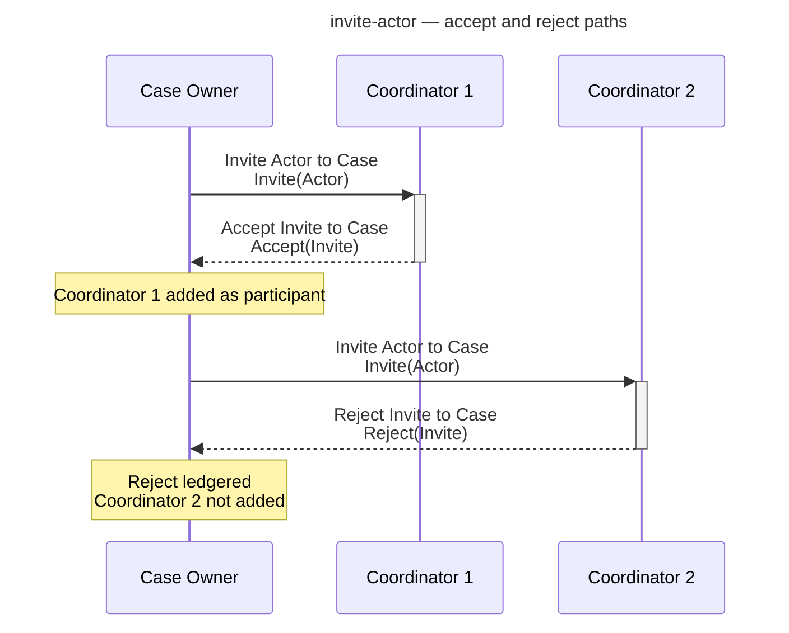
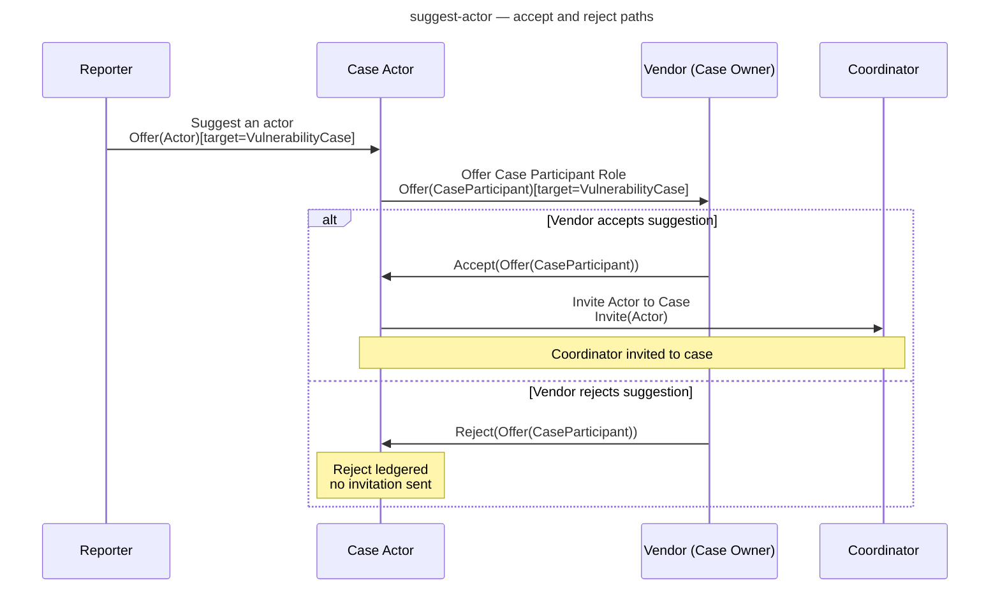
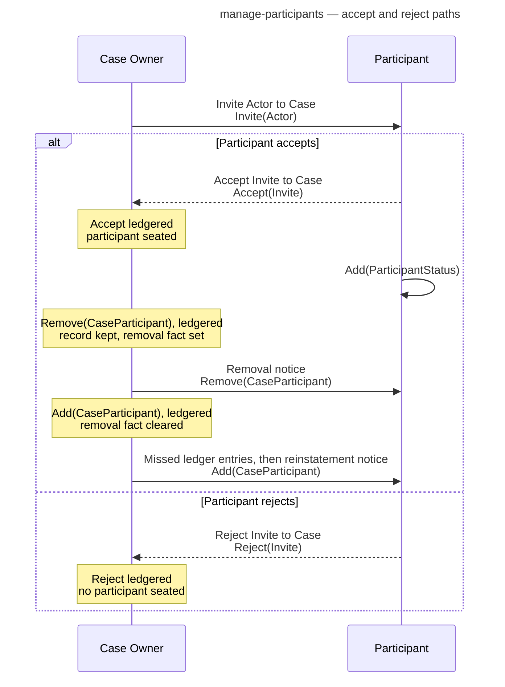
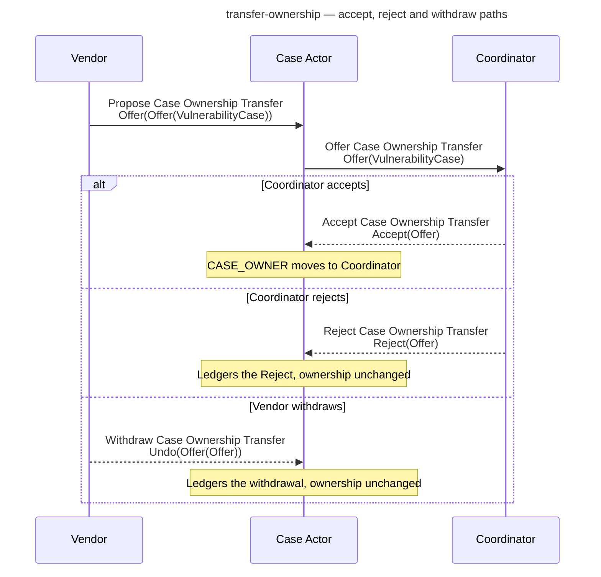
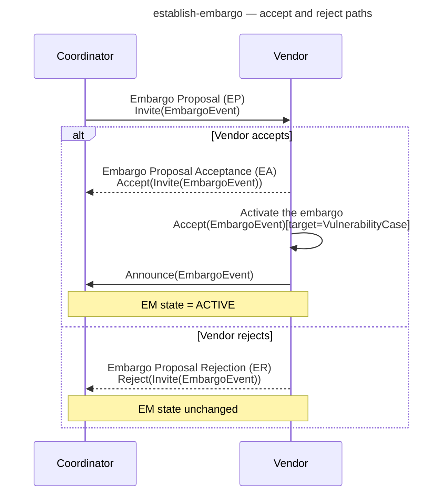
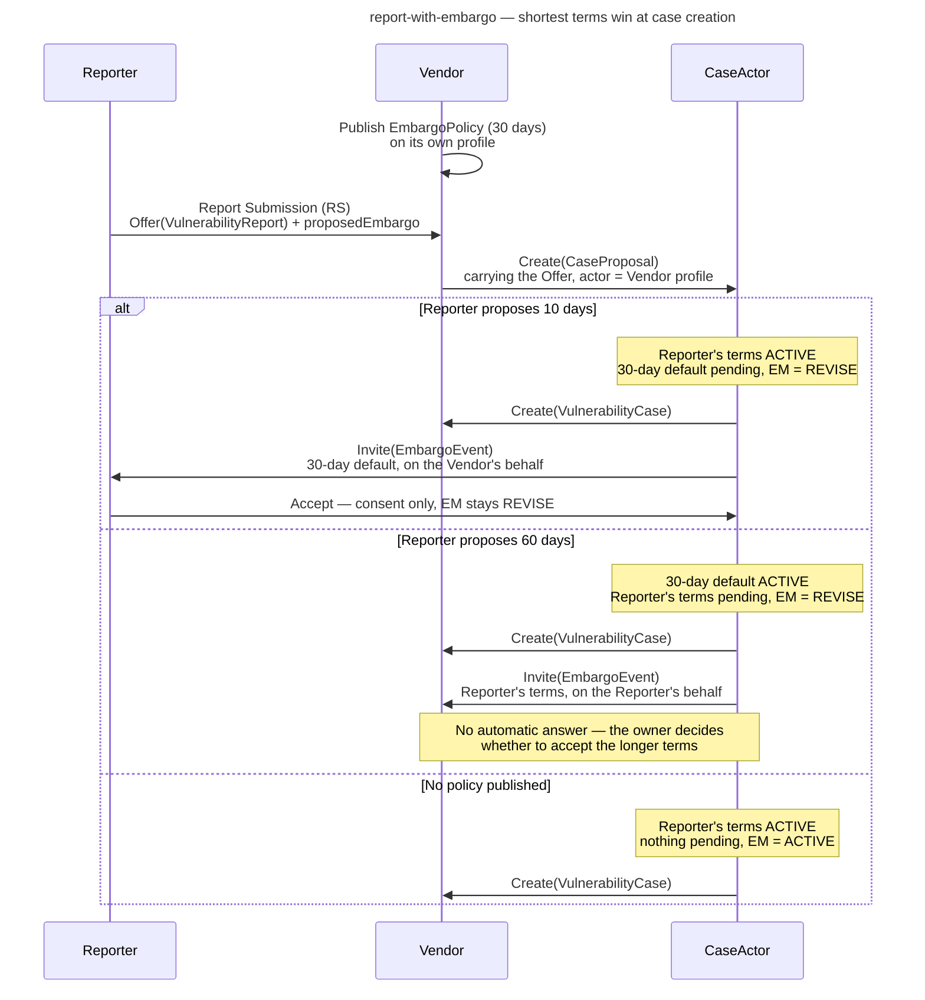
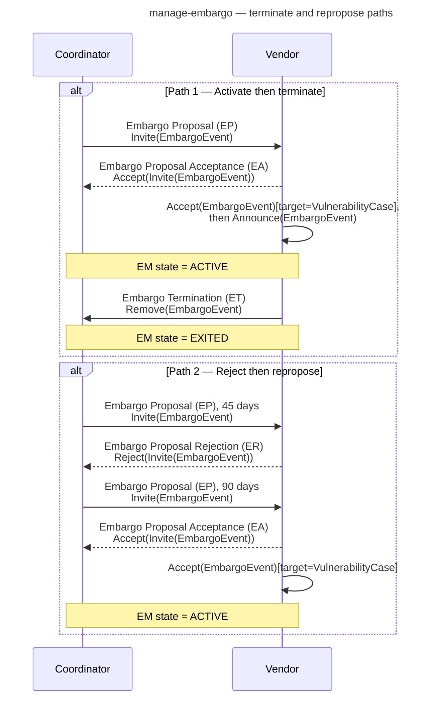
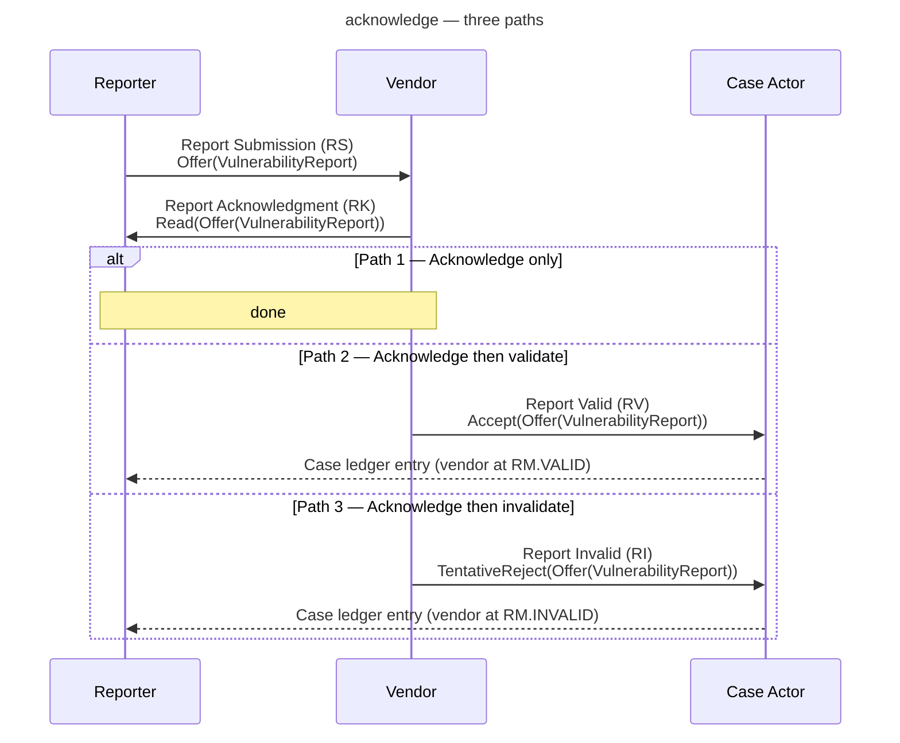
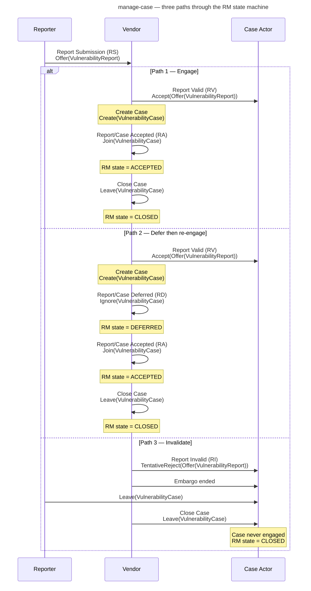

# Tutorial: Running the Other Demos

In this tutorial, we will run the remaining Vultron demo sub-commands end to end inside the demo container.
By the end of this tutorial, we will have explored:

- case initialization and participant management,
- actor invitation, suggestion, and ownership transfer,
- embargo establishment and lifecycle management,
- acknowledgment, status updates, and notes,
- the full Report Management (RM) case lifecycle, and
- the trigger endpoints an actor uses to act on its own initiative.

!!! info "What we will learn"

    Each demo sub-command exercises a focused slice of the Vultron Protocol.
    This tutorial introduces all of them except `receive-report`.
    [Run the Receive-Report Demo](receive_report_demo.md) covers that one.
    We name each exchange by its formal protocol message and its ActivityStreams wire form.
    The [How-to guides](../howto/activitypub/activities/index.md) use the same names, so you can move between the log output and the guides.

---

## Prerequisites

You need the following tools installed before we begin:



You do **not** need Python installed locally.
The containers include everything that is necessary.

This tutorial continues from [Run the Receive-Report Demo](receive_report_demo.md).
That tutorial clones the repository and opens a shell in the demo container.
If you still have that container shell open, skip Step 1.

---

## Step 1 — Start the demo container

If you exited the container after the previous tutorial, start it again from the repository root:

```bash
docker compose -f docker/docker-compose.yml run --rm demo
```

After the images are built and the API server is healthy, you should see a container shell prompt:

```text
root@<container-id>:/app#
```

Run all commands in the remaining steps inside this container shell.

---

## Step 2 — Case initialization

### initialize-case



This demo shows the steps that a vendor takes to open a new case after it receives a report:

1. Create the case.
   This seats the vendor as Case Owner and CASE_MANAGER.
2. Link the report to the case.
3. Invite the reporter.
   The reporter joins when it accepts.

See [How to Initialize a Case](../howto/activitypub/activities/initialize_case.md) for the full activity-by-activity walkthrough.

### initialize-participant



This demo shows how a participant joins an existing case.
The vendor asks the CaseActor to invite a coordinator, and the coordinator joins by accepting the Invite.
Notice that the vendor's own copy of the case gets the coordinator from the ledger entry for the `Accept`, with no other message.

See [How to Seat a Participant on an Existing Case](../howto/activitypub/activities/initialize_participant.md) for details.

---

## Step 3 — Actor management

### invite-actor



This demo shows two invitation outcomes.
The Case Owner invites a coordinator, who **accepts** and is added to the case.
Then the Case Owner invites a second coordinator, who **rejects** and is not added.
Notice the log lines showing the Invite Actor to Case, `Invite(Actor)`, and the answering `Accept(Invite)` or `Reject(Invite)`.
Both answers are case events, so the case ledger records the `Reject` just as it records the `Accept`.



In a multi-actor deployment, the Case Actor sends the invitation on behalf of the owner, and the answer goes back to the Case Actor.
See [How to Invite an Actor to a Case](../howto/activitypub/activities/invite_actor.md) for that exchange.

### suggest-actor



This demo shows a reporter *suggesting* a coordinator for the case.
The suggestion goes to the Case Actor, which forwards it to the Case Owner as a proposed participant.
The demo shows two paths:

- The vendor **accepts** the suggestion, and the Case Actor invites the coordinator.
- The vendor **rejects** the suggestion, and nobody sends an invitation.

The vendor's `Reject` is ledgered like its `Accept`.



See [How to Suggest an Actor for a Case](../howto/activitypub/activities/suggest_actor.md) for the corresponding activity descriptions.

### manage-participants



This demo combines the full participant lifecycle.
The steps are invite, accept, record a participant status, remove the participant from active participation, and reinstate it.
Here the vendor is both Case Owner and CASE_MANAGER, so the owner sends the removal and the reinstatement requests to itself.
The participant receives a direct notice of each from the CASE_MANAGER, and its record stays on the case during all of these steps.

A second path shows the participant as it declines the invitation.
Its `Reject` is a case event, and the CASE_MANAGER ledgers it just as it ledgers an `Accept`.
The demo logs each step, so we can follow the state changes.



See [How to Manage a Case Roster](../howto/activitypub/activities/manage_participants.md) for details.

### transfer-ownership

```bash
vultron-demo transfer-ownership
```

This demo shows case ownership transfer.
The current owner (the vendor) proposes the transfer to the Case Actor.
The Case Actor offers the case to a coordinator.
The demo shows three paths:

- The coordinator **accepts**, so the `attributedTo` of the case moves to the coordinator.
- The coordinator **rejects**, so ownership stays with the vendor.
- The vendor **withdraws** its proposal, and with it the offer, before the coordinator answers.
  Ownership again stays with the vendor.

In the accept path, the offer carries a deadline to answer.
The demo checks that the offer that the coordinator receives names this deadline.
The coordinator answers in time.

Every message goes through the Case Actor, which holds the CASE_MANAGER role.
This is so that the ledger records the transfer or the `Reject` of the coordinator, and every participant learns of it.



See [Ownership Transfer](../topics/case_lifecycle/ownership_transfer.md) for why the transfer is routed this way, and [Case Management Messages](../reference/messages/case_management.md) for the wire format.

---

## Step 4 — Embargo management

### establish-embargo



This demo exercises embargo negotiation.
A coordinator proposes embargo terms with an Embargo Proposal (EP), `Invite(EmbargoEvent)`.
The vendor then does one of two things:

- The vendor **accepts** with an Embargo Proposal Acceptance (EA), `Accept(Invite(EmbargoEvent))`.
  Then it activates the embargo on the case with `Accept(EmbargoEvent)[target=VulnerabilityCase]` and announces it with `Announce(EmbargoEvent)`.
  The Embargo Management (EM) state becomes `ACTIVE`.
- The vendor **rejects** with an Embargo Proposal Rejection (ER), `Reject(Invite(EmbargoEvent))`.
  The EM state does not change.



See [How to Establish an Embargo](../howto/activitypub/activities/establish_embargo.md) for background.

### report-with-embargo



This demo exercises the negotiated embargo path, which no other demo reaches.
The Reporter proposes embargo terms *with* the report.
The Report Submission (RS), `Offer(VulnerabilityReport)`, carries a proposed `EmbargoEvent` as `proposedEmbargo`.
The Reporter sends it through the `proposed_embargo_end_time` of the `submit-report` trigger.

The recipient's default is the `EmbargoPolicy` on its own actor profile, published through `PUT /actors/{actor_id}/embargo-policy` (EP-04-003).
The recipient sends that profile inline as the `actor` of its case proposal, and the CaseActor reads the default from there (CP-01-010).

When the case is created, the shorter of the two becomes the active embargo.
The longer one stays pending as a revision, so the EM state is `REVISE`.
When the recipient has published no default, the terms of the Reporter apply at their stated length, and the EM state is `ACTIVE`.

No proposal exchange occurs before the case.
The comparison is settled when the case is created.

The CaseActor then relays the pending revision to the party whose terms won, on behalf of the party whose terms lost (EP-04-011).
When the Reporter proposed 60 days, that party is the Vendor, the case owner.
The protocol requires no automatic answer.
So the 30-day default of the Vendor stays active, and the longer terms of the Reporter stay pending until the owner answers.
The case stays at `REVISE`.

When the Reporter proposed 10 days, the CaseActor invites the Reporter instead.
The acceptance of the Reporter only records consent, so the case also stays at `REVISE`.



See [How to Report a Vulnerability](../howto/activitypub/activities/report_vulnerability.md#submit-a-report) for the Offer that carries the terms, and [Default Embargoes](../topics/process_models/em/defaults.md) for why the shorter terms win.

### manage-embargo



This demo continues from an active embargo.
Two paths are shown:

1. **Activate and terminate**: the coordinator proposes, and the vendor accepts and activates.
   Then the vendor ends the embargo with an Embargo Termination (ET), `Remove(EmbargoEvent)`.
   This moves the EM state to `EXITED`.
2. **Reject and repropose**: the coordinator proposes 45-day terms, and the vendor rejects them.
   The coordinator proposes 90-day terms as a new proposal, and the vendor accepts and activates.



The second proposal in Path 2 is a new Embargo Proposal (EP), not an Embargo Revision Proposal (EV).
When the coordinator sends it, no active embargo exists to revise.

See [How to Revise or Terminate an Embargo](../howto/activitypub/activities/manage_embargo.md) for details.

---

## Step 5 — Acknowledgment, status, and notes

### acknowledge



This demo shows how a vendor acknowledges receipt of a report without a commitment to an outcome.
The vendor uses a Report Acknowledgment (RK), `Read(Offer(VulnerabilityReport))`.
The reporter submits through its `submit-report` trigger, so it holds the Offer.
It accepts the acknowledgment because the vendor is the addressee of the Offer.

The vendor sends the acknowledgment through its `ack-report` trigger.
This trigger addresses only the reporter, never the CASE_MANAGER, even though a case already exists.
The demo shows three paths:

1. **Acknowledge only** — the vendor sends the acknowledgment to the reporter.
2. **Acknowledge then validate** — the acknowledgment, then a Report Valid (RV), `Accept(Offer(VulnerabilityReport))`.
3. **Acknowledge then invalidate** — the acknowledgment, then a Report Invalid (RI), `TentativeReject(Offer(VulnerabilityReport))`.

The vendor sends the Report Valid or the Report Invalid through its `validate-report` or `invalidate-report` trigger.
These triggers address the Case Actor that manages the case opened on receipt.
The Case Actor records the vendor's answer, and the reporter learns it from its copy of the case.



See [Acknowledge a Report](../howto/activitypub/activities/acknowledge.md) for the corresponding activity descriptions.

### status-updates



This demo shows two workflows for updating a case record:

1. **Notes** — the vendor creates a `Note`, adds it to the case with `Add(Note)`, and then removes it again with `Remove(Note)`.
2. **Status** — the vendor reports public awareness in a new `ParticipantStatus`.
   It adds the status to its own participant record with `Add(ParticipantStatus)`.
   The demo then checks that the case status adopted it.

An actor reports its own Case State (CS) progress with a participant status update.
Vendor Awareness (CV), Fix Readiness (CF), and Fix Deployed (CD) are all `Add(ParticipantStatus)` activities.
So are Public Awareness (CP), Exploit Public (CX), and Attacks Observed (CA).
These three are in the case status that the participant status embeds.
Only the Case Manager sends `Add(CaseStatus)`.

See [How to Post a Status Update or a Case Note](../howto/activitypub/activities/status_updates.md) for details.

---

## Step 6 — Full RM case lifecycle

### manage-case



This demo exercises the Report Management (RM) state machine from submission through closure.
Three paths are shown:

1. **Engage path** — submit, validate, create the case, engage, close.
2. **Defer and re-engage path** — submit, validate, create the case, defer, re-engage, close.
3. **Invalidate path** — submit, invalidate, end the embargo, close the case opened for the report.
   The reporter leaves first, and the vendor, the Case Owner, leaves last.

Notice the RM state transitions that the demo logs at each step.
Notice also that every path closes with `Leave(VulnerabilityCase)`.
The vendor opened a case for each report when it received the report.
After a case holds a report, its owner closes the case, never the report.
Only a report that no case holds is closed with a Report Closed (RC), `Reject(Offer(VulnerabilityReport))`.



See [Manage a Case](../howto/activitypub/activities/manage_case.md) for the corresponding activity descriptions and the RM state ladder.

---

## Step 7 — Trigger endpoints

### trigger

```bash
vultron-demo trigger
```

Most activities in the demos so far went to an inbox.
An inbox post is how an actor *reacts* to another actor.
The report submission of the reporter already went through a trigger: its own `submit-report`.

This demo shows the other direction.
An actor *initiates* a protocol behavior from its own state when it calls one of its trigger endpoints.
The behavior tree of the actor builds the activity and queues it for delivery.
Two workflows are shown:

1. **Validate and engage** — the reporter submits a report.
   Then the vendor calls `POST /actors/{actor_id}/trigger/validate-report` and `POST /actors/{actor_id}/trigger/engage-case`.
2. **Invalidate and close** — the reporter submits a second report.
   The vendor calls `trigger/invalidate-report` and ends the embargo of the case with `trigger/terminate-embargo`.
   Then it closes the case that it opened for the report with `trigger/leave-case`, which sends `Leave(VulnerabilityCase)`.
   Once a case holds a report, its owner closes the case this way, never with `Close(Report)`.
   The vendor ends the embargo first, because `leave-case` refuses the Case Owner while the embargo of the case is active.

Notice that each trigger response carries the ActivityStreams activity that the actor produced.
Notice also that the activity appears in the outbox of the vendor.
The multi-actor container demos use this mechanism to drive every actor.
See [Running the Multi-Actor Container Demos](container_demos.md).

See the [Trigger API](../reference/trigger-api.md) reference for every trigger endpoint.

---

## Step 8 — Run all demos in sequence

To run every demo in the standard order, use the `all` sub-command:

```bash
vultron-demo all
```

The `all` sub-command runs each demo in turn and prints a summary table when it finishes:

```text
==================================================
Demo Summary
==================================================
  receive-report                        ✅ PASS
  initialize-case                       ✅ PASS
  ...
  trigger                               ✅ PASS
==================================================
  <passed>/<total> demos passed
==================================================
```

A demo that raised an exception is listed as `❌ FAIL` with the error.

---

## Step 9 — Exit the container

When you are finished, type `exit` to leave the container shell:

```bash
exit
```

Stop the API server with:

```bash
docker compose -f docker/docker-compose.yml down
```

---

## What we accomplished

We have:

- run every remaining Vultron demo sub-command, covering the major protocol workflows,
- observed how the Vultron Protocol handles case initialization, actor management, embargo negotiation, the RM state machine, and trigger-driven behavior, and
- run the complete demo suite in one step with `vultron-demo all`.

---

## Next steps

- **Understand the protocol** — browse the [Vultron AS Activity Guides](../howto/activitypub/activities/index.md) for task guides covering everything we observed.
- **See the protocol run across containers** — [Running the Multi-Actor Container Demos](container_demos.md) uses the trigger endpoints to drive whole cases across isolated actors.
- **Explore the demo scripts** — the exchange demos are in `vultron/demo/exchange/`; shared utilities are in `vultron/demo/utils.py`.
- **Read the demo README** — `vultron/demo/README.md` describes the demo architecture and available sub-commands.
