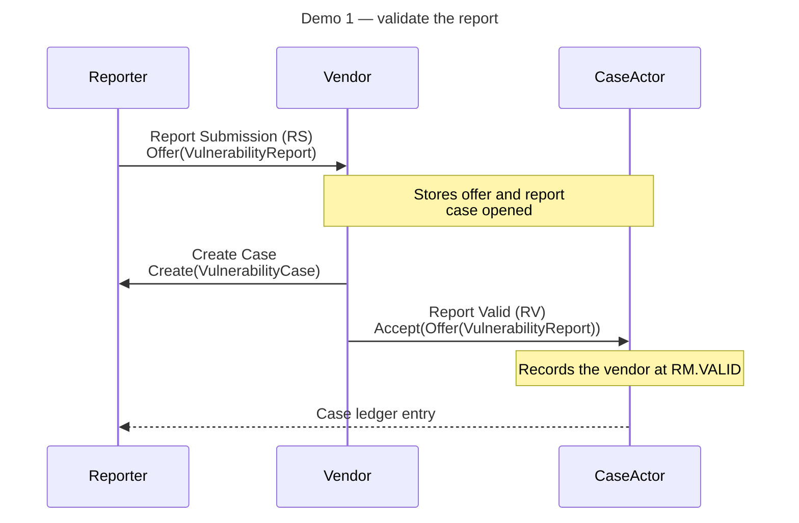
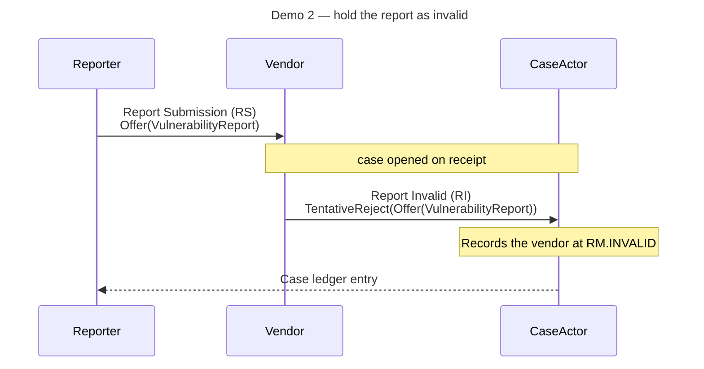
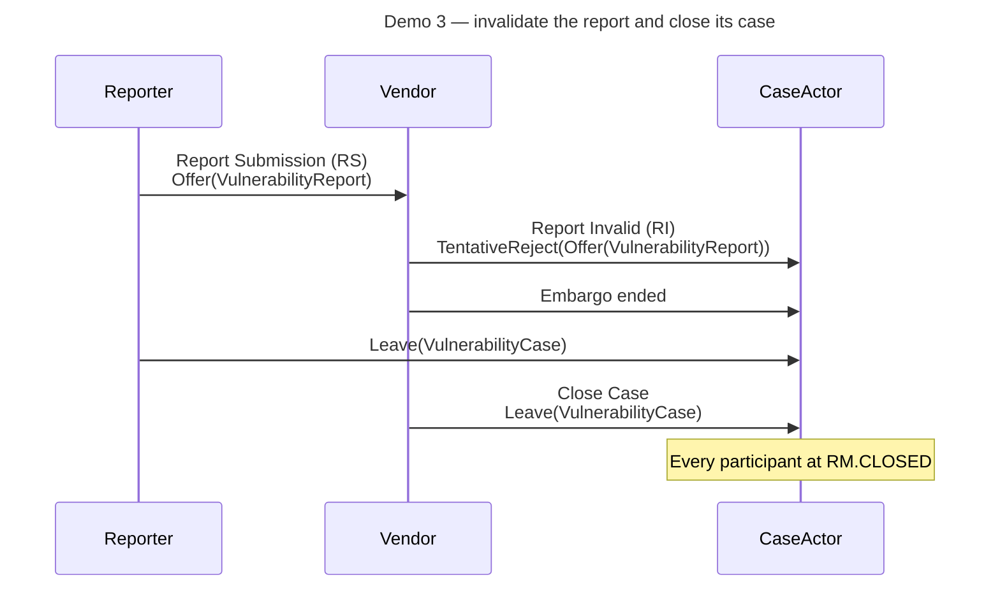

# Tutorial: Run the Receive-Report Demo

In this tutorial, we will run the Vultron `receive-report` demo end-to-end
using Docker Compose. By the end of this tutorial, we will have:

- started a local Vultron API server,
- run three vulnerability-report workflows, and
- observed how a vendor accepts, invalidates, and closes reports in the
  Vultron protocol.

!!! info "What we will learn"

    This tutorial focuses on the *receive-report* workflow: a reporter submits a vulnerability report to a vendor, and the vendor decides what to do with it.
    We will run all three outcomes — accept (validate), hold (invalidate), and reject-and-close — and read the structured log output to understand what happened at each step.
    The vendor's decision is a move in the [Report Management (RM)](../topics/process_models/rm/index.md) state machine, and each move has a formal message name and an ActivityStreams wire form.
    The demo log prints the wire form; this page names both.

---

## Prerequisites

We need the following tools installed before we begin:



We do **not** need Python installed locally; the containers include everything
required.

---

## Step 1 — Clone the repository

First, let's get a local copy of the Vultron project:

```bash
git clone https://github.com/CERTCC/Vultron.git
cd Vultron
```

!!! tip

    If you already have a local clone, `cd` into the repository root and run
    `git pull` to make sure you are up to date.

---

## Step 2 — Start the demo container

The `demo` container depends on the `api-dev` container. Docker Compose starts
both automatically and waits until the API server is healthy before launching
the demo shell.

```bash
docker compose -f docker/docker-compose.yml run --rm demo
```

After the images are built (this takes a few minutes the first time), we
should see a shell prompt inside the container:

```text
root@<container-id>:/app#
```

Notice that both the `api-dev` and `demo` containers are now running.
The `api-dev` container exposes the Vultron API at
`http://localhost:7999/api/v2`.

The `api-dev` container also acts as its own CaseActor service.
When the vendor receives a report, it proposes a case for it to the CaseActor service that `VULTRON_ACTOR__CASE_ACTOR_SERVICE_URL` names.
The Compose file sets this variable to `http://localhost:7999/api/v2` for us.

!!! tip "Running the server without Docker"

    To run the API server directly instead, set the same variable when you start it:

    ```bash
    VULTRON_ACTOR__CASE_ACTOR_SERVICE_URL=http://localhost:7999/api/v2 \
      uv run uvicorn vultron.adapters.driving.fastapi.main:app --host localhost --port 7999
    ```

    If the variable is not set, the server cannot propose a case for a report.
    No case is opened, and every demo fails.

---

## Step 3 — Run the receive-report demo

Inside the container shell, run:



The demo runs three separate workflows in sequence.
Each step begins with a `🚥` marker and ends with either `🟢` (success) or `🔴` (failure).
Verification checks are marked with `📋` (start) and `✅` (pass) or `❌` (fail).

Each workflow ends with its own completion line, for example:

```text
✅ DEMO 1 COMPLETE: Report validated, case created, and introduced to the reporter.
```

If any step or check failed, the demo prints a failure summary after the last workflow, reports `FAIL`, and exits with a non-zero status.

---

## Step 4 — Read the output

Let's look at what happened in each workflow.

### Demo 1: Validate Report

```text
DEMO 1: Validate Report and Create Case
```

1. **Step 1** — The *reporter* actor submits a `VulnerabilityReport` through its own `submit-report` trigger, which sends a Report Submission (RS), `Offer(VulnerabilityReport)`, to the *vendor*.
   The trigger also records which actor the reporter sent the report to, so the reporter can later check who introduces the case.
   Notice the log lines showing that the offer and the report are both stored in the vendor's DataLayer.
   When the vendor receives the report, it asks its CaseActor to open a case for it.

2. **Step 2** — The *vendor* calls its own `validate-report` trigger, which sends a Report Valid (RV), `Accept(Offer(VulnerabilityReport))`, to the CaseActor that manages the case.
   The CaseActor records the vendor at `RM.VALID`, and the case ledger carries that record to the reporter's copy of the case.
   Notice the ✅ confirming that the reporter's copy records the vendor at `VALID`.

3. **Step 3** — The vendor finds the case that was opened for the report, and introduces it to the reporter with its own Create Case, `Create(VulnerabilityCase)`.
   The reporter accepts the introduction because it comes from the actor the reporter sent the report to.
   Notice the final ✅ confirming that the reporter's record of the report now names the vendor and points at the case.



### Demo 2: Invalidate Report

```text
DEMO 2: Invalidate Report (Hold for Reconsideration)
```

The reporter submits a second, separate report.
The vendor calls its `invalidate-report` trigger, which sends a Report Invalid (RI), `TentativeReject(Offer(VulnerabilityReport))`, to the CaseActor.
A Report Invalid means the report is held open for further investigation rather than closed outright.
The CaseActor records the vendor at `RM.INVALID`, and the reporter learns the decision from its copy of the case.
The vendor still opened a case when the report arrived, so the demo ends by checking that the reporter accepted the vendor's introduction of it.



### Demo 3: Invalidate and Close Report

A third report is submitted.
The vendor first invalidates it with a Report Invalid (RI), and then closes the case it opened for the report.
Once a case holds a report, its Case Owner closes the case with `Leave(VulnerabilityCase)`, never with a Report Closed (RC), `Reject(Offer(VulnerabilityReport))`, which the case manager refuses from every sender.
The case has an active embargo, and the Case Owner cannot leave while it is active, so the vendor ends the embargo first with its `terminate-embargo` trigger.
The reporter then leaves the case, and the vendor leaves last, each through its own `leave-case` trigger.
Notice the ✅ lines confirming that the CaseActor records every participant at `RM.CLOSED`, and that the reporter again accepted the vendor's introduction of the case.



---

## Step 5 — Exit the container

When we are finished, type `exit` to leave the container shell:

```bash
exit
```

The `--rm` flag we passed in Step 2 ensures the container is removed
automatically on exit. The `api-dev` container will continue running;
stop it with:

```bash
docker compose -f docker/docker-compose.yml down
```

---

## What we accomplished

We have:

- started the Vultron API server and demo container with a single
  `docker compose run` command,
- run three vulnerability-report workflows covering the three main outcomes
  defined in the Report Management (RM) state machine, and
- read structured log output showing each step and verification check.

---

## Next steps

- **Run more demos** — see
  [Tutorial: Running the Other Demos](other_demos.md) to explore case
  initialization, embargo management, actor invitation, and more.
- **Understand the protocol** — read
  [How to Report a Vulnerability](../howto/activitypub/activities/report_vulnerability.md)
  for a detailed walkthrough of the activities we observed.
- **Explore the demo scripts** — the source for this demo is in
  `vultron/demo/exchange/receive_report_demo.py`; the shared utilities are in
  `vultron/demo/utils.py`.
- **See the formal names** — [Report Management (RM) Messages](../reference/messages/rm.md)
  maps each RM message to its ActivityStreams wire form.
- **Run all demos at once** — inside the demo container, run
  `vultron-demo all` to execute every demo in sequence.




