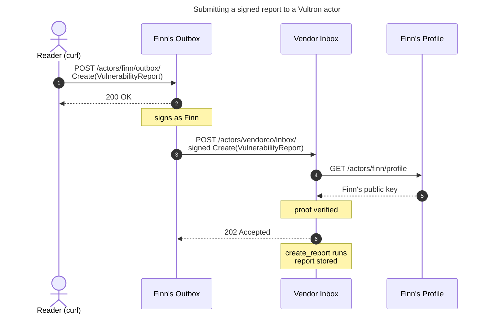

# Tutorial: Submit a report to a Vultron actor



In this tutorial, we will submit a vulnerability report to a running Vultron actor and confirm that the actor received it.
We will start the reference implementation, create one actor to play the part of a vendor and one to play the part of a finder, have the finder send the vendor a signed `Create(VulnerabilityReport)` message, and read the report back out of the vendor's store.
This tutorial is for a developer who wants to see, first-hand, what it takes to
speak to a Vultron actor over the wire.

!!! info "What we will learn"

    Vultron actors exchange [ActivityStreams](../reference/glossary.md) messages
    over HTTP.
    We will construct one such message, have the sending actor's Outbox sign it and deliver it to the receiving actor's [Inbox](../reference/glossary.md), and watch the report land in the receiving actor's store.
    We will not cover the full report-management lifecycle here; the
    [How to Report a Vulnerability](../howto/activitypub/activities/report_vulnerability.md)
    how-to guide takes the story further.

    The commands and the message on this page are rendered from
    `vultron.wire.as2.vocab.examples.submit_report_tutorial`, the same module a
    test drives end-to-end, so what you copy here is what the code actually does.

---

## Prerequisites

You need the following before we begin:

- [uv](https://docs.astral.sh/uv/getting-started/installation/){:target="_blank"}
  (the project's Python runner; it manages its own virtual environment)
- [`curl`](https://curl.se/){:target="_blank"} (to send HTTP requests from a
  second terminal)
- Git (to clone the repository)

You do **not** need to install Python or any dependencies by hand; `uv run`
resolves them on first use.

---

## Step 1 — Clone the repository

First, get a local copy of the Vultron project:

```bash
git clone https://github.com/CERTCC/Vultron.git
cd Vultron
```

!!! tip

    If you already have a local clone, `cd` into the repository root and run
    `git pull` so you are up to date.

---

## Step 2 — Start the Vultron API server

From the repository root, start the reference API server:

```python exec="true" idprefix=""
from vultron.wire.as2.vocab.examples.submit_report_tutorial import render_server_command
print(render_server_command())
```

The first run downloads dependencies, so it may take a moment.
When the server is ready, you should see:

```text
INFO:     Application startup complete.
INFO:     Uvicorn running on http://127.0.0.1:7999 (Press CTRL+C to quit)
```

Leave this terminal running.
The server now serves the Vultron API at `http://localhost:7999/api/v2`.

Open a **second terminal** and confirm the server is live:

```python exec="true" idprefix=""
from vultron.wire.as2.vocab.examples.submit_report_tutorial import render_health_check
print(render_health_check())
```

The server responds with:

```json
{"status":"ok"}
```

!!! tip "Prefer containers?"

    You can also start the same API server with Docker Compose by running
    `docker compose -f docker/docker-compose.yml up api-dev`, which exposes the
    API at the same `http://localhost:7999/api/v2` address.
    The remaining steps are identical.
    See [Run the Receive-Report Demo](receive_report_demo.md) for the
    container-based tour.

---

## Step 3 — Create the vendor and the finder

A report has to be sent *to* someone, so we first create an actor to play the part of a vendor.
Run this in the second terminal:

```python exec="true" idprefix=""
from vultron.wire.as2.vocab.examples.submit_report_tutorial import render_create_actor
print(render_create_actor())
```

The server responds with `201 Created` and the new actor record:

```json
{"@context":["https://www.w3.org/ns/activitystreams","https://certcc.github.io/Vultron/ns/context.jsonld"],"id":"http://localhost:7999/api/v2/actors/vendorco","type":"Organization","name":"VendorCo","published":"2026-01-01T00:00:00.000000+00:00","updated":"2026-01-01T00:00:00.000000+00:00","inbox":"http://localhost:7999/api/v2/actors/vendorco/inbox","outbox":"http://localhost:7999/api/v2/actors/vendorco/outbox"}
```

Your `published` and `updated` timestamps will differ; everything else matches.
Notice that the actor's `id` is the URL that reaches it.
Its Inbox, the endpoint where it receives messages, is that same URL with `/inbox/` appended.

A report also has to come *from* someone.
Every message a Vultron actor receives must carry a `proof`: a signature made with its sender's key.
The receiver reads the sender's public key from the sender's actor profile, so the sender has to be an actor that a server hosts.
Create a second actor to play the part of the finder who reports the vulnerability:

```python exec="true" idprefix=""
from vultron.wire.as2.vocab.examples.submit_report_tutorial import render_create_finder
print(render_create_finder())
```

The server again responds with `201 Created` and the actor record, this time for a `Person` named `Finn`.
Finn's actor profile, with the public key that verifies Finn's messages, is at `http://localhost:7999/api/v2/actors/finn/profile`.

---

## Step 4 — Submit the report

Now Finn sends the vendor a `Create(VulnerabilityReport)` message.
This is an ActivityStreams Vocabulary 2.0 (AS2) activity: a `Create` activity whose `object` is the `VulnerabilityReport` we are reporting.
The `actor` field names Finn as the sender, and the `to` field addresses the message to our vendor by its `id`, the URL from Step 3:

```python exec="true" idprefix=""
from vultron.wire.as2.vocab.examples.submit_report_tutorial import render_payload
print(render_payload())
```

The message carries no `proof` yet.
We do not sign it ourselves, and we do not post it to the vendor's Inbox directly: the vendor would refuse an unsigned message with `422 Unprocessable Content`.
Instead, we hand the message to Finn's Outbox, the endpoint where an actor sends messages:

```python exec="true" idprefix=""
from vultron.wire.as2.vocab.examples.submit_report_tutorial import render_submit_report
print(render_submit_report())
```

The server responds with `200 OK`:

```text
HTTP/1.1 200 OK
```

Finn's Outbox checks that the message's `actor` is Finn, signs the message with Finn's key, and delivers it to the vendor's Inbox in the background.
The vendor's Inbox fetches Finn's actor profile, reads Finn's public key from it, and verifies the proof before it accepts the message.
The Inbox answers the delivery with `202 Accepted`, and the vendor processes the report.

Switch to the terminal running the server.
You should see the delivery, the key lookup and the vendor processing the report:

```text
INFO:     Processing outbox item for actor 'http://localhost:7999/api/v2/actors/finn': urn:uuid:11111111-1111-1111-1111-111111111111
INFO:     Fetched 'http://localhost:7999/api/v2/actors/finn' from http://localhost:7999/api/v2/actors/finn/profile for actor_id=http://localhost:7999/api/v2/actors/vendorco (attempt 1)
INFO:     Resolved key http://localhost:7999/api/v2/actors/finn#main-key from the fetched profile of http://localhost:7999/api/v2/actors/finn for actor_id=http://localhost:7999/api/v2/actors/vendorco
INFO:     Delivered activity urn:uuid:11111111-1111-1111-1111-111111111111 to http://localhost:7999/api/v2/actors/vendorco/inbox/ (HTTP 202)
INFO:     Dispatching activity of type 'VulnerabilityReport' with semantics 'create_report'
INFO:     Dispatch: dispatched create_report activity_id=urn:uuid:11111111-1111-1111-1111-111111111111 disposition=applied
```

The following diagram shows the exchange we just completed: we hand the report to Finn's Outbox, Finn's Outbox signs it and delivers it to the vendor's Inbox, and the vendor verifies it by Finn's published key.



---

## Step 5 — Confirm the actor received the report

The vendor's `202 Accepted` went to Finn's Outbox, not to us.
Let's confirm the vendor verified and stored the report by reading its store back:

```python exec="true" idprefix=""
from vultron.wire.as2.vocab.examples.submit_report_tutorial import render_verify
print(render_verify())
```

The vendor returns the report we submitted, keyed by its `id`:

```python exec="true" idprefix=""
from vultron.wire.as2.vocab.examples.submit_report_tutorial import render_stored_report
print(render_stored_report())
```

The report, with our `content` of "I found a vulnerability!", is now in the
vendor's store.
The vendor received our report.

---

## Step 6 — Stop the server

When you are finished, return to the first terminal and press ++ctrl+c++ to stop
the server.

---

## What we accomplished

We have:

- started the Vultron reference implementation with a single `uv run` command,
- created an actor to receive a report and an actor to send it,
- constructed a `Create(VulnerabilityReport)` AS2 message and handed it to the sender's Outbox, which signed it and delivered it to the receiver's Inbox, and
- confirmed, by reading the receiver's store, that the report was verified and received.

---

## Next steps

- **Go deeper on report submission** — read
  [How to Report a Vulnerability](../howto/activitypub/activities/report_vulnerability.md)
  to see how a report is validated, accepted, and turned into a Case, and how
  the `Offer(VulnerabilityReport)` activity fits alongside `Create(VulnerabilityReport)`.
- **Decide whether to submit at all** — read
  [How to Decide Who Owns a Case](../howto/decide_who_owns_a_case.md) to
  choose between submitting a report, creating the case yourself, and
  transferring ownership of a case you already run.
- **See the full workflow run for you** — follow
  [Run the Receive-Report Demo](receive_report_demo.md) to watch a finder and a
  vendor exchange reports end-to-end with the demo CLI.
- **Read the source of these examples** — the commands and the message above
  come from `vultron/wire/as2/vocab/examples/submit_report_tutorial.py`, and the
  flow is verified end-to-end in
  `test/demo/test_submit_report_tutorial.py`.


