# Worked Example



Here we give a brief worked example that shows a few usage scenarios of the [protocol](../reference/formal_protocol/index.md).
We use Unified Modeling Language (UML) Sequence Diagrams to show the interaction between Participant roles.

<!-- single-vendor-start -->
## A Finder Becomes a Reporter

As we mention in [RM Interactions](../topics/process_models/rm/rm_interactions.md#the-secret-lives-of-finders), Finders have a few hidden state transitions before the Coordinated Vulnerability Disclosure (CVD) process really begins.
The figure below shows an example.
The Finder must discover, validate, and prioritize their finding before they start the CVD process.

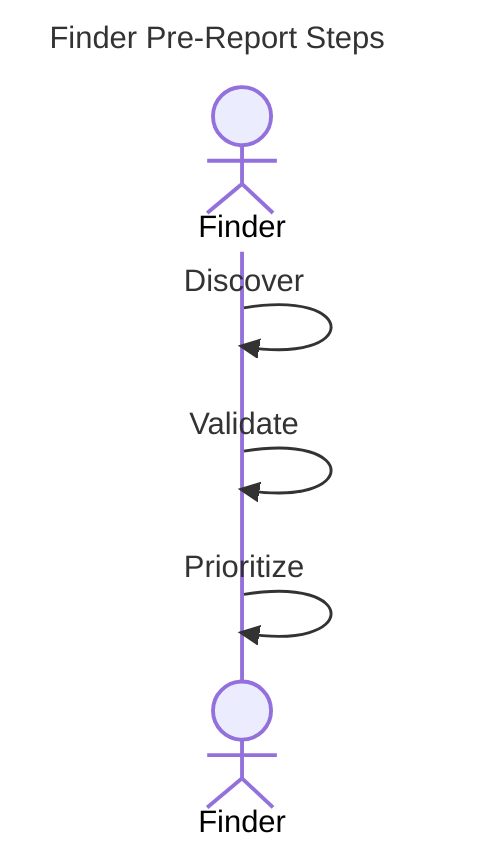

Finders become Reporters when they report a vulnerability to someone else.
The next figure shows a Finder that sends a report (*RS*) together with an embargo proposal (*EP*) to a Vendor.
The Vendor receives the report and updates their state to match.

Then the Vendor replies with three messages.
It acknowledges receipt of the report (*RK*) and of the embargo proposal (*EK*).
It also confirms that the Vendor is aware of the report (*CV*).

The *EK* response confirms that the Vendor received the embargo proposal (*EP*).
It does not accept the proposal.
We discuss acceptance in the next subsection.

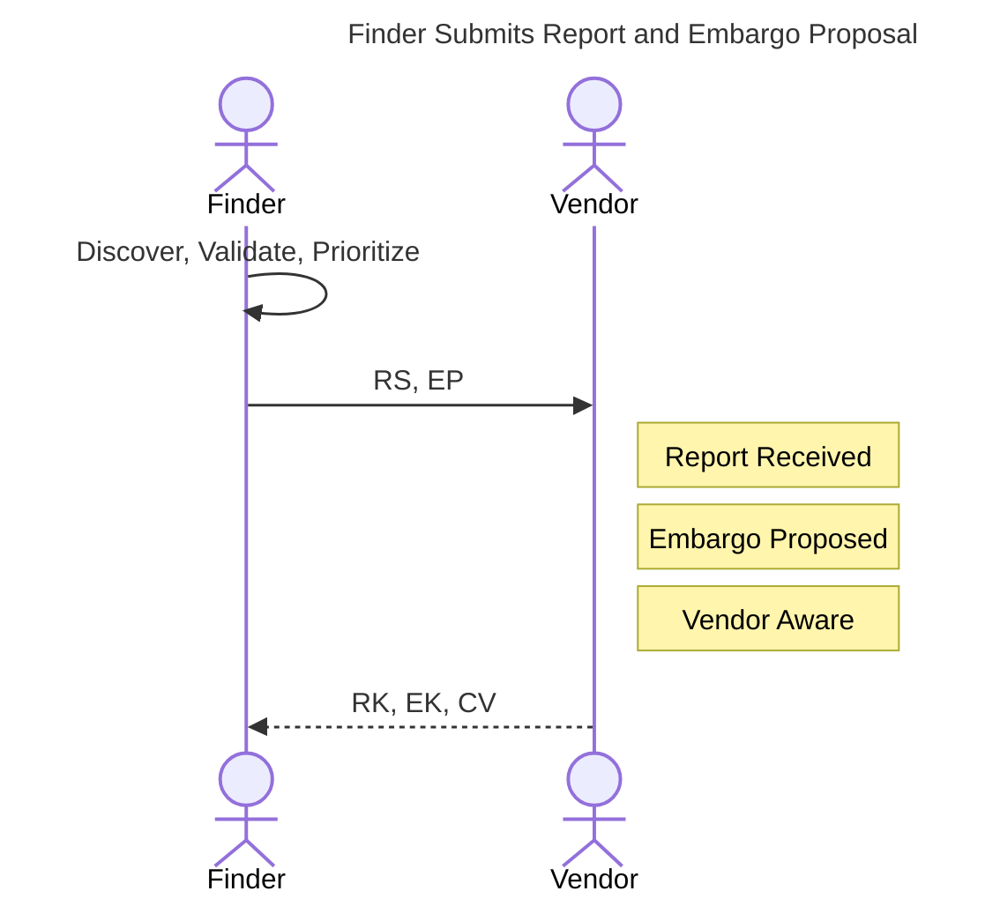

## Vendor Evaluates Embargo

In this section, we show a variety of responses a Vendor might have to an embargo proposal.

### Vendor Accepts Embargo

First is a basic accept sequence.
The Vendor accepts the proposed embargo and tells the Reporter with an *EA* message.
The Reporter acknowledges this with an *EK* in response.

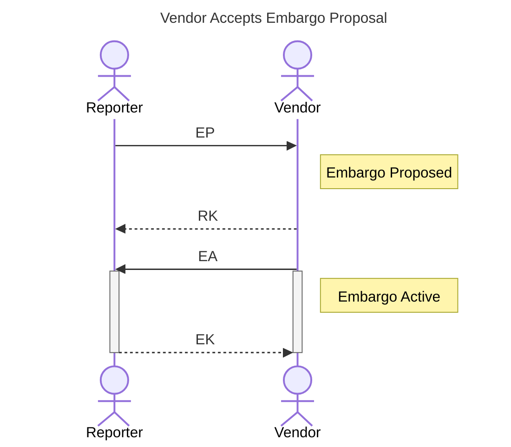

### Vendor Rejects Embargo

Next we show a rejected proposal.
As above, this is a simple sequence.
The Vendor rejects the proposal with an *ER* message, and the Reporter acknowledges this with an *EK* message.

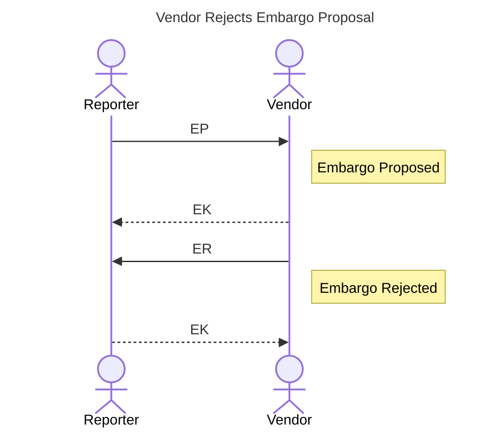

### Vendor Counterproposal

Here we show a Vendor embargo counterproposal.
The Vendor responds to the prior *EP* message of the Reporter with an *EP* message of their own.
The Reporter first acknowledges the counterproposal with an *RK* message.
Then the Reporter evaluates it and accepts it with an *EA* message.
Finally, the Vendor acknowledges the acceptance with an *EK* message.

But no embargo is active until the Reporter accepts it.
This method of counterproposal might delay the start of an embargo.

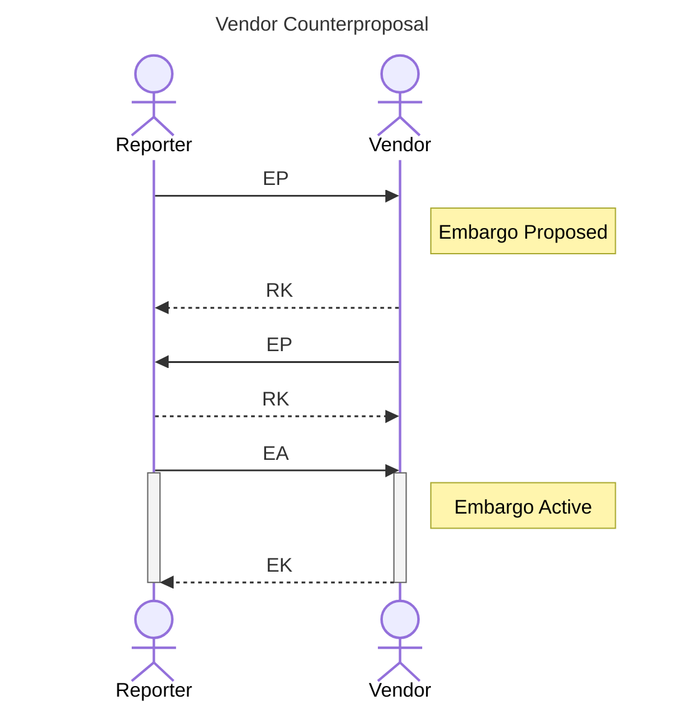

### Vendor Accepts then Proposes Revision

!!! tip inline end "Yes, And..."

    "Yes-And" is a heuristic from improvisational theatre.
    In it, Participants are encouraged to agree with what their counterpart suggests and add to it, instead of rejecting it outright.
    It is a good model for cooperation among parties who share an interest in a positive outcome.

Finally, the following diagram shows what we think is a better approach than a simple counterproposal.
In this "Accept-then-Counter" sequence, the Vendor first accepts the embargo that the Reporter proposed.
Then the Vendor immediately sends a revision proposal of their own.
The difference is that the Vendor accepts the proposal first, so they are in an active embargo state before they try to renegotiate.

This sequence is intended to agree with our earlier discussion of [default embargo strategies](../topics/process_models/em/defaults.md).
You can think of this as the "Yes-And" rule for embargo negotiations.

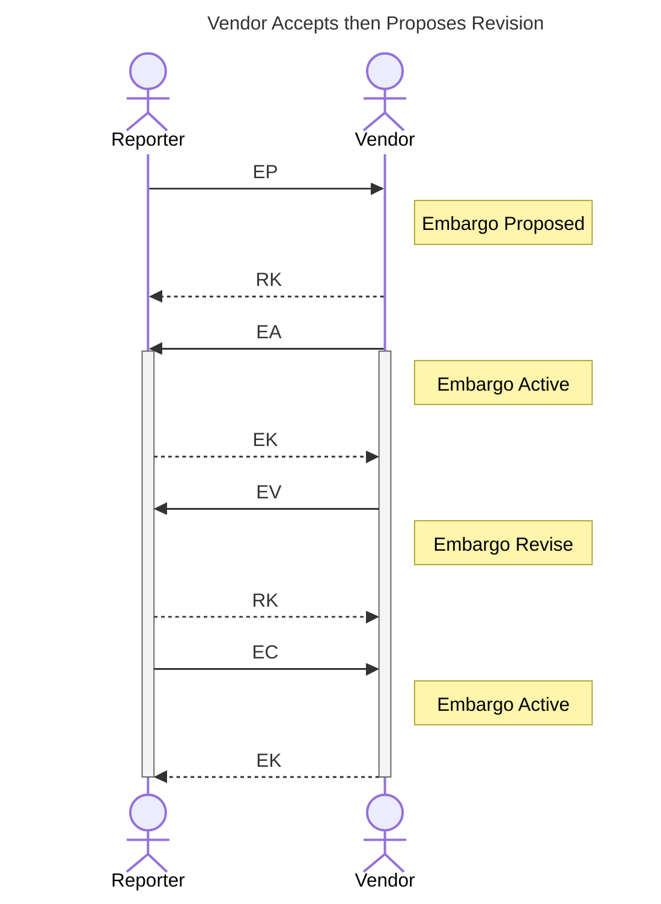

## Vendor Sets Priority

Here we show two responses from a Vendor in the course of prioritizing a report.

### Vendor Accepts Report

This figure shows a Vendor that accepts the report for further work with an *RA* message.
The further work is probably to develop a patch.

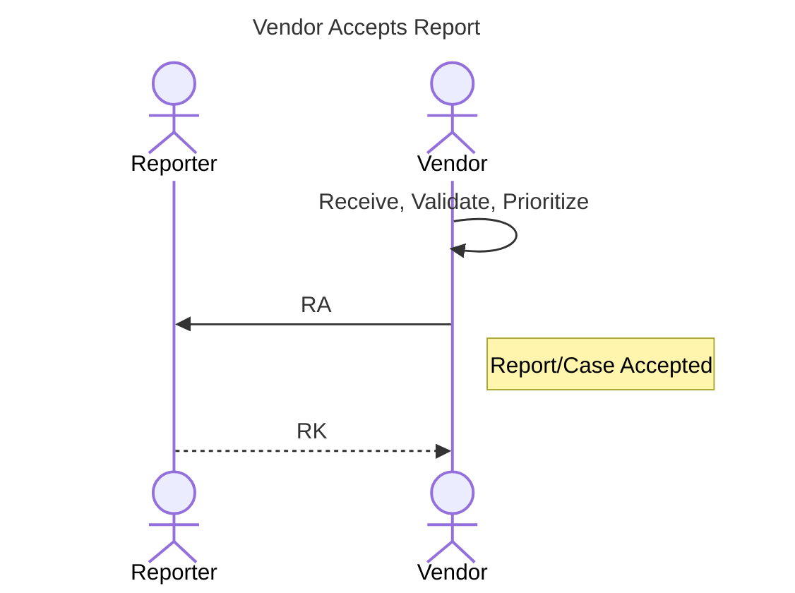

### Vendor Defers Report

In contrast, this figure shows the Vendor as it defers the report with an *RD* message.
In both cases, the Reporter acknowledges the Vendor's messages with an *RK* message.

<!-- single-vendor-end -->
<!-- multi-party-start -->
## Coordination With a Coordinator

The next two diagrams show how a Reporter engages a Coordinator, and how the Coordinator then engages a Vendor.
In the first diagram, the Reporter sends a report together with an embargo proposal to the Coordinator ($RS,EP$).
The Coordinator acknowledges receipt with an $RK,EK$ response.
After it evaluates the proposed embargo, the Coordinator accepts it with an *EA* message.
Then the Coordinator validates and prioritizes the report, and sends an *RV* and an *RA* as it does so.

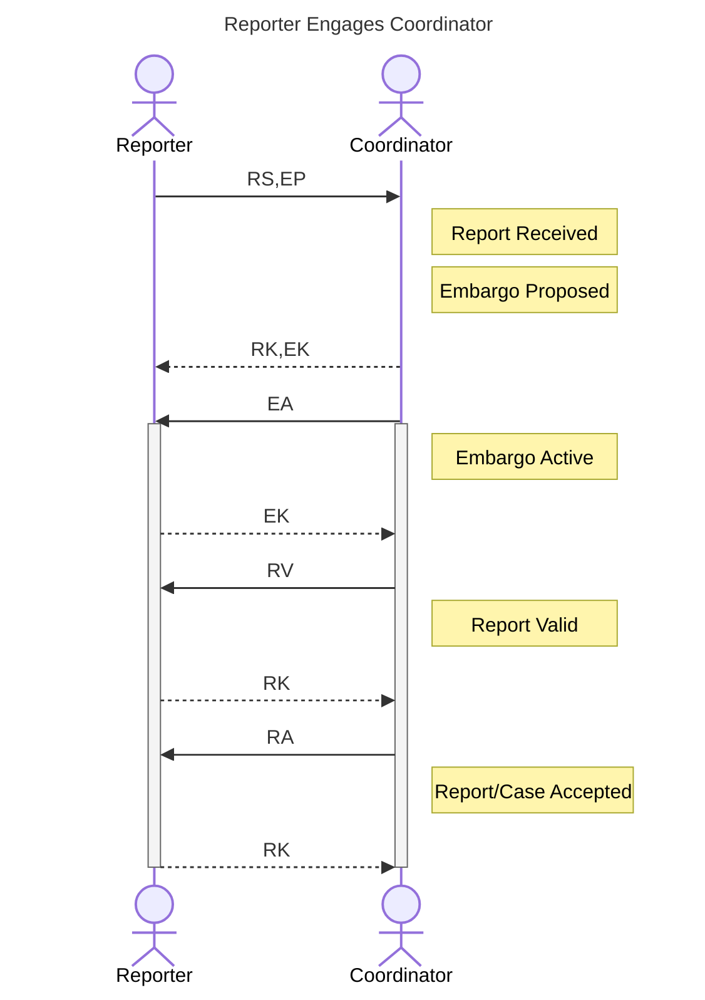

!!! tip inline end "Coordinator-as-proxy can be sub-optimal"

    In this scenario, we show the Coordinator as a proxy between the Reporter and the Vendor.
    This is how people practiced CVD in the past, but it is not necessarily the most efficient way to operate.
    CVD Platforms like [VINCE](https://kb.cert.org/vince){:target="_blank"} show that the process can be more efficient when CVD case participants share one space.

In the next diagram, the Coordinator acts as a proxy for the Reporter.
The Coordinator notifies the Vendor and sends the embargo information in an $RS,EP$ message of its own.
The Vendor agrees to the existing embargo, and then validates (*RV*) and prioritizes (*RA*) the report.
The case's embargo is already active, so the Vendor's agreement is its own consent to the embargo, an `Accept` of the Invite, and not an *EA*: *EA* is the decision that moves the case's embargo from proposed to active.
The Coordinator passes the relevant responses from the Vendor to the Reporter.

The Vendor accepted the report for further work, so the Vendor then creates a fix for the reported vulnerability.
When the fix is complete, the Vendor tells the Coordinator that it is ready.
The Coordinator then sends this information to the Reporter in the *CF* message.

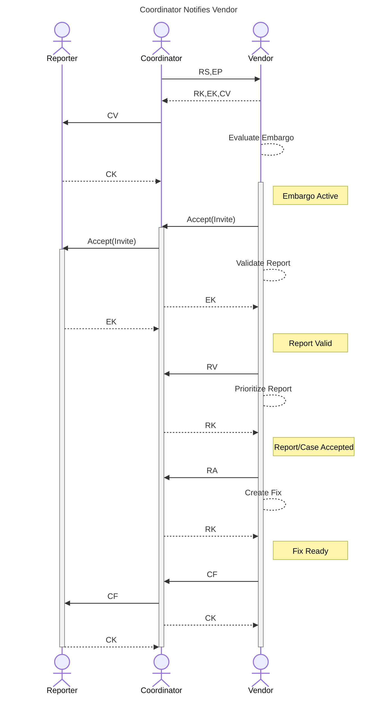

## Embargo Teardown, Publish, and Close

Any Participant can initiate an embargo teardown.
In the following diagram, we show the case where the Coordinator initiates it.
The Coordinator sends an embargo termination message (*ET*) to all parties in the case.
In this scenario, these parties are the Reporter and the Vendor.
Recipients of the *ET* message acknowledge receipt and update their EM state to match.

!!! tip "Embargo Teardown, Publication, and Closure Can Start with Any Participant"

    For all three scenarios in this section, Participants do not have to act in a specific order.
    We could also show the Reporter as it initiates an embargo teardown because of a leaked media report.
    Or we could show the Vendor as it exits an embargo early because their fix was ready sooner than expected.

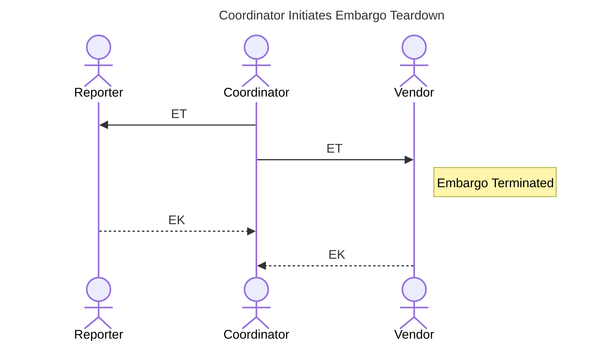

!!! tip inline end "Embargo Termination is not Publication"

    Our protocol only sets a discrete end to the embargo period.
    It intentionally does *not* address a publication schedule.
    After the embargo has been exited, *any* Participant may publish at any time.

    Participants can choose to coordinate their publication schedules more closely, but the protocol does not require it.
    Some situations might need more concise publication scheduling.
    We examine this concern again in [Process Implementation Notes](../howto/process_implementation.md).

### Publishing After Embargo Teardown

After the embargo has been exited, any Participant may now publish.
In the following figure, we show the Vendor as it publishes first.
The Vendor tells the Coordinator that it has published.
It uses a *CP* message, which says that information about the vulnerability is now public.

The Coordinator relays this information to the Reporter.
Both the Reporter and the Coordinator publish their own reports shortly thereafter.

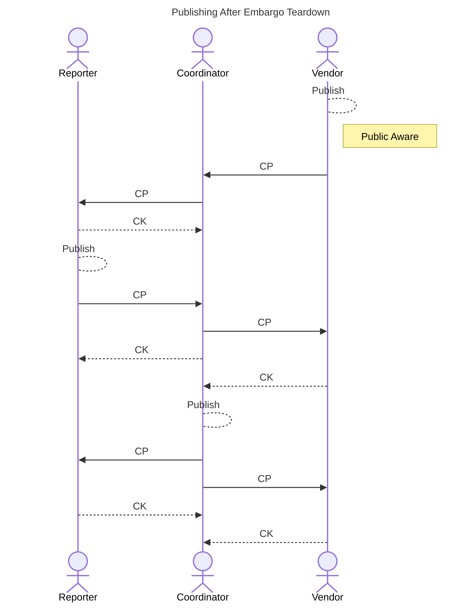

!!! tip inline end "Report Closure is a Per-Participant Choice"

    Report closure is a per-Participant choice.
    We chose to show a simple case where all Participants agreed at approximately the same time that no more work was necessary.
    Participants will not always agree at the same time, and they do not have to.

### Closing the Case

In the next diagram, the Reporter has no more work to do on the case.
So the Reporter closes their report and tells the Coordinator with an *RC* message.
This prompts the Coordinator to review their open tasks and decide to close their own report.
Then the Coordinator relays this to the Vendor, who also closes their report.

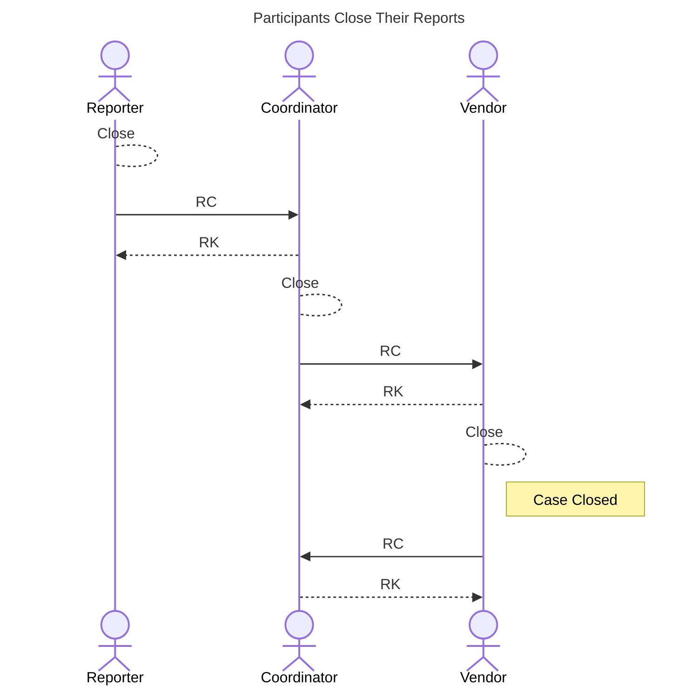

<!-- multi-party-end -->
